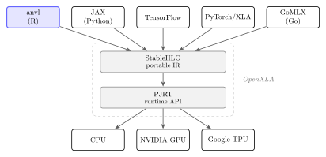

```{r}
#| include: false
library(anvl)
set.seed(42)

# Benchmark tables are read from CSVs produced by `make bench` rather than
# typed into the slides, so a re-run cannot silently disagree with the text.
# A missing file degrades to a visible note instead of failing the render.
bench <- function(file) if (file.exists(file)) utils::read.csv(file) else NULL
need <- function(what) cat(sprintf(
  "::: {.callout-warning}\n`%s` missing — run `make bench`.\n:::\n", what))
fmt <- function(x, digits = 3) formatC(x, format = "f", digits = digits)
```

## The problem

You write a numerical method in R. It works. Then the data gets bigger.
To make it faster on CPU:

- **Rewrite the hot loop in C or C++.** A second language, and code fewer of
  your users can read.
- **Transpile with {quickr}.** R to Fortran (only covers a subset of R).

To run it on a GPU:

- **{torch}.** Native, but eager and aimed at deep learning.
- **{OpenCL}.** Low level: you write the kernels. Not ergonomic.
- **Python via {reticulate}.** TensorFlow, Keras, JAX, and the usual
  cross-language costs: marshalling at every boundary, errors from the other
  language, memory management.


## {anvl} to the rescue

You write plain R functions over arrays. {anvl} currently does three things with them:

::: {.incremental}
- **Compiles.** `jit(f)` becomes one optimised program, via XLA, the compiler
  that also powers JAX and TensorFlow.
- **Differentiates.** `gradient(f, wrt = ...)` returns the derivative of `f` as another R function.
- **Hardware agnostic.** The same code runs on CPU or NVIDIA GPU.
:::

. . .

{anvl} aspires to be for R, what JAX is for Python.

## An ecosystem perspective

One frontend on a shared compiler stack.
The compiler is developed by Google.

{fig-align="center" width="90%"}

## An illustrative example {.smaller}

Our main example will be to implement Hamiltonian Monte Carlo in R.
It needs the **gradient of a log-density** and evaluates it many times, which makes it a perfect use case for {anvl}.

:::: {.columns}
::: {.column width="54%"}
The target is the two-dimensional banana distribution:

$$U(\theta) = \frac{\theta_1^2}{200} + \frac{\bigl(\theta_2 - b\,\theta_1^2 + 100\,b\bigr)^2}{2}$$

$U$ is the potential energy: the negative log-density, up to a constant.

:::
::: {.column width="46%"}
```{r}
#| echo: false
#| fig-width: 5.0
#| fig-height: 3.6
b0 <- 0.01
U_banana <- function(t1, t2) t1^2 / 200 + (t2 - b0 * t1^2 + 100 * b0)^2 / 2
g1 <- seq(-32, 32, length.out = 320)
g2 <- seq(-5.5, 9.5, length.out = 320)
dens <- exp(-outer(g1, g2, U_banana))

par(mar = c(3.3, 3.3, 0.3, 0.3), col.axis = "grey35", col.lab = "grey20",
    cex.axis = 0.95, cex.lab = 1.15, tcl = -0.25, mgp = c(2.0, 0.45, 0))
image(g1, g2, dens, col = colorRampPalette(c("#FFFFFF", "#C2560A"))(80),
      xlab = expression(theta[1]), ylab = expression(theta[2]), bty = "n")
contour(g1, g2, dens, levels = exp(-qchisq(c(0.5, 0.9, 0.99), df = 2) / 2),
        drawlabels = FALSE, col = "#7A3606", lwd = 1.1, add = TRUE)
```
:::
::::

<small>Duane, Kennedy, Pendleton & Roweth (1987), *Physics Letters B* **195**(2), 216–222 · Neal (2011), "MCMC using Hamiltonian dynamics", *Handbook of Markov Chain Monte Carlo*, ch. 5.</small>

## The whole sampler, once {.smaller}

:::: {.columns}
::: {.column width="50%"}
```{r}
#| eval: false
U <- function(theta, b) {
  theta1 <- theta[, 1]
  theta2 <- theta[, 2]
  theta1^2 / 200 +
    (theta2 - b * theta1^2 + 100 * b)^2 / 2
}

grad_U <- gradient(
  \(theta, b) sum(U(theta, b)),
  wrt = "theta"
)

leapfrog <- function(theta, p, b, eps, L) {
  grad <- grad_U(theta, b)$theta
  nv_while(
    list(theta = theta, p = p,
         grad = grad, i = 0L),
    \(theta, p, grad, i) i < L,
    \(theta, p, grad, i) {
      p     <- p - 0.5 * eps * grad
      theta <- theta + eps * p
      grad  <- grad_U(theta, b)$theta
      p     <- p - 0.5 * eps * grad
      list(theta = theta, p = p,
           grad = grad, i = i + 1L)
    }
  )
}
```
:::
::: {.column width="50%"}
```{r}
#| eval: false
kinetic <- function(p)
  nv_reduce_sum(p^2, axes = 2L) / 2

hmc_step <- function(theta, rng, b, eps, L) {
  d  <- nv_rnorm(shape(theta), rng, "f64")
  p  <- d[[2L]]
  H0 <- U(theta, b) + kinetic(p)
  lf <- leapfrog(theta, p, b, eps, L)
  H1 <- U(lf$theta, b) + kinetic(lf$p)

  K  <- shape(theta)[1L]
  d  <- nv_runif(K, d[[1L]], "f64")
  ok <- log(d[[2L]]) < H0 - H1
  ok <- nv_broadcast_to(
    nv_reshape(ok, c(K, 1L)), shape(theta))
  list(theta = nv_ifelse(ok, lf$theta, theta),
       rng   = d[[1L]])
}

sample_hmc <- jit(function(theta, rng, b,
                           eps, L, n) {
  buf <- nv_fill(0, shape =
    c(n, shape(theta)[1L], 2L), "f64")
  nv_while(
    list(theta = theta, rng = rng,
         buf = buf, i = nv_scalar(0L)),
    \(theta, rng, buf, i) i < n,
    \(theta, rng, buf, i) {
      s <- hmc_step(theta, rng, b, eps, L)
      buf[i + 1L, , ] <- s$theta
      list(theta = s$theta, rng = s$rng,
           buf = buf, i = i + 1L)
    }
  )
}, static = "n")
```
:::
::::

No C++. No hand-derived gradient. Runs on a GPU unchanged.

::: {.notes}
Don't walk through this. Name the pieces, then move on -- each one gets its own
slide shortly.

`nv_array` / `nv_scalar` -- build a device array. Everything downstream is one
of these, and `theta` carries a leading chain axis from the start.

`gradient(f, wrt = ...)` -- returns a new R function, the derivative. Needs
scalar output, hence `sum()` over chains. Reverse mode, done once at trace
time, not per call.

`nv_while(state, cond, body)` -- the loop, inside the compiled program. Used
twice: leapfrog steps in `leapfrog`, draws in `sample_hmc`. An R `for` would
unroll at trace time instead.

`nv_rnorm` / `nv_runif` -- return a *pair*: new RNG state, then the draws.
State is threaded by hand because a compiled pure function has no global seed.

`nv_reduce_sum(x, axes =)` -- sum along one axis only, so kinetic energy stays
a per-chain vector rather than collapsing to a scalar.

`nv_ifelse` -- accept/reject. Not `if`: the decision is a per-chain tensor,
unknown at compile time.

`nv_reshape` + `nv_broadcast_to` -- widen the length-K mask to (K, 2).
Explicit because only scalars broadcast implicitly here.

`nv_fill` -- pre-allocates the (n, K, 2) output buffer. Its shape must be known
before compilation, which is why `n` is `static` in the `jit()` call.

`jit(f, static = "n")` -- compiles the whole thing. One R call produces all n
draws.

If asked why `b` is a scalar array and not a plain 0.01: closed-over R values
get baked in as constants at trace time, so passing it keeps it an argument of
the compiled program.
:::


# Getting started {.center}

## Installation

{anvl} is not on CRAN yet, so install from r-universe:

```r
install.packages(
  "anvl",
  repos = c("https://r-xla.r-universe.dev", getOption("repos"))
)
```

The package needs additional dependencies, which are either downloaded upon first use or explicitly installed as follows:

```r
anvl::install_anvl()
```

. . .

For NVIDIA GPU (Linux x86_64), **a compatible driver is all you need.** We
ship the CUDA runtime, cuBLAS, cuDNN and cuSOLVER, so there is no CUDA toolkit
to install and no versions to match by hand.

Prebuilt Docker images are also available and the package website contains an *Installation* article.

## Hardware support today

| Platform | CPU | GPU |
|----------|:---:|:---:|
| Linux (x86_64) | ✓ | ✓ CUDA |
| Linux (ARM) | ✓ | ✗ |
| Windows | ✓ | ◐ WSL2 only (CUDA) |
| macOS (Apple Silicon) | ✓ | ✗ |
| macOS (Intel) | ✗ | ✗ |

: ✓ supported · ◐ limited · ✗ not supported

**AMD (ROCm) and CUDA-on-ARM** plugins exist upstream and we could add them relatively easily.
What we currently lack is CI machines to run tests on.

**Apple Silicon.** `jax-mps` is a promising project for an Apple Silicon backend.
We hope to explore adding it reasonably soon.

# Building the sampler {.center}

## The `AnvlArray`

A multi-dimensional array on a device. `nv_` is short for `anvl`. We use it as a prefix to prevent namespace conflicts.

The sampler's state is the chain positions: one row per chain, two columns for
the two-dimensional target.

```{r}
theta <- nv_array(matrix(0, nrow = 1L, ncol = 2L), dtype = "f64")  # 1 chain
b     <- nv_scalar(0.01, dtype = "f64")                            # the target's b

theta
```

Three properties: **dtype** (`f32`, `f64`, `i32`, `bool`, …), **shape**, and
**device**.

We want `f64` for precision.

## Eager mode — what you get by default

Write a function, call it. Every operation executes immediately, just like
base R or {torch}.

```{r}
U <- function(theta, b) {
  theta1 <- theta[, 1]
  theta2 <- theta[, 2]
  theta1^2 / 200 + (theta2 - b * theta1^2 + 100 * b)^2 / 2
}

U(theta, b)
```

This mode is primarily for **exploring and debugging**: `print()` and `browser()` work,
because the control flow is still ordinary R.

{anvl} is primarily designed around usage of `jit()`, which compiles the whole program at once.

## `jit()` — compile the whole function

```{r}
U_jit <- jit(U)
U_jit(theta, b)
```

. . .

Same answer. Instead of the individal functions running back to back, XLA sees the
**whole function at once**: it fuses operations, picks memory layouts, drops
intermediates, and specialises to the exact shapes.

. . .

**Your own R code compiles as well as a built-in operation.** A hand-written
log-density is not second-class.

. . .

**`jit()` assumes the function is pure**: its result depends only on its
arguments, and it changes nothing outside itself.

## `gradient()` — Automatic Differentiation {.smaller}

`gradient(f, wrt = ...)` returns a new R function: the gradient. It needs a
scalar output, so we differentiate the **sum** over chains.

```{r}
grad_U <- gradient(\(theta, b) sum(U(theta, b)), wrt = "theta")
```

Chain $k$'s energy depends only on $\theta_k$, so the cross-chain derivatives
vanish and row $k$ is the gradient at $\theta_k$. **All chains in one call.**

. . .

```{r}
theta_pair <- nv_matrix(c(0, 0, 1, 2),
  nrow = 2, byrow = TRUE, dtype = "f64")
jit(grad_U)(theta_pair, b)$theta
```


## `nv_while()` — the leapfrog integrator {.smaller}

**The step.** Treat $\theta$ as a particle with momentum $p$ and roll it along
the level sets of the energy. Leapfrog alternates half-steps of momentum with
full steps of position.

`L` is 80 here, and the loop must not enter the R interpreter 80 times per
draw.

```{r}
leapfrog <- function(theta, p, b, eps, L) {
  grad <- grad_U(theta, b)$theta
  out <- nv_while(
    list(theta = theta, p = p, grad = grad, i = 0L),
    \(theta, p, grad, i) i < L,
    \(theta, p, grad, i) {
      p     <- p - 0.5 * eps * grad          # half kick
      theta <- theta + eps * p               # drift
      grad  <- grad_U(theta, b)$theta        # one gradient per step
      p     <- p - 0.5 * eps * grad          # half kick
      list(theta = theta, p = p, grad = grad, i = i + 1L)
    }
  )
  list(theta = out$theta, p = out$p)
}
```

`nv_while()` puts the loop **inside** the compiled program.

## Rolling a particle across the target {.smaller}

Three trajectories from the same start, each with a different momentum and
80 leapfrog steps. The particle rolls along the valley rather than taking a
small random step, which is how HMC moves far without lowering its acceptance
rate.

```{r}
#| echo: false
#| fig-width: 11
#| fig-height: 3.5
b0    <- 0.01
Ufun  <- function(th) th[1]^2 / 200 + (th[2] - b0 * th[1]^2 + 100 * b0)^2 / 2
gradU <- function(th) {
  r <- th[2] - b0 * th[1]^2 + 100 * b0
  c(th[1] / 100 - 2 * b0 * th[1] * r, r)
}
roll <- function(th, p, eps = 0.2, L = 80L) {
  pos <- matrix(NA_real_, L + 1L, 2L); U <- K <- numeric(L + 1L)
  pos[1L, ] <- th; U[1L] <- Ufun(th); K[1L] <- sum(p^2) / 2
  g <- gradU(th)
  for (i in seq_len(L)) {
    p  <- p - 0.5 * eps * g
    th <- th + eps * p
    g  <- gradU(th)
    p  <- p - 0.5 * eps * g
    pos[i + 1L, ] <- th; U[i + 1L] <- Ufun(th); K[i + 1L] <- sum(p^2) / 2
  }
  list(pos = pos, U = U, K = K, H = U + K)
}

# Momenta chosen with a modest theta2 component: all are ordinary N(0, I)
# draws, but ones whose oscillation in the tight direction does not swamp the
# sweep along the valley, which is what the picture is about.
start <- c(-18, 2.24)
mom   <- list(c(1.9, 0.25), c(1.2, -0.35), c(-0.9, 0.4))
trs   <- lapply(mom, function(p) roll(start, p))

col_t <- "#C2560A"; col_p <- "#4269D0"; col_h <- "#3A3F4B"
par(mfrow = c(1, 2), col.axis = "grey35", col.lab = "grey20",
    cex.axis = 0.95, cex.lab = 1.1, tcl = -0.25, mgp = c(2.1, 0.45, 0))

# --- position space -------------------------------------------------------
g1 <- seq(-34, 34, length.out = 260); g2 <- seq(-6, 11, length.out = 260)
dens <- exp(-outer(g1, g2, function(a, b) {
  vapply(seq_along(a), function(k) Ufun(c(a[k], b[k])), numeric(1))
}))
par(mar = c(3.4, 3.4, 0.4, 0.4))
contour(g1, g2, dens, levels = exp(-qchisq(c(0.5, 0.9, 0.99), df = 2) / 2),
        drawlabels = FALSE, col = col_t, lwd = 1.4, bty = "n",
        xlab = expression(theta[1]), ylab = expression(theta[2]))
for (tr in trs) lines(tr$pos, col = adjustcolor(col_p, alpha.f = 0.85), lwd = 2.1)
points(start[1L], start[2L], pch = 16, cex = 1.5, col = col_h)
for (tr in trs) points(tr$pos[nrow(tr$pos), 1L], tr$pos[nrow(tr$pos), 2L],
                       pch = 21, bg = "white", col = col_p, lwd = 1.9, cex = 1.2)

# --- energy along the first trajectory ------------------------------------
tr <- trs[[1L]]
par(mar = c(3.4, 3.6, 0.4, 0.4))
plot(0, type = "n", xlim = c(0, 80), ylim = range(0, tr$U, tr$K, tr$H) * 1.15,
     bty = "n", xlab = "leapfrog step", ylab = "energy")
lines(0:80, tr$U, col = col_t, lwd = 2)
lines(0:80, tr$K, col = col_p, lwd = 2)
lines(0:80, tr$H, col = col_h, lwd = 2.4)
text(80, tr$U[81L], "  U", col = col_t, adj = 0, xpd = NA, cex = 0.95)
text(80, tr$K[81L], "  K", col = col_p, adj = 0, xpd = NA, cex = 0.95)
text(80, tr$H[81L], "  H", col = col_h, adj = 0, xpd = NA, cex = 0.95)
```

Potential and kinetic energy trade off; the total $H$ stays nearly flat.

## Random state is explicit {.smaller}

**The step.** Each draw starts by sampling a fresh momentum
$p \sim N(0, I)$. That is what moves the sampler onto a new energy level;
without it the trajectory would be stuck on the one it started on.

A compiled *pure* function cannot reach out and mutate a global seed, so the
state is threaded through as a value.

```{r}
rng  <- nv_rng_state(42L)
out  <- nv_rnorm(shape(theta), rng, dtype = "f64")   # returns a *pair*
rng  <- out[[1L]]                                    # the new state
out[[2L]]                                            # the momentum
```

## The Metropolis step {.smaller}

**The step.** Total energy is $H = U(\theta) + \tfrac{1}{2}p^\top p$. Exact
dynamics would conserve it; leapfrog does not quite, so accept the proposal
with probability $\min(1, e^{H_0 - H_1})$.

```{r}
kinetic <- function(p) nv_reduce_sum(p^2, axes = 2L) / 2

hmc_step <- function(theta, rng, b, eps, L) {
  d   <- nv_rnorm(shape(theta), rng, dtype = "f64")
  p   <- d[[2L]]
  H0  <- U(theta, b) + kinetic(p)
  lf  <- leapfrog(theta, p, b, eps, L)
  H1  <- U(lf$theta, b) + kinetic(lf$p)

  n_chains <- shape(theta)[1L]
  d   <- nv_runif(n_chains, d[[1L]], dtype = "f64")
  ok  <- log(d[[2L]]) < H0 - H1
  ok  <- nv_broadcast_to(nv_reshape(ok, c(n_chains, 1L)), shape(theta))

  list(theta = nv_ifelse(ok, lf$theta, theta), rng = d[[1L]])
}
```

A compiled program forces two things into the open:

- **`nv_ifelse()`, not `if`.** `nv_ifelse()` is part of the compiled program. With an R `if`, only one branch is embedded in the executable.
- **`nv_broadcast_to()`.** Only scalars broadcast implicitly, so widening a
  length-$K$ mask to $(K, 2)$ needs to be done explicitly.

## All $n$ draws in one call {.smaller}

**The step.** Repeat the transition $n$ times, recording $\theta$ each time.

```{r}
sample_hmc <- jit(function(theta, rng, b, eps, L, n) {
  buf <- nv_fill(0, shape = c(n, shape(theta)[1L], 2L), dtype = "f64")
  out <- nv_while(
    list(theta = theta, rng = rng, buf = buf, i = nv_scalar(0L)),
    \(theta, rng, buf, i) i < n,
    \(theta, rng, buf, i) {
      s <- hmc_step(theta, rng, b, eps, L)
      buf[i + 1L, , ] <- s$theta
      list(theta = s$theta, rng = s$rng, buf = buf, i = i + 1L)
    }
  )
  out$buf
}, static = "n")
eps <- nv_scalar(0.2, dtype = "f64")
L   <- nv_scalar(80L)
shape(sample_hmc(theta, nv_rng_state(42L), b, eps, L, n = 200L))
```

**One R call. One compiled program. 200 draws × 80 leapfrog steps.**

The interpreter never enters the loop. `n` is `static` because the output
buffer's shape has to be known before compilation.

## 4 chains or 4000 is the same code

Nothing in the sampler mentions the number of chains. It is read from the
leading axis of `theta`.

```{r}
theta4 <- nv_array(matrix(0, nrow = 4L, ncol = 2L), dtype = "f64")
shape(sample_hmc(theta4, nv_rng_state(1L), b, eps, L, n = 200L))
```

The output is `(200, 4, 2)`: all four chains advanced **inside the same
compiled program**.
It is a single batched computation and the number of parallel chains can be freely chosen.

. . .

That is the whole sampler: `nv_array()` for state, eager mode to debug it,
`gradient()` for the derivative, `nv_while()` for the loops, explicit RNG for the random sampling, and one top-level `jit()`.

**Chains are just an axis.** That is the shape of computation a GPU is built
for, and what modern parallel-chain algorithms are designed around.

## Running it on a GPU

Nothing about the sampler changes. Only where its arrays live:

```r
theta <- nv_array(matrix(0, nrow = 4096L, ncol = 2L),
                  dtype = "f64", device = "cuda")     # or "cuda:1"
```

An operation runs on the device its inputs are on, so the whole sampler
follows `theta` across.

To pin a compiled function to a device instead, and move its arguments there
for you:

```r
sample_hmc <- jit(function(theta, rng, b, eps, L, n) { ... },
                  static = "n", device = "cuda")
```

## Does it sample the right thing? {.smaller}

:::: {.columns}
::: {.column width="62%"}
```{r}
#| echo: false
#| fig-width: 6.4
#| fig-height: 4.0
b_val  <- 0.01
n_burn <- 500L
n_keep <- 5000L

theta0 <- nv_array(matrix(0, nrow = 4L, ncol = 2L), dtype = "f64")
draws  <- as_array(sample_hmc(theta0, nv_rng_state(7L), b, eps, L,
                              n = n_burn + n_keep))
pooled <- matrix(draws[-seq_len(n_burn), , ], ncol = 2L)   # 4 chains pooled

U_num <- function(t1, t2) t1^2 / 200 + (t2 - b_val * t1^2 + 100 * b_val)^2 / 2
probs <- c(0.5, 0.9, 0.99)
qs    <- qchisq(probs, df = 2)
g1    <- seq(-34, 34, length.out = 300)
g2    <- seq(-6, 11, length.out = 300)

col_draw <- "#4269D0"   # the sampler's draws
col_true <- "#C2560A"   # the analytic target

par(mar = c(4.2, 4.2, 0.4, 0.4), col.axis = "grey35", col.lab = "grey20",
    cex.axis = 0.95, cex.lab = 1.1, tcl = -0.25, mgp = c(2.4, 0.5, 0))
plot(pooled, pch = 16, cex = 0.3, bty = "n",
     col = adjustcolor(col_draw, alpha.f = 0.10),
     xlim = c(-34, 39), ylim = c(-5.4, 9.6),
     xlab = expression(theta[1]), ylab = expression(theta[2]))
contour(g1, g2, exp(-outer(g1, g2, U_num)),
        levels = exp(-qs / 2), drawlabels = FALSE,
        col = col_true, lwd = 1.9, add = TRUE)

# Label each contour at its own right-hand tip, where the three curves are far
# apart -- an inline label sits on an arc that could be read as its neighbour's.
# Along the ridge theta2 = b*theta1^2 - 100b the tip is at theta1 = 10*sqrt(q).
tip_x <- 10 * sqrt(qs)
text(tip_x, b_val * tip_x^2 - 100 * b_val, labels = paste0(probs * 100, "%"),
     pos = 4, offset = 0.45, col = col_true, cex = 0.85, xpd = NA)
```
:::
::: {.column width="38%"}
```{r}
#| echo: false
#| output: asis
inside <- vapply(probs, function(p) {
  mean(2 * U_num(pooled[, 1L], pooled[, 2L]) <= qchisq(p, df = 2))
}, numeric(1))

print(knitr::kable(data.frame(
  ` `        = c(sprintf("draws inside the %g%% contour", probs * 100),
                 "$\\mathrm{sd}(\\theta_1)$", "$\\mathrm{sd}(\\theta_2)$"),
  exact      = c(sprintf("%.3f", probs), "10.000",
                 sprintf("%.3f", sqrt(1 + 2e4 * b_val^2))),
  `sampled`  = c(sprintf("%.3f", inside),
                 sprintf("%.3f", sd(pooled[, 1L])),
                 sprintf("%.3f", sd(pooled[, 2L]))),
  check.names = FALSE
), align = "lrr", row.names = FALSE))
cat(sprintf("\n: 4 chains × %s draws, %s discarded as warm-up.\n",
            format(n_keep, big.mark = " "), format(n_burn, big.mark = " ")))
```
:::
::::

# How it works, in a nutshell {.center}

## One IR, many transformations {.smaller}

{fig-align="center" width="70%"}

1. **Trace** — R function → `AnvlGraph`, our own IR
2. **Transform** — `AnvlGraph` → `AnvlGraph`
3. **Lower** — `AnvlGraph` → device executable, via OpenXLA

. . .

**`gradient()` is one transformation, not the architecture.** The same slot
takes others, and each is a graph-to-graph pass, so it composes with `jit()`
and with the rules already written:

- **Forward-mode AD**, for Jacobians and **Hessians**
- **`vmap`-style batching**: write the code for one item, run it on a batch

## What `jit()` does to your R code {.smaller}

`jit()` does not interpret your function on every call. It **runs it once**, on
abstract values that carry a shape and a dtype but no data, and records the
operations. That recording is what gets compiled.

:::: {.columns}
::: {.column width="52%"}
```{r, message = TRUE}
one <- nv_scalar(1, dtype = "f64")

f <- jit(function(x) {
  message("traced once")
  for (i in 1:3) x <- x + one
  x
})

f(nv_scalar(1, dtype = "f64"))
f(nv_scalar(2, dtype = "f64"))
```
:::
::: {.column width="48%"}
And this is what got compiled:

```{r}
trace_fn(
  function(x) {
    for (i in 1:3) x <- x + one
    x
  },
  args = list(x = nv_aval("f64", integer()))
)
```
:::
::::

The loop is gone, unrolled into three additions, and `one` has become a
constant. **Ordinary R runs at trace time, once.**

## R control flow needs R values {.smaller}

At trace time a tensor has no value, so it cannot drive an R `if`:

```{r}
#| error: true
jit(function(x) if (x > 0) x else -x)(nv_scalar(1, dtype = "f64"))
```

That is what `nv_ifelse()` and `nv_if()` are for: they put the branch *in* the
program, exactly as the Metropolis step did.

. . .

The same rule explains `nv_while()`. An R `while` would need to test its
condition now; `nv_while()` compiles the test into the program instead.

## Static arguments {.smaller}

Some arguments decide **which program to build** rather than supplying data to
it. Mark them `static` and they arrive as ordinary R values, so R control flow
can use them:

```{r}
combine <- function(x, y, op) if (op == "add") nv_add(x, y) else nv_mul(x, y)
combine_jit <- jit(combine, static = "op")

x <- nv_array(c(2, 3), dtype = "f64")
y <- nv_array(c(10, 10), dtype = "f64")

c(as_array(combine_jit(x, y, "add")), as_array(combine_jit(x, y, "mul")))
```

. . .

The recording is a real object, and the two static values produce two
different programs:

:::: {.columns}
::: {.column width="50%"}
```{r}
av <- list(x = nv_aval("f64", 2L),
           y = nv_aval("f64", 2L))
trace_fn(function(x, y) combine(x, y, "add"),
         args = av)
```
:::
::: {.column width="50%"}
```{r}
trace_fn(function(x, y) combine(x, y, "mul"),
         args = av)
```
:::
::::

The `if` never reaches the device: by the time anything is compiled, the
branch has already been decided.

## The API surface {.smaller}

Around **140 functions**, shaped like NumPy where that is sensible, named
like base R where that is sensible.

:::: {.columns}
::: {.column width="50%"}
- **Arithmetic & math** — `+`, `*`, `nv_exp`, `nv_lgamma`, … (~40 special functions)
- **Reductions** — `nv_reduce_sum`, `nv_mean`, `nv_var`, `nv_quantile`
- **Cumulative** — `nv_cumsum`, `nv_cummax`, …
- **Sorting** — `nv_sort`, `nv_top_k`, `nv_argmax`
:::
::: {.column width="50%"}
- **Linear algebra** — `nv_matmul`, `nv_chol`, `nv_qr`, `nv_svd`, `nv_eigh`, `nv_solve`, `nv_triangular_solve`
- **Control flow** — `nv_while`, `nv_if`, `nv_ifelse`
- **RNG** — `nv_rnorm`, `nv_runif`, `nv_rbinom`
- **Shape** — `nv_reshape`, `nv_transpose`, `nv_pad`, `nv_concatenate`
:::
::::

Base R generics dispatch too, so `theta[, 1]`, `p^2`, `mean()` and `log()`
read like ordinary R. **Where base R's array semantics are inconsistent, we
deviate on purpose.**

## Underneath: primitives {.smaller}

Those ~160 `nv_*` functions are not ~160 separate implementations. They bottom
out in about **100 primitives**: the atomic operations the compiler actually
knows about.

```{r}
attr(prim_add, "primitive")
```

A primitive is not a function so much as a bundle of **rules**, one per
transformation:

```{r}
names(attr(prim_add, "primitive")$rules)
```

- **`stablehlo`** — how to lower it to the portable IR.
- **`reverse`** — its derivative, which is what `gradient()` walks backwards.
- **`quickr`** — the same operation for the other backend.

. . .

This is why composition is free: anything you build out of primitives is
differentiable and compilable already, because every piece carries its own
rules. A **new** primitive is only needed when no combination will do.

## API design {.smaller}

Two rules that sound contradictory, and are not:

::: {.incremental}
1. **Match base R where base R is sensible.** Same names, same arguments, same
   defaults. `nv_dnorm(x, mean, sd, log)` and
   `nv_pnorm(q, mean, sd, lower_tail, log_p)` are base R's signatures,
   argument for argument. If you know R, you already know these.
2. **Deviate where it is not.** Where R's own semantics are inconsistent, and
   array subsetting is the clearest case, we take the predictable rule
   instead, and say so.
:::

## When the primitives can't express something {.smaller}

Most gaps close by composing existing operations, and a composition inherits
`jit()` and `gradient()` for free. When composition is not enough:

::: {.incremental}
- **Add a primitive.** You supply a lowering rule, and optionally a derivative
  rule.
  [Vignette](https://r-xla.github.io/anvl/dev/articles/extending_primitive.html)
- **Register a custom call.** When no StableHLO operation exists at all: a C
  or C++ handler through PJRT's FFI, dispatched per platform. Custom CUDA
  kernels are possible in principle by the same route.
:::

. . .

The package is primarily written in **R**. Reading the source and extendig it is possible without knowing any C++.

## Some gotchas (1/3) {.smaller}

**Arrays are row-major.** XLA is; R is not. This shows up whenever you
flatten or reshape.

```{r}
m <- matrix(1:6, nrow = 2)
m
as_array(nv_reshape(nv_array(m), 6L))   # not 1 2 3 4 5 6
```

. . .

**There is no `NA`.** Hardware has no missingness. `NA` becomes `NaN` for
floats, and something worse for integers, silently:

```{r}
nv_array(c(1, NA, 3))
nv_array(c(1L, NA_integer_, 3L))
```

```{r}
nv_array(c(1L, NA_integer_, 3L))   # R's internal NA, now an ordinary number
```

Handle missingness before you hand data to {anvl}.

## Some gotchas (2/3) {.smaller}

**R doubles become `f32` by default**, not `f64`. Accelerators prefer single
precision. Hence the explicit `f64` on every array in the sampler:

```{r}
nv_array(c(1.5, 2.5))
```

Expect `f64` to be much slower on a consumer GPU. A leapfrog integrator still
wants it.

. . .

**Everything is a value, including random state.** We met that one building
the sampler: `nv_rnorm()` hands back a *pair*, and you thread the new state
onwards by hand. A compiled pure function has no global seed to mutate.

## Some gotchas (3/3) {.smaller}

**The primitives are defined so that nothing can fail at run time.** A kernel
running on a device has no way to raise an R condition, so the semantics are
chosen to avoid the situation rather than to report it.

Indexing is the clearest case. An index known at trace time is checked:

```{r}
#| error: true
x <- nv_array(c(10, 20, 30, 40, 50), dtype = "f64")
x[10]
```

An index only known at run time cannot be, so it is **clamped**:

```{r}
jit(function(x, i) x[i])(x, nv_scalar(10L))   # base R would give NA
```

. . .

There are also **no assertions inside a compiled program**. Check inputs in R,
before `jit()` sees them.

## One compile per shape {.smaller}

XLA needs shapes known at compile time. A new input shape means a new compile,
cached thereafter:

```{r, message = TRUE}
traced <- jit(function(theta, b) {
  message("compiling for theta of shape ", paste(shape(theta), collapse = "x"))
  sum(U(theta, b))
})

traced(theta, b)      # 1 chain: compile + run
traced(theta4, b)     # 4 chains: new shape -> recompile
traced(theta4, b)     # cache hit
```

The same holds for `n` in `sample_hmc()`: it is a `static` argument, so asking
for a different number of draws is a different program.

## Living with static shapes

The real cost: operations whose **output shape depends on the data**, such as
`unique()` or boolean masking, cannot appear inside a JIT'd function. They

The standard workaround is pad-and-mask:

```{r}
pad_and_sum <- jit(function(x, mask) nv_reduce_sum(x * mask))

x    <- nv_array(c(2, 5, 1, 4, 0, 0, 0, 0), shape = 8L, "f32")  # 4 real values
mask <- nv_array(c(1, 1, 1, 1, 0, 0, 0, 0), shape = 8L, "f32")
pad_and_sum(x, mask)
```

This trades wasteful compute for less compilations.
A common strategy is to use exponential padding.

## The compilation overhead

The compilation overhead is non-negligible:

```{r}
#| echo: false
#| output: asis
h <- bench("hmc-results.csv")
if (is.null(h)) need("hmc-results.csv") else {
  d <- h[h$n %in% c(100L, 50000L), ]
  print(knitr::kable(data.frame(
    ` `                  = paste("draw", format(d$n, big.mark = " ", trim = TRUE), "samples"),
    `first call`         = paste(fmt(d$anvl_cold_s), "s"),
    `subsequent calls`   = paste(fmt(d$anvl_warm_s), "s"),
    check.names = FALSE
  ), align = "lrr"))
  cat(sprintf(
    "\nThe gap *is* the compile cost — roughly %.1f s, paid once per shape.\n",
    mean(d$anvl_cold_s - d$anvl_warm_s)))
}
```

The package therefore only really shines in performance when its amortized, either in a single very expensive call or across multiple calls.

## When you can use {anvl} {.smaller}

The question is not whether XLA is fast. It is whether **your problem** is the
kind XLA is fast for.

:::: {.columns}
::: {.column width="50%"}
**Sweet spot**

- Dense arrays
- Regular, repeated shapes
- The same computation many times
- Batched / GPU-amenable work
- Gradients needed
:::
::: {.column width="50%"}
**Poor fit**

- Dominated by many tiny operations
- Data-dependent shapes everywhere
- Sparse data
- One-shot computations too small to amortize a compile
:::
::::

# What about performance? {.center}

## HMC: how it compares to Stan

2-D banana target, matched step size, **80 leapfrog steps** per iteration, single chain, single thread, CPU. Stan in static-HMC
mode via CmdStan.

```{r}
#| echo: false
#| output: asis
h <- bench("hmc-results.csv")
if (is.null(h)) need("hmc-results.csv") else {
  d <- h[h$n >= 1000, ]
  tab <- data.frame(
    `$n$ samples`         = format(d$n, big.mark = " ", trim = TRUE),
    `anvl`   = paste(fmt(d$anvl_warm_s), "s"),
    `Stan`     = paste(fmt(d$stan_sample_s), "s"),
    check.names = FALSE
  )
  cap <- sprintf(
    "One-off model compile: **{anvl} ~ %.1f s**, **CmdStan ~ %.0f s**.",
    mean(h$anvl_cold_s - h$anvl_warm_s), h$stan_compile_s[1L]
  )
  print(knitr::kable(tab, align = "rrr"))
  cat("\n", cap, "\n", sep = "")
}
```

Roughly **11× per draw** in steady state, from a sampler written in **pure R**.

<!-- Cut from the talk as too much detail, kept here for reference.
     Reads gradient-cost.csv, regenerated by "make gradient-cost".
     To restore: delete the comment markers below, and turn the plain "r"
     code fence back into an executable one with echo false, output asis.

## Where the speed-up comes from {.smaller}

Read that table by asking what a single **gradient evaluation** costs. Vary
the number of leapfrog steps, hold everything else fixed, and regress wall time
on that count. The slope is the marginal cost of one gradient, free of
start-up and per-draw overhead.

```r
g <- bench("gradient-cost.csv")
if (is.null(g)) need("gradient-cost.csv") else {
  lbl <- c(anvl = "{anvl}", stan = "Stan")
  print(knitr::kable(data.frame(
    ` `                       = unname(lbl[g$system]),
    `per gradient evaluation` = sprintf("**%.0f ns**", g$ns_per_gradient),
    `fixed cost per draw`     = sprintf("%.1f µs", g$us_fixed_per_draw),
    check.names = FALSE
  ), align = "lrr", row.names = FALSE))
  cat(sprintf(
    "\n: Same target, `f64`, single thread. Fitted separately from the table above, $R^2 \\geq %.2f$.\n",
    min(g$r_squared)))
}
```

. . .

**Almost the whole gap is automatic differentiation, not arithmetic.**

- Stan differentiates **at run time**. Every leapfrog step allocates the nodes
  of an expression graph on its arena, records the operations, then walks the
  graph backwards. A few hundred nanoseconds of bookkeeping around roughly
  twenty floating-point operations.
- {anvl} differentiates **once, at trace time**. XLA then fuses the whole
  leapfrog body into straight-line `f64` code: no allocation, no dispatch, no
  graph at run time. What is left is close to the arithmetic itself.

. . .

That overhead is **per node, not per data point**: a fixed toll a
two-parameter model pays in full and a real model amortises away.
-->

## Multi-threading {.smaller}

Stan runs one chain in one thread, so a fair per-draw comparison pins {anvl}
to one thread too. **That is not the default.**

XLA parallelises a compiled program across cores by itself. No `mclapply()`,
no cluster, no threaded BLAS to install:

```{r}
#| echo: false
#| output: asis
tp <- bench("cpu-threads.csv")
if (is.null(tp)) need("cpu-threads.csv") else {
  tp <- tp[!grepl("HMC", tp$workload), ]   # the sampler does not thread; see cpu-threads.R
  print(knitr::kable(data.frame(
    ` `             = tp$workload,
    `1 core`        = paste(fmt(tp$one_core_s), "s"),
    `all cores`     = paste(fmt(tp$all_cores_s), "s"),
    `speed-up`      = sprintf("%.1f×", tp$speedup),
    check.names = FALSE
  ), align = "lrrr", row.names = FALSE))
  cat(sprintf("\n: `f64`, on a laptop with %d cores.\n",
              tp$n_cores[1L]))
}
```

<!-- Cut from the talk, kept here for reference. Contains the honest
     caveats on the Stan comparison, including the verified-matched-work
     note. To restore: delete the comment markers around this block.

## The caveats on that table {.smaller}

Better to distrust this table than to over-read it.

::: {.incremental}
- **A 2-D target with a trivial log-density** is exactly where autodiff
  bookkeeping dominates and compilation looks best. As the model grows, real
  arithmetic takes over and the ratio falls. **Do not extrapolate 11× to a
  hierarchical model.**
- **Stan gives much more in return:** NUTS, step-size and mass-matrix
  adaptation, divergence diagnostics, `R̂`. We matched a *fixed-trajectory*
  sampler to make the arithmetic comparable. Nobody uses Stan that way.
- **Matched work has to be read back, not assumed.** Stan treats a requested
  step size as a *starting* value unless its initial step-size search is off.
  With these very settings, {rstan} silently ran **13** leapfrog steps per draw
  where 80 were asked for. Assert the realised step size before believing any
  comparison like this one.
- **Stan pays ~0.01 s of process launch** per run here, which hurts it at
  small $n$. Hence $n \geq 1000$.
- **CmdStan shows Stan's compile in its best light:** a standalone executable,
  not a full in-process runtime. The 3.5 s is honest, and it is the *low* end.
- Both samplers were validated against the banana target: {anvl} against the
  exact $\chi^2_2$ coverage shown earlier, Stan against the same analytic
  marginals.
:::
-->

# Interoperability {.center}

## Programs are portable, in both directions

Under the hood, a compiled {anvl} function is a **StableHLO** program: a
portable, versioned, strongly-typed IR. It is just text. It is not tied to R.

::: {.incremental}
- **Export from {anvl}, run elsewhere.** Hand the program to any
  StableHLO-consuming runtime. The recipient does not need R installed.
- **Import from elsewhere, run in R.** A program produced by **JAX**,
  PyTorch/XLA, TensorFlow, GoMLX — compile and execute it with our {pjrt}
  package, unchanged.
:::

## Not tied to one compiler: the experimental {quickr} backend {.smaller}

XLA is a *backend*, not the architecture. `AnvlBackend` is the abstraction that separates the **what** (program logic) from the **how** (it is run).
The transformations happen on {anvl}'s
own IR, *before* anything is lowered, so a backend inherits `gradient()`
rather than reimplementing it.

Same closure, same `gradient()`, two unrelated compilers:

```{r}
f   <- function(x, y) sum(x^2 * y)
gf  <- gradient(f, wrt = "x")

run <- function() {                                # identical either way
  x <- nv_array(c(1, 2, 3), dtype = "f64")
  y <- nv_array(c(1, 1, 2), dtype = "f64")
  as_array(jit(gf)(x, y)$x)
}

run()                                              # XLA
with_backend("quickr", run())                      # transpiled to Fortran
```

. . .

- **`pjrt`** — XLA. The mature one, and where every number in this talk comes from.
- **`quickr`** — experimental, transpiles to Fortran. **No XLA in it at all.**

# Where this is going {.center}

## Status

::: {.incremental}
- **On r-universe today**, CRAN planned reasonably soon.
- **The CRAN catch:** tests that need the XLA compiler cannot run there by
  default, because it downloads prebuilt libraries. {torch} is in exactly the
  same position. We can still run reverse-dependency checks
  outside CRAN, though: packages depending on {anvl} just need the right
  testing setup (instructions and a vignette to follow).
- Five small packages (`anvl`, `stablehlo`, `pjrt`, `tengen`, `xlamisc`).
:::

## On statistical modeling {.smaller}

**Right now:** distribution functions that are **fast and precise at once**.
Fast means branch-free, vectorisable code with no data-dependent control flow;
precise means the tails, where the naive formulas lose all their digits.
`nv_pnorm()` and `nv_dnorm()` are reworked to `f64` machine precision, and the
rest follow.

. . .

**Then (hopefully):** a new Bayesian modelling package for R, built on {anvl}, with
**Louis Aslett** (Durham).

## Roadmap {.smaller}

**A lot of small or big things**

- Extend API, primitives
- Currently: Improved type system
- ...

**Transformations**

- Forward-mode AD → Jacobians and **Hessians**
- `vmap`-style automatic batching
- Reverse rules for the remaining matrix factorizations

**Hardware**

- ROCm (AMD) and CUDA-on-ARM plugins — blocked on CI hardware
- Support for CUDA 13

## Get involved

The most useful things you can do:

- **Try it on a real problem** and report any issues
- **Tell us what is missing** from the package.

. . .

- Package: [github.com/r-xla/anvl](https://github.com/r-xla/anvl)
- Docs: [r-xla.github.io/anvl](https://r-xla.github.io/anvl/)

## Thank you

**Acknowledgments.** Supported by **MaRDI**, the Mathematical Research Data
Initiative, an NFDI project funded by DFG grant 460135501.

```{r}
#| echo: false
#| output: asis
# Drop the official logo in as mardi-logo.png (press kit at
# mardi4nfdi.de/press/downloads); the slide renders fine without it.
if (file.exists("mardi-logo.png")) {
  cat('\n{fig-align="center" width="34%"}\n')
}
```

# Backup {.center}

# Why {anvl}? {.center}

## Compared to {torch} {.smaller}

**{torch} is more mature, has more operations, and has a whole deep learning
framework on top. If you want eager-mode array computing today, use it.**

Where {anvl} differs:

::: {.incremental}
- **{torch} is eager-first.** Each operation is dispatched and run alone, with
  no fusing of neighbours and no specialising to your shapes. {anvl}'s eager
  mode is *slower* than {torch}'s and likely stays so: it reuses the tracing
  machinery rather than being tuned for the eager path.
- **Compilation is the whole point.** For the large models deep learning cares
  about, eager against compiled is a modest gap. For the small models common in
  statistics, per-operation overhead dominates and compilation wins big.
- **Custom code is not second-class.** A kernel you write in R compiles to the
  same quality as a built-in. In an eager framework you are largely restricted
  to the ops the library ships.
- {torch}'s own JIT path (TorchScript) is in maintenance mode and has no AD.
:::

## Compared to Python via {reticulate}

You *can* use JAX from R through {reticulate}, and it is a more mature library
than {anvl}. The costs:

::: {.incremental}
- **A Python installation to manage**, for you and for everyone who installs
  your package.
- **A conversion at every boundary.** R vector → numpy → device, and back.
- **Two garbage collectors, neither aware of the other.** This is the one that
  bites on GPU.
- **Errors and stack traces come from the other language.**
:::

. . .

And a softer point: {anvl} is developed for the R community first, not as a
wrapper following someone else's roadmap.

## Memory management, concretely {.smaller}

GPU memory is small and unforgiving. In {anvl}:

- A device buffer **is** an R external pointer with a finalizer, so **R's
  garbage collector owns GPU memory** directly.
- When the driver reports `RESOURCE_EXHAUSTED`, we run a full `gc()`, drain
  pending finalizers to actually release unreferenced buffers, and **retry
  once** before failing.
- Under `jit()`, intermediate results **never become R objects at all**. XLA
  allocates and frees them inside the compiled program. The R GC never sees
  them, so it never has to be persuaded to release them.

. . .

Through {reticulate}, an R proxy points at a Python object that owns the
device buffer. Freeing the proxy does not promptly free the buffer, and
neither runtime knows the other is under memory pressure.

## In the wild

[**{garry}**](https://github.com/belian-earth/garry) already builds on {anvl}
in production, and its author reports it is fast.

That matters more than any benchmark we run ourselves: someone outside the
project picked it up, built something real, and it held up.

. . .

**We want more of these.** Try {anvl} on a real problem and tell us where it
hurt. That is the single most useful thing you can do for the project right
now, and it is what drives prioritization.


## Backup: the gradient transformation {.smaller}

Each primitive carries rules keyed by transformation; `reverse` is the
derivative. `transform_gradient()` walks the graph backwards applying them.

```{r}
prim_mul[["reverse"]]$backward
```

```{r}
graph <- trace_fn(f, args = list(x = nv_aval("f32", integer()),
                                 y = nv_aval("f32", integer())))
transform_gradient(graph, wrt = c("x", "y"))
```

## Backup: lowering to StableHLO

Each primitive also carries a `stablehlo` rule:

```{r}
prim_add[["stablehlo"]]
```

Applying these across the graph yields the portable program that XLA compiles:

```{r}
anvl::stablehlo(graph)[[1]]
```

## Backup: CUDA dependency handling

`cuda12.8` downloads prebuilt CUDA wheels from PyPI at install time and
patches their RPATHs with `patchelf` so the libraries find each other. Other
packages `dyn.load()` them.

Several CUDA versions can be installed side by side; only one loads per
session.

It can probably **never go to CRAN**: downloading binaries at install time is
against CRAN policy.
