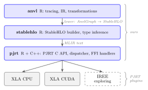
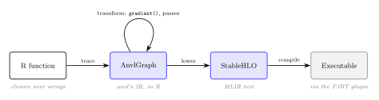
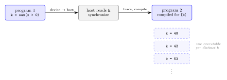
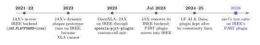
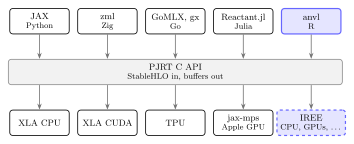
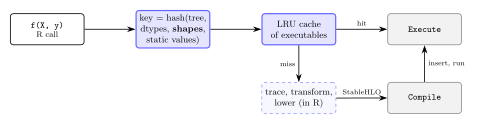

```{r}
#| include: false
library(anvl)
set.seed(1)

# The running example: logistic regression on simulated data.
n  <- 1000L
Xr <- cbind(1, matrix(rnorm(n * 2L), n))
yr <- rbinom(n, 1L, plogis(Xr %*% c(-0.5, 1, -2)))
X  <- nv_array(Xr, dtype = "f64")
y  <- nv_array(matrix(yr), dtype = "f64")

nll <- function(beta, X, y) {
  eta <- X %*% beta
  sum(nv_log1p(exp(eta)) - y * eta)
}

# Abstract values of the running example: shape and dtype, no data.
avals <- list(
  beta = nv_aval("f64", c(3L, 1L)),
  X    = nv_aval("f64", c(n, 3L)),
  y    = nv_aval("f64", c(n, 1L))
)

# --- Step-through slides ----------------------------------------------------
# The tracing and backward-pass slides are generated: each shows a code or
# graph panel on the left with the part being processed marked, and on the
# right the graph built so far, with what this step added marked.

html_escape <- function(x) {
  x <- gsub("&", "&amp;", x, fixed = TRUE)
  x <- gsub("<", "&lt;", x, fixed = TRUE)
  gsub(">", "&gt;", x, fixed = TRUE)
}

span <- function(class, lines) {
  paste0("<span class=\"", class, "\">", paste(html_escape(lines), collapse = "\n"), "</span>")
}

# Splits a printed graph into its header, its statements (named by id, e.g.
# "%3") and its closing lines. Printed narrow so that it fits half a slide.
graph_parts <- function(graph, width = 50L) {
  old <- options(width = width)
  on.exit(options(old))
  lines <- capture.output(print(graph))
  starts <- grep("^  %[0-9]+:", lines)
  ret <- grep("^  return", lines)
  ends <- c(starts[-1L] - 1L, ret - 1L)
  list(
    header = lines[seq_len(starts[1L] - 1L)],
    stmts = stats::setNames(
      Map(function(s, e) lines[s:e], starts, ends),
      sub("^  (%[0-9]+):.*", "\\1", lines[starts])
    ),
    tail = lines[ret:length(lines)]
  )
}

# Renders the statements `show` of a graph as HTML. `marks` maps statement
# ids, "header" and "return" to a CSS class; `fold` is a line that stands in
# for statements that are not shown.
graph_html <- function(parts, show, marks = character(), fold = NULL, done = FALSE) {
  render <- function(key, lines) {
    if (key %in% names(marks)) span(marks[[key]], lines) else paste(html_escape(lines), collapse = "\n")
  }
  out <- render("header", parts$header)
  if (!is.null(fold)) out <- c(out, span("dim", fold))
  out <- c(out, vapply(show, function(id) render(id, parts$stmts[[id]]), character(1L)))
  if (done) out <- c(out, render("return", parts$tail[1L]), html_escape(parts$tail[-1L]))
  paste(out, collapse = "\n")
}

panel <- function(class, html) {
  sprintf("```{=html}\n<pre class=\"%s\">%s</pre>\n```\n\n", class, html)
}

caption <- function(text) sprintf("::: {.trace-caption}\n%s\n:::\n\n", text)

# One step of an animation. All its slides show the same slide number:
# reveal.js numbers an uncounted slide like the last counted one before it,
# so only the first step is counted. step-numbers.html adds the step to the
# number ("14/2").
two_column_slide <- function(title, left, right, widths, step) {
  attrs <- sprintf("data-step=\"%d\"", step)
  if (step > 1L) attrs <- paste("visibility=\"uncounted\"", attrs)
  cat(sprintf("\n## %s {%s}\n\n", title, attrs))
  cat(sprintf(":::: {.columns}\n::: {.column width=\"%d%%\"}\n", widths[1L]))
  cat(left, sep = "")
  cat(sprintf(":::\n::: {.column width=\"%d%%\"}\n", widths[2L]))
  cat(right, sep = "")
  cat(":::\n::::\n\n")
}

fwd_parts <- graph_parts(trace_fn(nll, args = avals))
fwd_ids <- names(fwd_parts$stmts)
```

# Motivation {.center}

## What Is R

The language of statistics and data analysis. You can think of it as Python,
less rigorously defined: interpreted, dynamically typed, values are copied on
modification, arrays are column-major. What people do with it:

- **Data wrangling**, most of the time: `dplyr`, `data.table`
- **Plotting**: `ggplot2`
- **Statistical models**: `lm()`, `glm()`, mixed models, survival analysis,
  Bayesian models
- **Reports**: R Markdown, Quarto. These slides are a Quarto document, and
  every output on them was computed by R when they were rendered.

## Warts and All

R has a reputation. It has its warts:

```{r}
x <- numeric(0)
1:length(x)    # counts down when x is empty
```

Nobody would call it the most beautifully designed language.

. . .

But its ecosystem works. **CRAN** checks every new package version against
all packages that depend on it, so the latest versions of 20,000+ packages
work together.

No dependency hell (sorry, Python).

::: {.notes}
Keep it light. The point of the CRAN remark: R users are used to installing
the current version of everything and having it work. That matters for how
anvl is distributed later.
:::

## What Gets Expensive

R is fast enough for a lot of statistics: `glm()` on ten thousand rows is
instant. It gets expensive when

- **Bayesian modeling:** MCMC (Hamiltonian Monte Carlo needs thousands of
  gradient evaluations of the log-density), variational inference
  (stochastic gradient optimization);
- **Neural networks**, which statisticians use more and more: training is
  thousands of gradient steps;
- **Large data:** implementations that are fine for small `n` do not scale,
  such as an interpreted loop over observations, or an `O(n³)` Gaussian
  process;
- **Repetition:** bootstrap, cross-validation, simulation studies: the same
  model, refitted thousands of times.

Today's answer is to write the expensive part in C++, or in Stan.

::: {.notes}
Repetition comes back in the second half: refitting on different data means
different shapes.
:::

## anvl

:::: {.columns}
::: {.column width="45%"}
A JAX-inspired modeling toolbox for R.

- `jit()` compiles a whole R function.
- `gradient()` differentiates it (reverse mode).
- Same code on CPU and CUDA; Metal is experimental.
- ~160 user-facing functions over ~100 primitives.

All on top of **StableHLO** and the **PJRT C API**.
:::
::: {.column width="55%"}
{width="100%"}
:::
::::

::: {.notes}
Everything above PJRT is ours, written in R and C++. Everything below is
prebuilt plugins: today OpenXLA, and IREE is what I am exploring.
:::

# What the Front-End Can Do {.center}

## The Running Example: Logistic Regression

Observations $i = 1, \dots, n$ with covariates $x_i \in \mathbb{R}^p$ and a
binary response $y_i \in \{0, 1\}$:

$$
P(y_i = 1 \mid x_i) = \sigma(x_i^\top \beta), \qquad \sigma(t) = \frac{1}{1 + e^{-t}}
$$

Fit $\beta$ by minimizing the negative log-likelihood, with $\eta = X\beta$:

$$
\ell(\beta) = \sum_{i=1}^n \log\left(1 + e^{\eta_i}\right) - y_i \eta_i
$$

with gradient descent: $\beta \leftarrow \beta - \alpha \, \nabla \ell(\beta)$.

. . .

For the deep learning people: we are training a neural network with zero
hidden layers. ;)

::: {.notes}
Every statistician knows this model; the formula is here for the compiler
people. The same nll function is traced, differentiated and lowered on the
following slides.
:::

## A Statistical Algorithm, Compiled and Differentiated {.smaller}

Logistic regression, fitted by gradient descent:

:::: {.columns}
::: {.column width="56%"}
```{r}
nll <- function(beta, X, y) {
  eta <- X %*% beta
  sum(nv_log1p(exp(eta)) - y * eta)
}
grad_nll <- gradient(nll, wrt = "beta")

fit <- jit(function(X, y, lr, iters) {
  beta <- nv_fill(0, shape = c(ncol(X), 1L),
                  dtype = "f64")
  out <- nv_while(
    list(beta = beta, i = 0L),
    \(beta, i) i < iters,
    \(beta, i) {
      g <- grad_nll(beta, X, y)$beta
      list(beta = beta - lr * g, i = i + 1L)
    }
  )
  out$beta
})
```
:::
::: {.column width="44%"}
`X` is a 1000 × 3 design matrix, `y` a 0/1 response.

```{r}
beta <- fit(X, y, lr = 0.001, iters = 2000L)
beta
```

This is an illustrative example: in practice, logistic regression is fitted
differently (`glm()` uses iteratively reweighted least squares, a Newton
method).
:::
::::

::: {.notes}
This is ordinary R. The user never writes a kernel and never writes a
derivative. The loop runs inside the compiled program, 2000 iterations, one
call from R.
:::

## Small Data Needs Fast Loops, Too {.smaller}

Small data is not unusual in statistics: a clinical trial with a few hundred
patients, a lab experiment, one group in a per-group fit. Every iteration is
then cheap, and the overhead per iteration decides. The same fit in base R,
with the gradient derived by hand:

```{r}
fit_r <- function(X, y, lr, iters) {
  beta <- matrix(0, ncol(X), 1L)
  for (i in seq_len(iters)) {
    beta <- beta - lr * crossprod(X, plogis(X %*% beta) - y)
  }
  beta
}
```

```{r}
#| echo: false
#| output: asis
# Milliseconds per call, averaged over `reps` calls after one warm-up call.
# as_array() waits for the result, since anvl executes asynchronously.
time_ms <- function(f, reps = 10L) {
  f()
  t0 <- Sys.time()
  for (i in seq_len(reps)) f()
  as.numeric(Sys.time() - t0, units = "secs") / reps * 1000
}
base_ms <- time_ms(function() fit_r(Xr, yr, 0.001, 2000L), reps = 5L)
warm_ms <- time_ms(function() as_array(fit(X, y, lr = 0.001, iters = 2000L)))

# A new shape is a new compile: drop one observation at a time, so that every
# call below has a shape the cache has not seen.
new_shape_ms <- vapply(1:3, function(k) {
  Xk <- nv_array(Xr[-seq_len(k), ], dtype = "f64")
  yk <- nv_array(matrix(yr[-seq_len(k)]), dtype = "f64")
  t0 <- Sys.time()
  as_array(fit(Xk, yk, lr = 0.001, iters = 2000L))
  as.numeric(Sys.time() - t0, units = "secs") * 1000
}, numeric(1L))

print(knitr::kable(data.frame(
  `2000 iterations, n = 1000` = c(
    "base R loop",
    "anvl, compiled loop (warm)",
    "anvl, first call for a new shape"
  ),
  time = sprintf("%.0f ms", c(base_ms, warm_ms, stats::median(new_shape_ms))),
  check.names = FALSE
), align = "lr"))
compile_vs_base <- if (stats::median(new_shape_ms) > base_ms) {
  "which takes longer than the entire base R fit"
} else {
  sprintf("which takes %.0f%% of the time of the entire base R fit", 100 * stats::median(new_shape_ms) / base_ms)
}
cat(sprintf(
  "\nWarm, the whole loop runs inside one compiled program: %.0f× faster than base R. But a new shape costs a compile, %s. Hold that thought.\n",
  base_ms / warm_ms, compile_vs_base
))
```

::: {.notes}
Numbers are measured when the slides are rendered, on the CPU of the
rendering machine. The first compile of a session costs more still (plugin
and LLVM start-up); the table shows the cost of one more shape in a running
session.
:::

# How anvl Works {.center}

## From R to an Executable

{fig-align="center" width="100%"}

1. **Trace:** run the R function once, on abstract values, and record it.
2. **Transform:** rewrite the recording, e.g. into its gradient.
3. **Lower:** hand it to an `AnvlBackend`, which owns arrays, devices and
   compilation. The `pjrt` backend lowers to StableHLO and compiles through
   a PJRT plugin; the experimental `quickr` backend transpiles the same graph
   to Fortran.

::: {.notes}
This is the roadmap for the next six slides. Same architecture as JAX:
tracing to an IR of our own, transformations on that IR, lowering at the end.
:::

## Tracing: Running R on Abstract Values {.smaller}

`jit(f)` does not interpret `f` per call. It calls `f` **once**, with
`GraphBox` objects that carry a shape and a dtype but no data:

```{r}
one <- nv_scalar(1, dtype = "f64")

trace_fn(function(x) {
  print(x)
  for (i in 1:3) x <- x + one
  x
}, args = list(x = nv_aval("f64", integer())))
```

- R's S3 dispatch routes `+`, `%*%`, `exp`, ... on a `GraphBox` to a
  primitive, which appends a statement to the current trace.
- Ordinary R (loops, helper functions, closures) runs at trace time and
  disappears: the loop is unrolled, `one` became the constant `%c1`.

::: {.notes}
JAX's jit model, with operator overloading done by R's S3 dispatch instead of
Python's dunder methods. Tracing is partial evaluation with respect to
everything except array values. Next: the running example, one expression at
a time.
:::

```{r}
#| echo: false
#| output: asis
trace_code <- paste(c(
  "nll <- function(beta, X, y) {",
  "  eta <- X %*% beta",
  "  sum(nv_log1p(exp(eta)) - y * eta)",
  "}"
), collapse = "\n")

# One slide per step: the expression R evaluates, the number of statements
# the graph has afterwards, and the R variables bound to boxes so far.
trace_steps <- list(
  list(mark = "function(beta, X, y)", n = 0L,
       env = "`beta` → `%x1`, `X` → `%x2`, `y` → `%x3`",
       caption = "`jit()` calls the function once, with one `GraphBox` per argument. Each box is an input of the graph."),
  list(mark = "X %*% beta", n = 1L,
       env = "`eta` → `%1`",
       caption = "`%*%` dispatches on `GraphBox` to `nv_matmul()`, which calls the primitive `dot_general`. It appends a statement and returns a box for its result, which R binds to `eta`."),
  list(mark = "exp(eta)", n = 2L, env = NULL,
       caption = "`exp()` on a box: the primitive `exp`."),
  list(mark = "nv_log1p(exp(eta))", n = 3L, env = NULL,
       caption = "The primitive `log1p`."),
  list(mark = "y * eta", n = 4L, env = NULL,
       caption = "`*`: the primitive `mul`. `eta` is the same box as before, so `%1` is reused, not recomputed."),
  list(mark = "nv_log1p(exp(eta)) - y * eta", n = 5L, env = NULL,
       caption = "`-`: the primitive `sub`."),
  list(mark = "sum(nv_log1p(exp(eta)) - y * eta)", n = 6L, env = NULL,
       done = TRUE,
       caption = "`sum()`: the primitive `sum`. The function returns a box, and its node becomes the output of the graph.")
)

marked_code <- function(mark) {
  at <- regexpr(mark, trace_code, fixed = TRUE)
  end <- at + nchar(mark)
  paste0(
    html_escape(substr(trace_code, 1L, at - 1L)),
    span("now", mark),
    html_escape(substr(trace_code, end, nchar(trace_code)))
  )
}

bindings <- character()
for (i in seq_along(trace_steps)) {
  s <- trace_steps[[i]]
  bindings <- c(bindings, s$env)
  marks <- if (s$n == 0L) c(header = "new") else stats::setNames("new", fwd_ids[s$n])
  if (isTRUE(s$done)) marks[["return"]] <- "new"
  two_column_slide(
    "Tracing, Step by Step",
    left = c(
      panel("trace-code", marked_code(s$mark)),
      caption(paste("R variables:", paste(bindings, collapse = ", "))),
      caption(s$caption)
    ),
    right = panel("trace-graph", graph_html(fwd_parts, fwd_ids[seq_len(s$n)], marks, done = isTRUE(s$done))),
    widths = c(44L, 56L), step = i
  )
}
```

## The IR: `AnvlGraph` {.smaller}

The running example, traced:

```{r}
trace_fn(nll, args = avals)
```

- SSA statements: `primitive [params] (inputs)`, typed with abstract values.
- Similar to StableHLO: most primitives are one StableHLO op (`dot_general`,
  `exp`, `log1p`, `gather`, `while`), and `f64[1000,3]` is
  `tensor<1000x3xf64>`. Differences: 1-based axes, and a few primitives that
  lower to several ops or a custom call (`sum`, `qr`).
- Nested R lists flatten into inputs and outputs (pytrees, in JAX terms).
- Control flow carries closed sub-graphs; side effects (the RNG state) are
  explicit inputs and outputs.

::: {.notes}
Why our own IR rather than tracing straight into StableHLO: transformations
need primitive-level rules (derivatives, lowering to several backends). That
is easier on a small IR we control, written in R.
:::

## Primitives Are Bundles of Rules {.smaller}

~100 primitives, each with one rule per interpretation:

```{r}
names(attr(prim_mul, "definition")$rules)
```

:::: {.columns}
::: {.column width="50%"}
Lowering to StableHLO:

```{r}
prim_mul[["stablehlo"]]
```
:::
::: {.column width="50%"}
Reverse-mode derivative:

```{r}
prim_mul[["reverse"]]$backward
```
:::
::::

The ~160 `nv_*` functions compose primitives, and so inherit every rule.
`quickr` is a second backend that transpiles to Fortran.

::: {.notes}
This is the design that makes transformations compose: anything built from
primitives is differentiable and compilable, because every piece carries its
own rules.
:::

## Transformations Are Graph Rewrites {.smaller}

`gradient()` takes a graph and returns a graph:

1. find which values need gradients, and which forward values the backward
   pass reads;
2. replay the forward statements;
3. walk the statements backwards, applying each primitive's `reverse` rule.

```{r}
#| eval: false
trace_fn(gradient(nll, wrt = "beta"), args = avals)
```

The result is again an `AnvlGraph`. The next slides build it for `nll`, one
reverse rule at a time.

::: {.notes}
The result is an ordinary AnvlGraph: it can be jitted, differentiated again,
or passed through passes. Forward mode and vmap-style batching are planned as
further graph-to-graph passes. The transformation happens above StableHLO, so
any backend, IREE included, inherits differentiation for free. If asked: the
replayed forward statements that the backward pass does not read are left
for the compiler's dead-code elimination.
:::

```{r}
#| echo: false
#| output: asis
bwd_parts <- graph_parts(trace_fn(gradient(nll, wrt = "beta"), args = avals))

# Each step applies the reverse rule of the forward statement `at`, appends
# the statements `new` to the gradient graph, and updates the cotangents.
grad_steps <- list(
  list(at = "return", new = character(), cot = c("%6" = "1"),
       caption = "`gradient()` traces a new graph: it replays the forward statements, seeds the cotangent of the output with 1 (the constant `%c1`), and walks the forward graph backwards."),
  list(at = "%6", new = "%7", cot = c("%5" = "%7"),
       caption = "`sum`: the cotangent is broadcast back to the shape of the input."),
  list(at = "%5", new = "%8", cot = c("%3" = "%7", "%4" = "%8"),
       caption = "`sub`: the left operand gets the cotangent as it is, the right operand its negation."),
  list(at = "%4", new = "%9", cot = c("%1" = "%9"),
       caption = "`mul(%x3, %1)`: only `%1` needs a gradient (`y` is not differentiated), so the rule emits one statement."),
  list(at = "%3", new = c("%10", "%11", "%12"), cot = c("%2" = "%12"),
       caption = "`log1p`: divide by `1 + x`. The rule reads the forward value `%2`, which is why the forward pass is replayed."),
  list(at = "%2", new = c("%13", "%14"), cot = c("%1" = "%14"),
       caption = "`exp`: multiply by `exp(x)`, which is `%2` again. `%1` is used twice in the forward pass, so its two contributions are added."),
  list(at = "%1", new = c("%15", "%16"), cot = c("%x1" = "%16"), done = TRUE,
       caption = "`dot_general`: the cotangent of `beta` is `t(X) %*% %14`, computed as a transposed product. It is the output of the gradient graph.")
)

# The steps above are written for the graph anvl produces today; fail the
# render rather than show slides that no longer match it.
expected_ops <- c(
  "%7" = "broadcast_in_axes", "%8" = "negate", "%9" = "mul", "%10" = "fill",
  "%11" = "add", "%12" = "div", "%13" = "mul", "%14" = "add",
  "%15" = "dot_general", "%16" = "transpose"
)
stopifnot(identical(names(bwd_parts$stmts), c(fwd_ids, names(expected_ops))))
stopifnot(all(mapply(
  function(id, op) grepl(paste0("= ", op), bwd_parts$stmts[[id]][1L], fixed = TRUE),
  names(expected_ops), expected_ops
)))

cotangents <- character()
shown <- character()
for (i in seq_along(grad_steps)) {
  s <- grad_steps[[i]]
  shown <- c(shown, s$new)
  cotangents[names(s$cot)] <- s$cot
  new_marks <- stats::setNames(rep("new", length(s$new)), s$new)
  if (isTRUE(s$done)) new_marks[["return"]] <- "new"
  two_column_slide(
    "The Backward Pass, Step by Step",
    left = c(
      panel("trace-graph", graph_html(fwd_parts, fwd_ids, stats::setNames("now", s$at), done = TRUE)),
      caption(paste(
        "Cotangents:",
        paste0("`", names(cotangents), "` ← `", cotangents, "`", collapse = ", ")
      )),
      caption(s$caption)
    ),
    right = panel("trace-graph", graph_html(
      bwd_parts, shown, new_marks,
      fold = "  %1 ... %6: the forward pass, replayed", done = isTRUE(s$done)
    )),
    widths = c(50L, 50L), step = i
  )
}
```

## One IR, Several Backends {.smaller}

anvl differentiates **its own IR, in R, before lowering**. The alternative,
differentiating the compiled program (Enzyme on MLIR, as in Reactant.jl),
works for any producer of StableHLO but ties AD to MLIR. Here, every
`AnvlBackend` inherits `gradient()`:

```{r}
f  <- function(x, y) sum(x^2 * y)
gf <- gradient(f, wrt = "x")
run <- function() {
  x <- nv_array(c(1, 2, 3), dtype = "f64")
  y <- nv_array(c(1, 1, 2), dtype = "f64")
  as_array(jit(gf)(x, y)$x)
}
run()                           # pjrt: StableHLO through a PJRT plugin
with_backend("quickr", run())   # quickr: transpiled to Fortran, no MLIR
```

Separating the *what* from the *how* is common now: **JAX** (jaxprs, lowered
to StableHLO for any PJRT plugin), **Burn** (one `Backend` trait: CUDA, ROCm,
Metal, Vulkan, WebGPU through CubeCL, plus CPU backends), **GoMLX** (XLA
through PJRT, a pure Go backend, ONNX Runtime).

::: {.notes}
This is why swapping XLA for IREE is a backend question for us, not a
rewrite: the gradient does not care who compiles it.
:::

## Lowering to StableHLO {.smaller}

Each statement's `stablehlo` rule emits ops through our `stablehlo` R
package: an IR builder that implements the spec's type inference and prints
MLIR.

```{r}
#| eval: false
stablehlo(trace_fn(nll, args = avals))
```

The lowering walks the graph once, in order, and keeps a map from graph
values to StableHLO values. The next slides lower `nll` one statement at a
time.

::: {.notes}
This is the boundary to the compiler, and the only thing a StableHLO consumer
has to accept. A few ops are CHLO (lgamma, digamma, erf_inv, top_k) and a few
are custom calls (next part).
:::

```{r}
#| echo: false
#| output: asis
# The printed StableHLO function, in the shape of graph_parts(): the
# signature, one entry per op (named by its result, e.g. "%3"), and the
# return. Body lines are indented and long lines wrapped to fit half a slide.
hlo_parts <- function(func, width = 52L) {
  lines <- capture.output(print(func))
  body <- seq(2L, length(lines) - 1L)
  lines[body] <- paste0("  ", lines[body])
  wrap <- function(line) {
    if (nchar(line) <= width) return(line)
    lead <- nchar(sub("^( *).*", "\\1", line))
    strwrap(trimws(line), width = width, indent = lead, exdent = lead + 4L)
  }
  starts <- grep("^  %[0-9]+ = ", lines)
  ret <- grep("^  return ", lines)
  ends <- c(starts[-1L] - 1L, ret - 1L)
  list(
    header = unlist(lapply(lines[seq_len(starts[1L] - 1L)], wrap)),
    stmts = stats::setNames(
      Map(function(s, e) unlist(lapply(lines[s:e], wrap)), starts, ends),
      sub("^  (%[0-9]+) = .*", "\\1", lines[starts])
    ),
    tail = lines[ret:length(lines)]
  )
}

hlo <- hlo_parts(stablehlo(trace_fn(nll, args = avals))[[1L]])

# Each step lowers the graph statement `at` into the StableHLO ops `new`, and
# adds the values it defines to the map.
lower_steps <- list(
  list(at = "header", new = "header", map = c("%x1" = "%0", "%x2" = "%1", "%x3" = "%2"),
       caption = "The inputs of the graph become the arguments of `func.func @main`, with their static types."),
  list(at = "%1", new = "%3", map = c("%1" = "%3"),
       caption = "`dot_general` → `stablehlo.dot_general`. Axes become 0-based: `contracting_axes = list(2, 1)` is `contracting_dims = [1] x [0]`."),
  list(at = "%2", new = "%4", map = c("%2" = "%4"),
       caption = "`exp` → `stablehlo.exponential`."),
  list(at = "%3", new = "%5", map = c("%3" = "%5"),
       caption = "`log1p` → `stablehlo.log_plus_one`."),
  list(at = "%4", new = "%6", map = c("%4" = "%6"),
       caption = "`mul` → `stablehlo.multiply`. Its operands come from the map: `%x3` is `%2`, `%1` is `%3`."),
  list(at = "%5", new = "%7", map = c("%5" = "%7"),
       caption = "`sub` → `stablehlo.subtract`."),
  list(at = "%6", new = c("%8", "%9"), map = c("%6" = "%9"), done = TRUE,
       caption = "`sum` is not one op: a constant 0 and a `stablehlo.reduce` whose body adds, over dimensions 0 and 1. Every type is static (`tensor<1000x3xf64>`): that is the problem the rest of this talk is about.")
)

# The steps above are written for the StableHLO anvl emits today; fail the
# render rather than show slides that no longer match it.
expected_hlo <- c(
  "%3" = "stablehlo.dot_general", "%4" = "stablehlo.exponential",
  "%5" = "stablehlo.log_plus_one", "%6" = "stablehlo.multiply",
  "%7" = "stablehlo.subtract", "%8" = "stablehlo.constant",
  "%9" = "stablehlo.reduce"
)
stopifnot(identical(names(hlo$stmts), names(expected_hlo)))
stopifnot(all(mapply(
  function(id, op) grepl(op, hlo$stmts[[id]][1L], fixed = TRUE),
  names(expected_hlo), expected_hlo
)))

value_map <- character()
shown <- character()
for (i in seq_along(lower_steps)) {
  s <- lower_steps[[i]]
  ops <- setdiff(s$new, "header")
  shown <- c(shown, ops)
  value_map[names(s$map)] <- s$map
  new_marks <- stats::setNames(rep("new", length(s$new)), s$new)
  left_marks <- stats::setNames("now", s$at)
  if (isTRUE(s$done)) {
    new_marks[["return"]] <- "new"
    left_marks[["return"]] <- "now"
  }
  two_column_slide(
    "Lowering, Step by Step",
    left = c(
      panel("trace-graph", graph_html(fwd_parts, fwd_ids, left_marks, done = TRUE)),
      caption(paste(
        "Value map:",
        paste0("`", names(value_map), "` → `", value_map, "`", collapse = ", ")
      )),
      caption(s$caption)
    ),
    right = panel("trace-graph", graph_html(hlo, shown, new_marks, done = isTRUE(s$done))),
    widths = c(48L, 52L), step = i
  )
}
```

# Runtime {.center}

## `pjrt`: R Bindings to the PJRT C API {.smaller}

:::: {.columns}
::: {.column width="55%"}
StableHLO in, buffers out, no anvl involved:

```{r}
src <- '
func.func @main(%x: tensor<3xf32>,
                %y: tensor<3xf32>) -> tensor<3xf32> {
  %0 = stablehlo.add %x, %y : tensor<3xf32>
  func.return %0 : tensor<3xf32>
}'
exe <- pjrt::pjrt_compile(
  pjrt::pjrt_program(src = src, format = "mlir")
)
pjrt::pjrt_execute(
  exe,
  pjrt::pjrt_buffer(c(1, 2, 3)),
  pjrt::pjrt_buffer(c(10, 20, 30))
)
```
:::
::: {.column width="45%"}
- Talks to the plugin through the **C API only**: `GetPjrtApi`,
  `Client_Create`, `Client_Compile`, `BufferFromHostBuffer`,
  `LoadedExecutable_Execute`, events.
- The XLA plugins are prebuilt (from zml's `pjrt-artifacts`) and downloaded.
- Another plugin is one environment variable away:
  `PJRT_PLUGIN_PATH_CPU=.../libiree_pjrt.so`
:::
::::

::: {.notes}
The C API is what makes the plugin swappable: in principle nothing in anvl
needs to change for IREE. This is how I ran anvl's test suite on IREE.
:::

## Custom Calls: Where Portability Breaks {.smaller}

StableHLO has no QR, LU, SVD or symmetric eigendecomposition. `nv_solve()`
lowers to a custom call, a gather and two triangular solves:

```{r}
#| echo: false
solve_ir <- capture.output(print(stablehlo(trace_fn(
  nv_solve,
  args = list(a = nv_aval("f64", c(3L, 3L)), b = nv_aval("f64", c(3L, 1L)))
))[[1L]]))
ops <- grep("custom_call|triangular_solve|gather\"", solve_ir, value = TRUE)
cat(sub("\\s*\\{$", " ...", ops), sep = "\n")
```

| anvl | lowers to | XLA CPU | XLA CUDA | IREE today |
|---|---|---|---|---|
| `nv_chol()` | `custom_call @potrf` | LAPACK | cuSOLVER | ✗ |
| `nv_qr()` | `custom_call @geqrf`, `@orgqr` | LAPACK | cuSOLVER | ✗ |
| `nv_lu()`, `nv_solve()` | `custom_call @lu` | LAPACK | cuSOLVER | ✗ |
| `nv_svd()`, `nv_eigh()` | `custom_call @svd`, `@eigh` | LAPACK | cuSOLVER | ✗ |
| triangular solves | `stablehlo.triangular_solve` | XLA | XLA | ✗ (#11018) |

The handlers are XLA FFI handlers, registered through PJRT's FFI extension.
JAX does the same.

::: {.notes}
For statistics this is not optional: QR and Cholesky are the workhorses of
regression. Plant the question here; it comes back in the history part
(IREE hit the same problem with JAX in 2023) and in the questions at the end.
:::

# Why IREE {.center}

## One Compile per Shape {.smaller}

XLA compiles for static shapes. StableHLO can express `?` dimensions, but the
XLA CPU plugin rejects them ("Unbounded dynamism is disabled for instruction:
`f32[?]` parameter(0)"); JAX refines shapes to static ones before it
compiles. So every new shape is a new trace, lowering and compile:

```{r}
traced <- jit(function(beta, X, y) {
  message("tracing for n = ", shape(X)[1L])
  nll(beta, X, y)
})
beta0 <- nv_fill(0, shape = c(3L, 1L), dtype = "f64")
for (m in c(1000L, 999L, 998L, 998L)) {
  traced(beta0, nv_array(Xr[seq_len(m), ], dtype = "f64"),
         nv_array(matrix(yr[seq_len(m)]), dtype = "f64"))
}
jit_cache_size(traced)
```

For the fit from earlier: about `r round(stats::median(new_shape_ms))` ms
per new shape, against `r round(warm_ms)` ms for a warm call.

::: {.notes}
A compile of a hundred milliseconds is fine once. It is not fine thousands of
times.
:::

## In Statistics, Shapes Vary All the Time

- **Sequential designs:** Bayesian optimization refits a Gaussian process
  after every evaluation, so `n` grows by one per step.
- **Cross-validation:** fold sizes differ when `k` does not divide `n`.
- **Model selection:** stepwise or best-subset regression fits models with
  `p = 1, 2, …` covariates.
- **Per-group fits:** the same model for each hospital, gene or country.
- **Simulation studies:** a grid over `(n, p)` is the experimental design.
- **Library code:** a package author jits a function once; users call it with
  shapes the author never sees.

::: {.callout-note title="TODO"}
Plot: total time against the number of distinct shapes, XLA vs warm
execution (design.md, section 7).
:::

::: {.notes}
In deep learning, the shape is a hyperparameter you fix once. In statistics,
it is part of the data.
:::

## Example: Bayesian Optimization {.smaller}

Minimize an expensive black-box function `f`. At every step:

1. fit a Gaussian process to the `n` points seen so far: an `n × n` kernel
   matrix, its Cholesky factor, and the gradient of the marginal likelihood
   with respect to the kernel's parameters;
2. maximize the acquisition function (e.g. expected improvement), again with
   gradients;
3. evaluate `f` at the new point: `n` becomes `n + 1`.

With XLA, **every step is a new shape**, so both programs are traced and
compiled again at every step. For a cheap `f`, compilation dominates.

It has everything this talk is about: a dynamic axis, a custom call
(Cholesky), gradients through it, and `f64` (kernel matrices are
ill-conditioned; an `f32` Cholesky fails early).

::: {.callout-note title="TODO"}
Plot: time per step against `n`, for XLA (compile every step), XLA warm, and
IREE with a dynamic `n` (design.md, section 7).
:::

## Workaround 1: Pad and Mask {.smaller}

Pad `n` up to the next power of two and mask the padding. But padding is not
neutral, and a compiled program cannot raise an error, so a wrong padding is
silent:

:::: {.columns}
::: {.column width="50%"}
```{r}
A <- crossprod(matrix(rnorm(30L), 10L))
b <- matrix(rnorm(3L))

A0 <- matrix(0, 4L, 4L)    # zero padding
A0[1:3, 1:3] <- A
nv_solve(nv_array(A0, dtype = "f64"),
         nv_array(rbind(b, 0), dtype = "f64"))
```
:::
::: {.column width="50%"}
```{r}
A1 <- A0                   # identity padding
A1[4L, 4L] <- 1
nv_solve(nv_array(A1, dtype = "f64"),
         nv_array(rbind(b, 0), dtype = "f64"))
```
:::
::::

Zero rows are fine for `X'X`; a solve or Cholesky needs identity padding; a
mean needs the true `n`. Every library author has to get this right for every
algorithm, and two padded axes (`n`, `p`) still give `log2(n) × log2(p)`
compiles. This is not very user friendly.

## Workaround 2: XLA's Bounded Dynamism

A dimension with an upper bound, compiled once:

```
tensor<?x3xf64, #stablehlo.bounds<1024, ?>>
```

XLA pads to the bound internally (`PadToStatic`, `SliceToDynamic`). This is
what drives dynamic shapes in TorchTPU. But:

- work and memory are those of the bound;
- the bound has to be known in advance;
- the XLA CPU plugin anvl uses rejects it: "Custom call target PadToStatic is
  not implemented".

Neither workaround handles shapes that depend on the data.

## Boolean Subsetting Needs a Graph Break

`x[x > 0]` has a shape that depends on the data, so it cannot live in one
static program. It can be split there:

{fig-align="center" width="100%"}

Program 2's shape depends on what program 1 computed, so **every distinct `k`
is a new compile**, and the host waits in between.

::: {.notes}
This is the graph break of torch.compile. The cost is the recompile, not the
break.
:::

## A Graph Break in anvl {.smaller}

The mean of the positive entries, as two programs:

```{r}
n_pos <- jit(function(x) sum(x > 0))
mean_pos <- jit(function(x, k) {
  n <- shape(x)[1L]
  mean(nv_sort(x)[(n - k + 1L):n])
}, static = "k")

ks <- integer()
for (i in 1:5) {
  x <- nv_array(rnorm(100L), dtype = "f64")
  ks[i] <- as_array(n_pos(x))   # device -> host
  mean_pos(x, ks[i])            # compiled for this k
}
c(distinct_k = length(unique(ks)), compiles = jit_cache_size(mean_pos))
```

Loops have the same problem. A vectorized `nv_while()` that iterates every
element until it meets a stopping criterion (one Newton solve per
observation, one sampler per chain) runs **until the last element is done**:
the loop state has a static shape. With dynamic shapes, the body could drop
the finished elements and return a smaller state in each iteration.

::: {.notes}
In statistics, data-dependent subsetting is routine: dropping outliers and
refitting, complete-case analysis, subsetting to a group, keeping
observations above a threshold.
:::

## CPU and Precision Matter {.smaller}

Statistical users run on laptops, CPU servers and HPC nodes, often without
GPUs, and on many small problems where compile time and overhead matter as
much as peak throughput. And they need **`f64`**:

:::: {.columns}
::: {.column width="45%"}
```{r}
nv_pnorm(nv_scalar(-30, dtype = "f32"))
nv_pnorm(nv_scalar(-30, dtype = "f64"))
```
:::
::: {.column width="55%"}
- log-likelihoods are sums over many observations;
- `X'X` and kernel matrices are ill-conditioned;
- tail probabilities and MCMC acceptance ratios live where `f32` has no
  digits left;
- results are compared against `f64` references (`glm()`, Stan).
:::
::::

XLA also flushes subnormals to zero, presumably for speed: `1e-200 * 1e-110`
is `r format(as_array(nv_scalar(1e-200, dtype = "f64") * nv_scalar(1e-110, dtype = "f64")))`
in anvl and `r format(1e-200 * 1e-110)` in R ([anvl#540](https://github.com/r-xla/anvl/issues/540)).
That may not be necessary any more: subnormals are only slow on Intel CPUs
([benchmark by Daniel Lemire](https://x.com/lemire/status/2099845112469635410)).

What this asks of IREE: no silent demotion of `f64` (today the default;
`--iree-input-demote-f64-to-f32=false`), a complete `f64` math library (`f64`
`exp`, `log`, `floor`, `round` reached the CPU math library in Sep 2026,
#24953), accurate approximations (#12903 is open), fast `f64` code on CPU.

## Targets Beyond CPU {.smaller}

| target | XLA through PJRT | IREE |
|---|---|---|
| CPU | ✓ | ✓ |
| CUDA | ✓ | ✓ |
| ROCm | ✓ | ✓ |
| Metal | Apple's `jax-metal`: no release since Oct 2024 | ✓ stable |
| Vulkan | ✗ | ✓ |
| WebAssembly | ✗ | experimental, no Emscripten build |

There is demand for Apple GPUs: the community wrote **jax-mps**
([github.com/tillahoffmann/jax-mps](https://github.com/tillahoffmann/jax-mps)),
a PJRT plugin on top of MLX, releasing regularly. A well-supported Metal
target in IREE would serve every PJRT frontend on Apple Silicon at once.
WebAssembly is interesting because **webR** already runs R in the browser.

## Slower Compiles, but Fewer of Them

IREE compiles more slowly than XLA today: it showed while running anvl's test
suite, where every test is a fresh compile. Dynamic shapes partly offset
that. For `k` distinct shapes:

- XLA: `k × (compile_XLA + run)`
- IREE, dynamic: `compile_IREE + k × run`

IREE wins once `k` exceeds about `compile_IREE / compile_XLA`. In the
sequential settings above, `k` is in the hundreds. And a program that does not
depend on the shape can be cached on disk, or even compiled ahead of time and
shipped with an R package: one compile, ever.

::: {.callout-note title="TODO"}
Benchmark: compile time on XLA vs IREE, and total time against the number of
distinct shapes (design.md, section 7).
:::

::: {.notes}
Compile time stays a first-class metric for this audience: interactive use,
small problems. The exponential compile time the test suite found (#24886)
was fixed within a month.
:::

# Been Here Before {.center}

## JAX on IREE, 2021–2023

{fig-align="center" width="100%"}

- 2022: JAX's dynamic-shapes prototype ran **on IREE because XLA could not**
  (jax#11268, jax#11313), and had to decide when two axis sizes are
  symbolically equal.
- Feb 2023: 1,495 failing compilations in the JAX test suite, mostly `bf16`,
  `complex` and zero-size tensors; 123 left by April (#12070).

::: {.notes}
You probably weren't around for this. Most of IREE's commits in the last six
months came from AMD and Roofline AI, none from google.com addresses. It is
worth knowing, because anvl hits the same gaps.
:::

## What Was Left Open {.smaller}

| issue | topic | state | why anvl cares |
|---|---|---|---|
| #10816 (2022) | no lowering for `cholesky` | open | regression, GPs, multivariate normals |
| #11018 (2022) | no lowering for `triangular_solve` | open | `solve()`, back-substitution |
| #12410 (2023) | `custom_call` support, "QR, Eigh, etc." | open; host-side shim prototyped, never merged | QR, LU, SVD, eigh |
| #12411 (2023) | JAX host callbacks | open | `print_tensor` |
| #12903 (2023) | numerical differences from XLA | open | `f64` precision in the tails |
| jax#15357 (2023) | PJRT API to register custom calls, filed from the IREE side | closed: "each backend will define its own API" | exactly our problem today |

Not relevant to anvl: `bf16`, `complex`, collectives, `pmap`.

## anvl's Test Suite on IREE {.smaller}

I replaced the XLA CPU PJRT plugin with IREE's (one environment variable) and
ran anvl's test suite, which checks every primitive against torch. For now,
with **static shapes** only.

::: {.callout-note title="TODO"}
Pass rate of the run. Next: shape-polymorphic tracing (at least partially)
and IR with dynamic shapes in anvl, then run the tests on IREE again.
:::

| issue | what | state |
|---|---|---|
| #24881 | the `GatherToTorchIndexSelect` lowering drops the index clamp: out-of-bounds gathers read arbitrary memory | open |
| #24885 | `stablehlo.while`: a loop-carried resource is deallocated on the branch into the loop | fixed, Oct 2026 |
| #24886 | LLVMCPU compile time exponential in the def chain feeding a data-dependent `tensor.extract` | fixed, Oct 2026 |

anvl's per-primitive tests are a ready-made regression corpus for the
StableHLO input path, with no `bf16` or `complex` noise.

::: {.notes}
Thank the people who fixed them. anvl depends on the gather clamp: it is how
indexing avoids runtime errors.
:::

## One Plugin, Many Frontends

{fig-align="center" width="85%"}

PJRT turns M frontends × N backends into M + N. A solid IREE PJRT plugin gives
every frontend IREE's targets and dynamic shapes, with no frontend changes.
Reactant.jl links XLA directly for CPU and GPU, and loads plugins for the
rest.

::: {.notes}
In 2023 the plugin existed to serve JAX. Today it would serve a whole list of
frontends. It is in the IREE tree and in CI, but stuck at PJRT API 0.68 (XLA
is at 0.117). Who owns it?
:::

## What anvl Needs From a PJRT Plugin

- `Client_Create`, `Compile`: StableHLO plus a serialized XLA
  `CompileOptionsProto`, which IREE's plugin already parses;
- buffers in and out, row-major layouts, async events;
- the FFI extension, or an equivalent, for custom calls.

IREE's plugin is in-tree and CI-tested, but at PJRT API 0.68; XLA is at
0.117.

# Open Questions {.center}

## Who Checks the Shapes?

With dynamic shapes, the signature of `nll` becomes:

```{=html}
<pre class="trace-code sig">func.func @main(%beta: tensor&lt;<span class="dim-p">?</span>x1xf64&gt;,
               %X:    tensor&lt;<span class="dim-n">?</span>x<span class="dim-p">?</span>xf64&gt;,
               %y:    tensor&lt;<span class="dim-n">?</span>x1xf64&gt;)</pre>
```

The program is only correct if the dimensions of the same color are equal:
`n` for the rows of `X` and `y`, `p` for the columns of `X` and the rows of
`beta`. anvl knows this at trace time. StableHLO cannot say it:

> "Constraints will be verified statically if possible, otherwise they are
> deferred to runtime and mismatches will result in undefined behavior."
> (StableHLO specification)

::: {.notes}
R users expect "ncol(X) must equal length(beta)", not a segfault, and
certainly not a silent wrong answer.
:::

## Who Checks the Shapes Today? {.smaller}

| where | how | today |
|---|---|---|
| frontend (R) | anvl checks before every call | fast, good errors; every frontend reimplements it; an imported program has no checks |
| in the IR | JAX's `custom_call @shape_assertion`, `shape.cstr_*`, `cf.assert` | JAX checks at *compile* time, and IREE's StableHLO input **drops** them; `shape.cstr_*` is illegal input; `cf.assert` is stripped at O1+ |
| compiler, at the ABI | IREE's `hal.buffer_view.assert` | checks dtype, rank and static dims; a dynamic dim is compared with itself |
| PJRT plugin | before `Execute` | needs metadata the IR cannot carry |
| nobody | undefined behavior | **the current state** |

## Constraints Are Also Information {.smaller}

A compiler that knows `dim(X, 1) == dim(beta, 0)` can form dispatches across
ops with the same iteration space and drop redundant dimension queries;
ranges and divisibility help tiling. **In which IR should a frontend write
this down?**

:::: {.columns}
::: {.column width="40%"}
StableHLO: `?` and bounds only, no symbols.

```
%X: tensor<?x?xf64>
%beta: tensor<?x1xf64>
```
:::
::: {.column width="60%"}
torch-mlir: symbols, which IREE turns into `util.assume.int`; equal symbols
are *assumed* equal, never checked.

```
%n = torch.symbolic_int "s0" {min_val = 1, max_val = 1048576} : !torch.int
%p = torch.symbolic_int "s1" {min_val = 1, max_val = 1024} : !torch.int
torch.bind_symbolic_shape %X, [%n, %p], affine_map<()[s0, s1] -> (s0, s1)> : ...
torch.bind_symbolic_shape %beta, [%p], affine_map<()[s0] -> (s0, 1)> : ...
```
:::
::::

Or `linalg`/`tensor` directly with `util.assume.int`, or a symbolic-shape
extension to StableHLO.

::: {.notes}
This is the main thing I want the audience's opinion on. StableHLO's own
tooling assumes specialization: refine-arguments, refine-shapes, and since
Nov 2025 check-shape-assertions.
:::

# Plan and Asks {.center}

## Plan

1. **Static, done:** anvl's test suite runs on IREE's PJRT plugin. Next: the
   remaining failures, and compile and run time against XLA on statistical
   benchmarks.
2. **Custom calls:** whichever route we settle on, starting with Cholesky and
   triangular solve.
3. **Dynamic shapes:** shape-polymorphic tracing for a subset of primitives,
   emitting `?` dimensions and constraints in the IR we agree on; then run
   the test suite on IREE again.
4. **PJRT:** help keep IREE's plugin tested, so that the swap stays
   configuration rather than code.
5. **Targets:** Metal and WebAssembly (webR).

## Questions for You

1. Who owns the IREE PJRT plugin?
2. Which input IR should a frontend emit for symbolic shapes and their
   constraints?
3. How should library kernels (LAPACK, cuSOLVER) reach a program IREE
   compiles?
4. How do IREE's CPU code and compile times look for small `f64` programs,
   and should `f64` be demoted by default?

## Thank You

- anvl: [github.com/r-xla/anvl](https://github.com/r-xla/anvl)
- Docs: [r-xla.github.io/anvl](https://r-xla.github.io/anvl/)

anvl's initial design was based on **Autodidax**, JAX's tutorial on building
JAX from scratch:
[docs.jax.dev/en/latest/autodidax.html](https://docs.jax.dev/en/latest/autodidax.html)

Supported by **MaRDI**, the Mathematical Research Data Initiative, an NFDI
project funded by DFG grant 460135501.

# Additional Slides {.center}

## What Tracing Cannot See {.smaller}

A traced value has no data, so it cannot drive R's `if`:

```{r}
#| error: true
jit(function(x) if (x > 0) x else -x)(nv_scalar(1, dtype = "f64"))
```

R's `if` has no hook for user types (Python has `__bool__`), so the error
comes from R itself. Data-dependent control flow is staged explicitly instead:

:::: {.columns}
::: {.column width="45%"}
```{r}
#| eval: false
nv_if(x > 0, \() x, \() -x)
```

Branch bodies are traced into **sub-graphs**: closed regions, whatever they
read from outside becomes an operand.

Arguments marked `static` stay R values during tracing, and are part of the
cache key.
:::
::: {.column width="55%"}
```{r}
#| echo: false
trace_fn(
  function(x) nv_if(x > 0, \() x, \() -x),
  args = list(x = nv_aval("f64", integer()))
)
```
:::
::::

::: {.notes}
The cache key is (input tree structure, dtypes, shapes, static values); the
dispatcher slide has the full picture.
:::

## The Dispatcher

{fig-align="center" width="100%"}

- A call to a jitted function is handled in C++: hash the call's signature,
  look up the executable, run it. Only a miss goes back into R.
- Eager mode is the same path: every primitive is itself jitted, so eager
  operations are small cached executables.
- **Shapes are part of the key**: a new shape is a new trace, lowering and
  compile.

::: {.notes}
The hit path never enters the R interpreter, which keeps the per-call
overhead low. Shapes in the key is the problem the second half of the talk is
about.
:::

## The Gradient in StableHLO {.smaller}

```{r}
#| class-output: hlo-dump
stablehlo(trace_fn(gradient(nll, wrt = "beta"), args = avals))[[1L]]
```

## Gotchas for Compiler People {.smaller}

**There is no `NA` on the device.** `NA` becomes `NaN` for floats, and an
ordinary number for integers.

**Nothing fails at run time.** An index known only at run time is clamped,
because a kernel cannot raise an R error:

```{r}
x10 <- nv_array(c(10, 20, 30, 40, 50), dtype = "f64")
jit(function(x, i) x[i])(x10, nv_scalar(10L))
```

## Why Not Just C++? {.smaller}

- **It fixes the menu.** A Gaussian process package offers the kernels its
  author wrote; anything else means changing the C++ code, or an R callback
  for every entry of an `n × n` matrix, slow and without gradients.
- **It fixes the hardware.** The C++ code runs on the CPU; a GPU means a
  second implementation, an Apple GPU a third.

A JIT compiles **library code and user code into one program**, for the
device at hand, and differentiates through both:

:::: {.columns}
::: {.column width="50%"}
Package code, written once:

```{r}
gp_nll <- function(kernel) function(theta, x, y) {
  n  <- shape(x)[1L]
  xm <- nv_broadcast_to(nv_reshape(x, c(n, 1L)), c(n, n))
  K  <- kernel(xm - t(xm), theta) +
    theta$noise^2 * nv_eye(n, dtype = "f64")
  L  <- nv_chol(K, lower = TRUE)
  a  <- nv_triangular_solve(L, nv_reshape(y, c(n, 1L)))
  sum(a^2) / 2 + sum(log(nv_extract_diag(L)))
}
```
:::
::: {.column width="50%"}
User code, a kernel the author never anticipated:

```{r}
my_kernel <- function(d, theta) {
  periodic <- exp(-2 * sin(pi * d / theta$period)^2 /
                    theta$ell^2)
  decay <- exp(-d^2 / (2 * theta$decay^2))
  theta$sigma^2 * periodic * decay
}
grad <- jit(gradient(gp_nll(my_kernel), wrt = "theta"))
```

```{r}
#| echo: false
set.seed(2)
x_gp <- sort(runif(200L, 0, 10))
y_gp <- sin(2 * pi * x_gp / 2.5) * exp(-x_gp / 10) + rnorm(200L, sd = 0.1)
x_gp <- nv_array(x_gp, dtype = "f64")
y_gp <- nv_array(y_gp, dtype = "f64")
theta <- lapply(
  list(sigma = 1, period = 2.5, ell = 1, decay = 5, noise = 0.1),
  nv_scalar, dtype = "f64"
)
```

```{r}
g <- grad(theta, x_gp, y_gp)$theta
round(vapply(g, as_array, numeric(1L)), 2L)
```
:::
::::

::: {.notes}
The gradient of the GP marginal likelihood with respect to all kernel
hyperparameters, through a Cholesky factorization and a triangular solve,
for a kernel the package author never saw. In C++ that is either a new
release of the package or an R callback per matrix entry, without
gradients.
:::

## What Changes in the Frontend {.smaller}

:::: {.columns}
::: {.column width="55%"}
- Abstract values carry symbols (`n`, `p`) instead of integers; R shape
  arithmetic (`n * p` for a reshape) builds symbolic expressions.
- R control flow on a shape (`if (nrow(X) > 1000)`) cannot be decided for a
  symbolic `n`: it raises, or becomes a guard that specializes the program.
- The cache key becomes (rank, dtype, symbolic pattern), and the cache stops
  growing with the data.
- Every primitive's shape rule works on symbols.
:::
::: {.column width="45%"}
A sketch (not implemented):

```
<AnvlGraph> (%x1: f64[p,1], %x2: f64[n,p],
             %x3: f64[n,1]) {
  %1: f64[n,1] = dot_general [...] (%x2, %x1)
  %2: f64[n,1] = exp(%1)
  %3: f64[n,1] = log1p(%2)
  %4: f64[n,1] = mul(%x3, %1)
  %5: f64[n,1] = sub(%3, %4)
  %6: f64[] = sum [...] (%5)
  return %6
}
```
:::
::::

::: {.notes}
Our side of the work, tractable because the IR and its shape rules are small
and ours. JAX's dynamic-shapes prototype went down the same road in 2022.
:::
