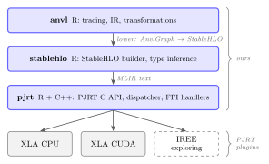
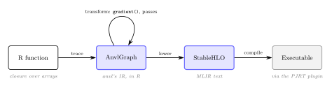
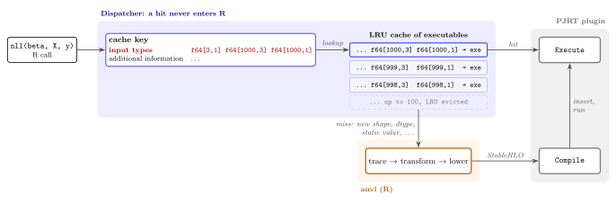
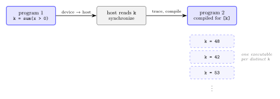
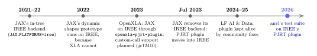
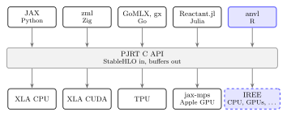
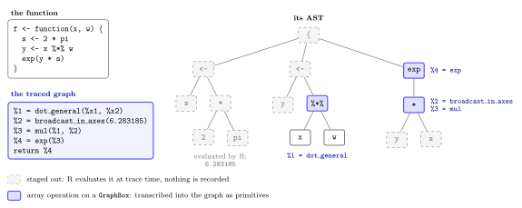
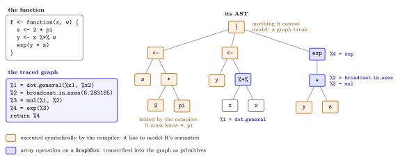

```{r}
#| include: false
library(anvl)
set.seed(1)

# The running example: logistic regression on simulated data.
n  <- 1000L
Xr <- cbind(1, matrix(rnorm(n * 2L), n))
yr <- rbinom(n, 1L, plogis(Xr %*% c(-0.5, 1, -2)))
X  <- nv_array(Xr, dtype = "f64")
y  <- nv_array(matrix(yr), dtype = "f64")

nll <- function(beta, X, y) {
  eta <- X %*% beta
  sum(nv_log1p(exp(eta)) - y * eta)
}

# Abstract values of the running example: shape and dtype, no data.
avals <- list(
  beta = nv_aval("f64", c(3L, 1L)),
  X    = nv_aval("f64", c(n, 3L)),
  y    = nv_aval("f64", c(n, 1L))
)

# --- Step-through slides ----------------------------------------------------
# The tracing and backward-pass slides are generated: each shows a code or
# graph panel on the left with the part being processed marked, and on the
# right the graph built so far, with what this step added marked.

html_escape <- function(x) {
  x <- gsub("&", "&amp;", x, fixed = TRUE)
  x <- gsub("<", "&lt;", x, fixed = TRUE)
  gsub(">", "&gt;", x, fixed = TRUE)
}

span <- function(class, lines) {
  paste0("<span class=\"", class, "\">", paste(html_escape(lines), collapse = "\n"), "</span>")
}

# Splits a printed graph into its header, its statements (named by id, e.g.
# "%3") and its closing lines. Printed narrow so that it fits half a slide.
graph_parts <- function(graph, width = 50L) {
  old <- options(width = width)
  on.exit(options(old))
  lines <- capture.output(print(graph))
  starts <- grep("^  %[0-9]+:", lines)
  ret <- grep("^  return", lines)
  ends <- c(starts[-1L] - 1L, ret - 1L)
  list(
    header = lines[seq_len(starts[1L] - 1L)],
    stmts = stats::setNames(
      Map(function(s, e) lines[s:e], starts, ends),
      sub("^  (%[0-9]+):.*", "\\1", lines[starts])
    ),
    tail = lines[ret:length(lines)]
  )
}

# Renders the statements `show` of a graph as HTML. `marks` maps statement
# ids, "header" and "return" to a CSS class; `fold` is a line that stands in
# for statements that are not shown.
graph_html <- function(parts, show, marks = character(), fold = NULL, done = FALSE) {
  render <- function(key, lines) {
    if (key %in% names(marks)) span(marks[[key]], lines) else paste(html_escape(lines), collapse = "\n")
  }
  out <- render("header", parts$header)
  if (!is.null(fold)) out <- c(out, span("dim", fold))
  out <- c(out, vapply(show, function(id) render(id, parts$stmts[[id]]), character(1L)))
  if (done) out <- c(out, render("return", parts$tail[1L]), html_escape(parts$tail[-1L]))
  paste(out, collapse = "\n")
}

panel <- function(class, html) {
  sprintf("```{=html}\n<pre class=\"%s\">%s</pre>\n```\n\n", class, html)
}

caption <- function(text) sprintf("::: {.trace-caption}\n%s\n:::\n\n", text)

# One step of an animation. All its slides show the same slide number:
# reveal.js numbers an uncounted slide like the last counted one before it,
# so only the first step is counted. step-numbers.html adds the step to the
# number ("14/2").
two_column_slide <- function(title, left, right, widths, step) {
  attrs <- sprintf("data-step=\"%d\"", step)
  if (step > 1L) attrs <- paste("visibility=\"uncounted\"", attrs)
  cat(sprintf("\n## %s {%s}\n\n", title, attrs))
  cat(sprintf(":::: {.columns}\n::: {.column width=\"%d%%\"}\n", widths[1L]))
  cat(left, sep = "")
  cat(sprintf(":::\n::: {.column width=\"%d%%\"}\n", widths[2L]))
  cat(right, sep = "")
  cat(":::\n::::\n\n")
}

fwd_parts <- graph_parts(trace_fn(nll, args = avals))
fwd_ids <- names(fwd_parts$stmts)
```

## About Me

-   Sebastian Fischer
-   PhD student at LMU Munich, supervised by Prof. Bernd Bischl
-   Work on ML software and benchmarking
-   Part of MaRDI, the Mathematical Research Data Initiative

# Motivation {.center}

## What Is R

An interpreted language for statistics, designed for interactive data analysis:

-   **Data wrangling**: `dplyr`, `data.table`
-   **Plotting**: `ggplot2`
-   **Dashboards**: Shiny
-   **Statistical models**: `lm()`, `glm()`, mixed models, survival analysis, Bayesian models
-   **Reports**: R Markdown, Quarto

::: notes
The language of statistics and data analysis. You can think of it as Python, less rigorously defined: interpreted, dynamically typed, values are copied on modification, arrays are column-major. What people do with it: data wrangling most of the time, plotting, dashboards, statistical models, reports.

These slides are a Quarto document, and every output on them was computed by R when they were rendered.
:::

## The Language and Its Ecosystem

-   **The language:** a reputation for inconsistent design
-   **The ecosystem:** works
    -   **CRAN** checks every new package version against all packages that depend on it
    -   The latest versions of 20,000+ packages work together
    -   No dependency hell (sorry, Python)

::: notes
Keep it light: nobody would call R the most beautifully designed language, and I won't defend it. The point of the CRAN remark: R users are used to installing the current version of everything and having it work. That matters for how anvl is distributed later.
:::

## What Gets Expensive {.smaller}

R is fast enough for most statistics. It gets expensive with:

-   **Bayesian modeling:** MCMC, variational inference
    -   e.g. parallel MCMC algorithms designed for GPUs[^1]
-   **Neural networks:** large operations, many gradient steps
-   **Large data:** "standard" statistical models on large data
-   **Repetition:** bootstraping, resampling, simulation studies

[^1]: Hoffman, Radul and Sountsov (2021), AISTATS; Sountsov, Carroll and Hoffman (2024), arXiv:2411.04260.

Before anvl: No easy way to write algorithms in R and compile them to run on GPU and CPU.

::: notes
`glm()` on ten thousand rows is instant. Hamiltonian Monte Carlo needs thousands of gradient evaluations of the log-density; variational inference is stochastic gradient optimization. Statisticians use neural networks more and more. Implementations that are fine for small `n` do not scale. Bootstrap, cross-validation and simulation studies refit the same model thousands of times.

Parallel MCMC: ChEES-HMC ("An Adaptive-MCMC Scheme for Setting Trajectory Lengths in Hamiltonian Monte Carlo") runs many chains at once and, on a GPU, gets considerably more gradient evaluations per second than NUTS. Sountsov, Carroll and Hoffman ("Running Markov Chain Monte Carlo on Modern Hardware and Software") describe the patterns for running MCMC on GPUs and TPUs.

Repetition comes back in the second half: refitting on different data means different shapes.
:::

## anvl

A JAX-inspired modeling toolbox for R:

-   **Array programs:** common array functions (like NumPy), written like ordinary R
-   **JIT compilation** of whole R functions, for different hardware: CPU, CUDA
-   **Code transformations** that change what a program computes: automatic differentiation (`gradient()`)

::: notes
anvl lets you write array programs in R, compiles whole R functions with `jit()` for the device at hand, and transforms programs: `gradient()` turns a function into the function that computes its gradient, in reverse mode. The same code runs on CPU and CUDA.
:::

## Inspired by JAX, Adapted to R {.smaller}

-   Much of the design comes from JAX, especially [Autodidax](https://docs.jax.dev/en/latest/autodidax.html), "JAX from scratch"
-   Tailored to the R community:
    -   more focus on precision: `f64`
    -   improved type promotion, for better precision, especially with literals
    -   precise implementations of statistical distribution functions
    -   an R-like API
    -   R's semantics: 1-based indexing, column-major arrays
    -   random numbers: a global random state, seeded like `set.seed()`, instead of explicit keys
    -   …
-   Simpler function transformations: rewrites of a traced graph instead of JAX's stack of interpreters; easier to understand and extend, maybe a little less efficient
-   Hopefully, with IREE: dynamic shapes

::: notes
Tracing, the IR, transformations as graph rewrites and lowering to StableHLO all follow JAX; anvl's first version was built along the Autodidax tutorial. But a port of JAX's semantics would not feel like R. Statisticians care about precision: type promotion that does not lose precision because of a literal, and distribution functions (densities, CDFs, quantiles) that are accurate in the tails. R users expect an API that looks like R, `f64`, indexing from 1 and column-major matrices, and random numbers that work like `set.seed()` and `runif()`, not keys they split by hand. Function transformations are deliberately simpler than in JAX: anvl traces once into a graph and implements `gradient()` as a rewrite of that graph, where JAX composes transformations by stacking interpreters. In my view this is easier to understand and to extend, at the price of perhaps a little efficiency. The next step on that list is the reason for this talk: shapes that change with the data.
:::

## The Stack

::::: columns
::: {.column width="40%"}
-   Ours: three R packages, partly C++
-   Below: prebuilt PJRT plugins
-   IREE: what I am exploring
:::

::: {.column width="60%"}
{width="100%"}
:::
:::::

::: notes
Everything above PJRT is ours, written in R and C++. Everything below is prebuilt plugins: today OpenXLA, and IREE is what I am exploring. The next slides explain the two interfaces in the middle: StableHLO and PJRT.
:::

## StableHLO

::::: columns
::: {.column width="55%"}
-   A stable version of XLA's HLO (High Level Operations) op set, as an MLIR dialect: 105 ops
-   Very low-level ops: `add`, `exponential`, `dot_general`, `reduce`, `gather`, …
-   The interface between ML frameworks and ML compilers
    -   Produced by JAX, PyTorch/XLA, TensorFlow, anvl, …
    -   Consumed by XLA and IREE
:::

::: {.column width="45%"}
```
func.func @main(%x: tensor<3xf32>,
                %y: tensor<3xf32>)
    -> tensor<3xf32> {
  %0 = stablehlo.add %x, %y
    : tensor<3xf32>
  func.return %0 : tensor<3xf32>
}
```
:::
:::::

::: notes
A recap for this audience, mostly so that the rest of the talk can say "StableHLO" without explanation. The op count is from the spec. anvl emits the text form and lets the plugin parse it.
:::

## Pluggable JIT RunTime (PJRT)

-   A C API between frameworks and compilers/runtimes
-   The R package `pjrt` is compiled against the PJRT header (`pjrt_c_api.h`) and the XLA FFI C header (`xla/ffi/api/c_api.h`, for custom calls)
-   Plugins: precompiled shared libraries (`.so`), loaded at run time (`dlopen`)
-   The plugin owns compilation, devices, memory, buffers, asynchronous execution
-   Versioned ABI, plus extensions (FFI custom calls, layouts, …)
-   Plugins: XLA CPU and CUDA, TPU, IREE, jax-mps, …

::: notes
The life cycle of one program: create a client once, compile, upload the inputs, execute, wait, download the outputs. The frontend never links a compiler: `pjrt` only includes the C header, and at run time it opens a plugin with `dlopen`, looks up `GetPjrtApi`, and talks to it through the function table it returns. That is what makes swapping XLA for IREE a configuration question for anvl.
:::

# What the Front-End Can Do {.center}

## anvl's User Interface

|   | examples | what it is |
|------------------------|------------------------|------------------------|
| **arrays** | `nv_array()`, `nv_scalar()`, `nv_fill()` | an `AnvlArray`: data on a device, with a dtype and a shape |
| **Array API** | `nv_add()` (`+`), `nv_matmul()` (`%*%`), `nv_solve()`, `nv_while()` | wrappers around primitives with improved ergonomics or functionality |
| **primitives** | `prim_add()`, `prim_dot_general()`, `prim_while()` | the operations of the IR, each with rules: lowering, derivative, … |
| **transformations** | `jit()`, `gradient()`, `value_and_gradient()` | take a function, return a function; internally implemented via `AnvlGraph` (IR) |

::: notes
Users write code against the array API: `nv_*` functions and R's operators on arrays. The API is built from primitives, the small set of operations the IR knows. `nv_add()` is a thin wrapper around `prim_add()`; `nv_solve()` is a composition of several primitives. Transformations never see the API, only the primitives it was traced into, which is why a new `nv_*` function needs no derivative and no lowering of its own.
:::

## The Running Example: Logistic Regression {.smaller}

::::: columns
::: {.column width="42%"}
$$
P(y_i = 1 \mid x_i) = \sigma(x_i^\top \beta)
$$

Negative log-likelihood, $\eta = X\beta$:

$$
\ell(\beta) = \sum_{i=1}^n \log\left(1 + e^{\eta_i}\right) - y_i \eta_i
$$

Gradient descent:

$$
\beta \leftarrow \beta - \alpha \, \nabla \ell(\beta)
$$
:::

::: {.column .joined-code width="58%"}
```{r}
nll <- function(beta, X, y) {
  eta <- X %*% beta
  sum(nv_log1p(exp(eta)) - y * eta)
}
```

::: fragment
```{r}
#| attr-source: 'startFrom="5"'
grad_nll <- gradient(nll, wrt = "beta")
```
:::

::: fragment
```{r}
#| attr-source: 'startFrom="6"'
fit <- jit(function(X, y, lr, iters) {
  beta <- nv_fill(0, shape = c(ncol(X), 1L),
                  dtype = "f64")
  out <- nv_while(
    list(beta = beta, i = 0L),
    \(beta, i) i < iters,
    \(beta, i) {
      g <- grad_nll(beta, X, y)$beta
      list(beta = beta - lr * g, i = i + 1L)
    }
  )
  out$beta
})
```
:::

::: fragment
```{r}
#| attr-source: 'startFrom="19"'
fit(X, y, lr = 0.001, iters = 2000L)
```
:::
:::
:::::

::: notes
Observations i = 1, …, n with covariates x_i and a binary response y_i; sigma is the logistic function. `X` is a 1000 × 3 design matrix, `y` a 0/1 response. Every statistician knows this model; the formulas are here for the compiler people. For the deep learning people: we are training a neural network with zero hidden layers.

This is an illustrative example: in practice, logistic regression is fitted differently (`glm()` uses iteratively reweighted least squares, a Newton method).

The code is ordinary R. The user never writes a kernel and never writes a derivative. The loop runs inside the compiled program, 2000 iterations, one call from R. The same nll function is traced, differentiated and lowered on the following slides.
:::

## Small Data Needs Fast Loops, Too {.smaller}

-   Small `n` is common
-   Then the overhead per iteration decides

Base R, gradient by hand:

```{r}
fit_r <- function(X, y, lr, iters) {
  beta <- matrix(0, ncol(X), 1L)
  for (i in seq_len(iters)) {
    beta <- beta - lr * crossprod(X, plogis(X %*% beta) - y)
  }
  beta
}
```

```{r}
#| echo: false
#| output: asis
# Milliseconds per call, averaged over `reps` calls after one warm-up call.
# as_array() waits for the result, since anvl executes asynchronously.
time_ms <- function(f, reps = 10L) {
  f()
  t0 <- Sys.time()
  for (i in seq_len(reps)) f()
  as.numeric(Sys.time() - t0, units = "secs") / reps * 1000
}
base_ms <- time_ms(function() fit_r(Xr, yr, 0.001, 2000L), reps = 5L)
warm_ms <- time_ms(function() as_array(fit(X, y, lr = 0.001, iters = 2000L)))

# A new shape is a new compile: drop one observation at a time, so that every
# call below has a shape the cache has not seen.
new_shape_ms <- vapply(1:3, function(k) {
  Xk <- nv_array(Xr[-seq_len(k), ], dtype = "f64")
  yk <- nv_array(matrix(yr[-seq_len(k)]), dtype = "f64")
  t0 <- Sys.time()
  as_array(fit(Xk, yk, lr = 0.001, iters = 2000L))
  as.numeric(Sys.time() - t0, units = "secs") * 1000
}, numeric(1L))
# Trace, lower and compile: the first call minus a warm run.
compile_ms <- stats::median(new_shape_ms) - warm_ms

print(knitr::kable(data.frame(
  `2000 iterations, n = 1000` = c(
    "base R loop",
    "anvl, compiled loop (warm)",
    "anvl, compile time"
  ),
  time = sprintf("%.0f ms", c(base_ms, warm_ms, compile_ms)),
  check.names = FALSE
), align = "lr"))
compile_vs_base <- if (compile_ms > base_ms) {
  "longer than the whole base R fit"
} else {
  sprintf("%.0f%% of the whole base R fit", 100 * compile_ms / base_ms)
}
cat(sprintf(
  "\n- Warm: %.0f× faster than base R\n- Compile time: %s\n",
  base_ms / warm_ms, compile_vs_base
))
```

::: notes
Small data is not unusual in statistics: a clinical trial with a few hundred patients, a lab experiment, one group in a per-group fit. Every iteration is then cheap, and the overhead per iteration decides.

Warm, the whole loop runs inside one compiled program. But compiling it costs time, and it is paid again for every new shape. Hold that thought.

Numbers are measured when the slides are rendered, on the CPU of the rendering machine. Compile time is the first call for a shape the cache has not seen, minus a warm run: trace, lower and compile. The first compile of a session costs more still (plugin and LLVM start-up).
:::

# How anvl Works {.center}

## From R to an Executable

{fig-align="center" width="100%"}

1.  **Trace:** run the R function once, on abstract values
2.  **Transform:** rewrite the recording, e.g. into its gradient
3.  **Lower:** hand it to an `AnvlBackend`
    -   `pjrt`: StableHLO, compiled by a PJRT plugin
    -   `quickr` (experimental): transpiled to Fortran

::: notes
This is the roadmap for the next slides. Same architecture as JAX: tracing to an IR of our own, transformations on that IR, lowering at the end. An `AnvlBackend` owns arrays, devices and compilation; both backends consume the same graph.
:::

## Tracing: Running R on Abstract Values {.smaller}

`jit(f)` calls `f` **once**, on `GraphBox`es: shape and dtype, no data.

```{r}
one <- nv_scalar(1, dtype = "f64")

trace_fn(function(x) {
  print(x)
  for (i in 1:3) x <- x + one
  x
}, args = list(x = nv_aval("f64", integer())))
```

-   Overloaded methods: `+`, `%*%`, `exp`, … on a `GraphBox` → a primitive → a statement
-   Ordinary R runs at trace time and disappears: loop unrolled, `one` → `%c1`

::: notes
`jit(f)` does not interpret `f` per call. It calls `f` once, with `GraphBox` objects that carry a shape and a dtype but no data. `+`, `%*%` and `exp` are overloaded for `GraphBox`, and call a primitive, which appends a statement to the current trace. Loops, helper functions and closures run at trace time and disappear.

JAX's jit model: R's method overloading plays the role of Python's dunder methods. Tracing is partial evaluation with respect to everything except array values. Next: the running example, one expression at a time.
:::

```{r}
#| echo: false
#| output: asis
trace_code <- paste(c(
  "nll <- function(beta, X, y) {",
  "  eta <- X %*% beta",
  "  sum(nv_log1p(exp(eta)) - y * eta)",
  "}"
), collapse = "\n")

# One slide per step: the expression R evaluates, the number of statements
# the graph has afterwards, and the R variables bound to boxes so far.
trace_steps <- list(
  list(mark = "function(beta, X, y)", n = 0L,
       env = "`beta` → `%x1`, `X` → `%x2`, `y` → `%x3`",
       caption = "`jit()` calls the function once, with one `GraphBox` per argument. Each box is an input of the graph."),
  list(mark = "X %*% beta", n = 1L,
       env = "`eta` → `%1`",
       caption = "`%*%` dispatches on `GraphBox` to `nv_matmul()`, which calls the primitive `dot_general`. It appends a statement and returns a box for its result, which R binds to `eta`."),
  list(mark = "exp(eta)", n = 2L, env = NULL,
       caption = "`exp()` on a box: the primitive `exp`."),
  list(mark = "nv_log1p(exp(eta))", n = 3L, env = NULL,
       caption = "The primitive `log1p`."),
  list(mark = "y * eta", n = 4L, env = NULL,
       caption = "`*`: the primitive `mul`. `eta` is the same box as before, so `%1` is reused, not recomputed."),
  list(mark = "nv_log1p(exp(eta)) - y * eta", n = 5L, env = NULL,
       caption = "`-`: the primitive `sub`."),
  list(mark = "sum(nv_log1p(exp(eta)) - y * eta)", n = 6L, env = NULL,
       done = TRUE,
       caption = "`sum()`: the primitive `sum`. The function returns a box, and its node becomes the output of the graph.")
)

marked_code <- function(mark) {
  at <- regexpr(mark, trace_code, fixed = TRUE)
  end <- at + nchar(mark)
  paste0(
    html_escape(substr(trace_code, 1L, at - 1L)),
    span("now", mark),
    html_escape(substr(trace_code, end, nchar(trace_code)))
  )
}

bindings <- character()
for (i in seq_along(trace_steps)) {
  s <- trace_steps[[i]]
  bindings <- c(bindings, s$env)
  marks <- if (s$n == 0L) c(header = "new") else stats::setNames("new", fwd_ids[s$n])
  if (isTRUE(s$done)) marks[["return"]] <- "new"
  two_column_slide(
    "Tracing, Step by Step",
    left = c(
      panel("trace-code", marked_code(s$mark)),
      caption(paste("R variables:", paste(bindings, collapse = ", "))),
      caption(s$caption)
    ),
    right = panel("trace-graph", graph_html(fwd_parts, fwd_ids[seq_len(s$n)], marks, done = isTRUE(s$done))),
    widths = c(44L, 56L), step = i
  )
}
```

## The IR: `AnvlGraph` {.smaller}

The running example, traced:

```{r}
trace_fn(nll, args = avals)
```

-   SSA statements: `primitive [params] (inputs)`, typed
-   Close to StableHLO: mostly one primitive per op; `f64[1000,3]` is `tensor<1000x3xf64>`

::: notes
Most primitives map to one StableHLO op: `dot_general`, `exp`, `log1p`, `gather`, `while`. Statements are typed with abstract values. Nested R lists flatten into inputs and outputs: what JAX calls pytrees.

Why our own IR rather than tracing straight into StableHLO: transformations need primitive-level rules (derivatives, lowering to several backends). That is easier on a small IR we control, written in R. Differences from StableHLO: 1-based axes, and some primitives become several ops or a custom call (`sum`, `qr`). Control flow carries closed sub-graphs.
:::

## Primitives Are Bundles of Rules {.smaller}

Every primitive has one rule per interpretation:

```{r}
names(attr(prim_mul, "definition")$rules)
```

::::: columns
::: {.column width="50%"}
Lowering to StableHLO:

```{r}
prim_mul[["stablehlo"]]
```
:::

::: {.column width="50%"}
Reverse-mode derivative:

```{r}
prim_mul[["reverse"]]$backward
```
:::
:::::

-   `nv_*` functions compose primitives → inherit every rule

::: notes
The `quickr` rule is for the second backend, which transpiles to Fortran.

This is the design that makes transformations compose: anything built from primitives is differentiable and compilable, because every piece carries its own rules.
:::

## Transformations Are Graph Rewrites {.smaller}

`gradient()` takes a graph and returns a graph:

1.  Find the values that need gradients, and the forward values the backward pass reads
2.  Replay the forward statements
3.  Walk the statements backwards, applying each `reverse` rule

```{r}
#| eval: false
trace_fn(gradient(nll, wrt = "beta"), args = avals)
```

-   The result: again an `AnvlGraph`

::: notes
The next slides build it for `nll`, one reverse rule at a time.

The result is an ordinary AnvlGraph: it can be jitted, differentiated again, or passed through passes. Forward mode and vmap-style batching are planned as further graph-to-graph passes. The transformation happens above StableHLO, so any backend, IREE included, inherits differentiation for free. If asked: the replayed forward statements that the backward pass does not read are left for the compiler's dead-code elimination.
:::

```{r}
#| echo: false
#| output: asis
bwd_parts <- graph_parts(trace_fn(gradient(nll, wrt = "beta"), args = avals))

# Each step applies the reverse rule of the forward statement `at`, appends
# the statements `new` to the gradient graph, and updates the cotangents.
grad_steps <- list(
  list(at = "return", new = character(), cot = c("%6" = "1"),
       caption = "`gradient()` traces a new graph: it replays the forward statements, seeds the cotangent of the output with 1 (the constant `%c1`), and walks the forward graph backwards."),
  list(at = "%6", new = "%7", cot = c("%5" = "%7"),
       caption = "`sum`: the cotangent is broadcast back to the shape of the input."),
  list(at = "%5", new = "%8", cot = c("%3" = "%7", "%4" = "%8"),
       caption = "`sub`: the left operand gets the cotangent as it is, the right operand its negation."),
  list(at = "%4", new = "%9", cot = c("%1" = "%9"),
       caption = "`mul(%x3, %1)`: only `%1` needs a gradient (`y` is not differentiated), so the rule emits one statement."),
  list(at = "%3", new = c("%10", "%11", "%12"), cot = c("%2" = "%12"),
       caption = "`log1p`: divide by `1 + x`. The rule reads the forward value `%2`, which is why the forward pass is replayed."),
  list(at = "%2", new = c("%13", "%14"), cot = c("%1" = "%14"),
       caption = "`exp`: multiply by `exp(x)`, which is `%2` again. `%1` is used twice in the forward pass, so its two contributions are added."),
  list(at = "%1", new = c("%15", "%16"), cot = c("%x1" = "%16"), done = TRUE,
       caption = "`dot_general`: the cotangent of `beta` is `t(X) %*% %14`, computed as a transposed product. It is the output of the gradient graph.")
)

# The steps above are written for the graph anvl produces today; fail the
# render rather than show slides that no longer match it.
expected_ops <- c(
  "%7" = "broadcast_in_axes", "%8" = "negate", "%9" = "mul", "%10" = "fill",
  "%11" = "add", "%12" = "div", "%13" = "mul", "%14" = "add",
  "%15" = "dot_general", "%16" = "transpose"
)
stopifnot(identical(names(bwd_parts$stmts), c(fwd_ids, names(expected_ops))))
stopifnot(all(mapply(
  function(id, op) grepl(paste0("= ", op), bwd_parts$stmts[[id]][1L], fixed = TRUE),
  names(expected_ops), expected_ops
)))

cotangents <- character()
shown <- character()
for (i in seq_along(grad_steps)) {
  s <- grad_steps[[i]]
  shown <- c(shown, s$new)
  cotangents[names(s$cot)] <- s$cot
  new_marks <- stats::setNames(rep("new", length(s$new)), s$new)
  if (isTRUE(s$done)) new_marks[["return"]] <- "new"
  two_column_slide(
    "The Backward Pass, Step by Step",
    left = c(
      panel("trace-graph", graph_html(fwd_parts, fwd_ids, stats::setNames("now", s$at), done = TRUE)),
      caption(paste(
        "Cotangents:",
        paste0("`", names(cotangents), "` ← `", cotangents, "`", collapse = ", ")
      )),
      caption(s$caption)
    ),
    right = panel("trace-graph", graph_html(
      bwd_parts, shown, new_marks,
      fold = "  %1 ... %6: the forward pass, replayed", done = isTRUE(s$done)
    )),
    widths = c(50L, 50L), step = i
  )
}
```

## One IR, Several Backends

-   AD on **our own IR, in R, before lowering**
-   Different from Enzyme (as in Reactant.jl), which differentiates the MLIR program
-   So every `AnvlBackend` inherits `gradient()`: the `pjrt` backend (StableHLO) and the `quickr` backend (Fortran, no MLIR)

::: notes
Enzyme differentiates the compiled program, on MLIR, as Reactant.jl does: that works for any producer of StableHLO, but ties AD to MLIR. anvl differentiates before lowering, so the same gradient also runs on the `quickr` backend, which transpiles to Fortran and never sees MLIR.

Separating the what from the how is common now: JAX lowers jaxprs to StableHLO for any PJRT plugin; Burn has one `Backend` trait with CUDA, ROCm, Metal, Vulkan and WebGPU through CubeCL, plus CPU backends; GoMLX runs XLA through PJRT, a pure Go backend, or ONNX Runtime.

This is why swapping XLA for IREE is a backend question for us, not a rewrite: the gradient does not care who compiles it.
:::

## Lowering to StableHLO {.smaller}

-   Each statement's `stablehlo` rule emits ops
-   Through our `stablehlo` R package: IR builder, the spec's type inference, prints MLIR

```{r}
#| eval: false
stablehlo(trace_fn(nll, args = avals))
```

-   One walk over the graph, in order
-   A map from graph values to StableHLO values

::: notes
The next slides lower `nll` one statement at a time.

This is the boundary to the compiler, and the only thing a StableHLO consumer has to accept. A few ops are CHLO (lgamma, digamma, erf_inv, top_k) and a few are custom calls (next part).
:::

```{r}
#| echo: false
#| output: asis
# The printed StableHLO function, in the shape of graph_parts(): the
# signature, one entry per op (named by its result, e.g. "%3"), and the
# return. Body lines are indented and long lines wrapped to fit half a slide.
hlo_parts <- function(func, width = 52L) {
  lines <- capture.output(print(func))
  body <- seq(2L, length(lines) - 1L)
  lines[body] <- paste0("  ", lines[body])
  wrap <- function(line) {
    if (nchar(line) <= width) return(line)
    lead <- nchar(sub("^( *).*", "\\1", line))
    strwrap(trimws(line), width = width, indent = lead, exdent = lead + 4L)
  }
  starts <- grep("^  %[0-9]+ = ", lines)
  ret <- grep("^  return ", lines)
  ends <- c(starts[-1L] - 1L, ret - 1L)
  list(
    header = unlist(lapply(lines[seq_len(starts[1L] - 1L)], wrap)),
    stmts = stats::setNames(
      Map(function(s, e) unlist(lapply(lines[s:e], wrap)), starts, ends),
      sub("^  (%[0-9]+) = .*", "\\1", lines[starts])
    ),
    tail = lines[ret:length(lines)]
  )
}

hlo <- hlo_parts(stablehlo(trace_fn(nll, args = avals))[[1L]])

# Each step lowers the graph statement `at` into the StableHLO ops `new`, and
# adds the values it defines to the map.
lower_steps <- list(
  list(at = "header", new = "header", map = c("%x1" = "%0", "%x2" = "%1", "%x3" = "%2"),
       caption = "The inputs of the graph become the arguments of `func.func @main`, with their static types."),
  list(at = "%1", new = "%3", map = c("%1" = "%3"),
       caption = "`dot_general` → `stablehlo.dot_general`. Axes become 0-based: `contracting_axes = list(2, 1)` is `contracting_dims = [1] x [0]`."),
  list(at = "%2", new = "%4", map = c("%2" = "%4"),
       caption = "`exp` → `stablehlo.exponential`."),
  list(at = "%3", new = "%5", map = c("%3" = "%5"),
       caption = "`log1p` → `stablehlo.log_plus_one`."),
  list(at = "%4", new = "%6", map = c("%4" = "%6"),
       caption = "`mul` → `stablehlo.multiply`. Its operands come from the map: `%x3` is `%2`, `%1` is `%3`."),
  list(at = "%5", new = "%7", map = c("%5" = "%7"),
       caption = "`sub` → `stablehlo.subtract`."),
  list(at = "%6", new = c("%8", "%9"), map = c("%6" = "%9"), done = TRUE,
       caption = "`sum` is not one op: a constant 0 and a `stablehlo.reduce` whose body adds, over dimensions 0 and 1. Currently, every shape is static (`tensor<1000x3xf64>`): that is the problem the rest of this talk is about.")
)

# The steps above are written for the StableHLO anvl emits today; fail the
# render rather than show slides that no longer match it.
expected_hlo <- c(
  "%3" = "stablehlo.dot_general", "%4" = "stablehlo.exponential",
  "%5" = "stablehlo.log_plus_one", "%6" = "stablehlo.multiply",
  "%7" = "stablehlo.subtract", "%8" = "stablehlo.constant",
  "%9" = "stablehlo.reduce"
)
stopifnot(identical(names(hlo$stmts), names(expected_hlo)))
stopifnot(all(mapply(
  function(id, op) grepl(op, hlo$stmts[[id]][1L], fixed = TRUE),
  names(expected_hlo), expected_hlo
)))

value_map <- character()
shown <- character()
for (i in seq_along(lower_steps)) {
  s <- lower_steps[[i]]
  ops <- setdiff(s$new, "header")
  shown <- c(shown, ops)
  value_map[names(s$map)] <- s$map
  new_marks <- stats::setNames(rep("new", length(s$new)), s$new)
  left_marks <- stats::setNames("now", s$at)
  if (isTRUE(s$done)) {
    new_marks[["return"]] <- "new"
    left_marks[["return"]] <- "now"
  }
  two_column_slide(
    "Lowering, Step by Step",
    left = c(
      panel("trace-graph", graph_html(fwd_parts, fwd_ids, left_marks, done = TRUE)),
      caption(paste(
        "Value map:",
        paste0("`", names(value_map), "` → `", value_map, "`", collapse = ", ")
      )),
      caption(s$caption)
    ),
    right = panel("trace-graph", graph_html(hlo, shown, new_marks, done = isTRUE(s$done))),
    widths = c(48L, 52L), step = i
  )
}
```

# Runtime {.center}

## `pjrt`: R Bindings to the PJRT C API {.smaller}

StableHLO in, buffers out, no anvl involved:

```{r}
src <- '
func.func @main(%x: tensor<3xf32>,
                %y: tensor<3xf32>) -> tensor<3xf32> {
  %0 = stablehlo.add %x, %y : tensor<3xf32>
  func.return %0 : tensor<3xf32>
}'
exe <- pjrt::pjrt_compile(
  pjrt::pjrt_program(src = src, format = "mlir")
)
pjrt::pjrt_execute(
  exe,
  pjrt::pjrt_buffer(c(1, 2, 3)),
  pjrt::pjrt_buffer(c(10, 20, 30))
)
```

::: notes
`pjrt` uses the C API only. The XLA plugins are prebuilt (from zml's `pjrt-artifacts`) and downloaded; another plugin is selected with an environment variable. The C API is what makes the plugin swappable: in principle nothing in anvl needs to change for IREE. This is how I ran anvl's test suite on IREE.
:::

## Custom Calls: Where Portability Breaks {.smaller}

-   StableHLO has no QR, LU, SVD or symmetric eigendecomposition

| anvl | lowers to | XLA CPU | XLA CUDA |
|---------------|---------------|---------------|---------------|
| `nv_chol()` | `custom_call @potrf` | LAPACK | cuSOLVER |
| `nv_qr()` | `custom_call @geqrf`, `@orgqr` | LAPACK | cuSOLVER |
| `nv_lu()`, `nv_solve()` | `custom_call @lu` | LAPACK | cuSOLVER |
| `nv_svd()`, `nv_eigh()` | `custom_call @svd`, `@eigh` | LAPACK | cuSOLVER |

-   Handlers: XLA FFI, registered through PJRT's FFI extension (as in JAX)

::: notes
For statistics this is not optional: QR and Cholesky are the workhorses of regression. Plant the question here; it comes back in the history part (IREE hit the same problem with JAX in 2023) and in the questions at the end.
:::

## Calling a Jitted Function

{.nostretch fig-align="center" width="100%"}

::: notes
A call to a jitted function is handled in C++: build the key from the input types and some additional information, look up the executable, run it. Only a miss goes back into R, to trace, transform and lower, and then through the plugin's compiler. A new shape, dtype, static value, input structure, device or set of default dtypes is a miss; new array values are a hit. The cache keeps up to 100 executables per function by default and evicts the least recently used one. Eager mode is the same path: every primitive is itself jitted, so eager operations are small cached executables. The hit path never enters the R interpreter, which keeps the per-call overhead low.

Shapes in the key is the problem the second half of the talk is about.
:::

# Why IREE {.center}

## Three Kinds of Dynamic Shapes {.smaller}

|   | unknown at compile time | example | StableHLO |
|------------------|------------------|------------------|------------------|
| **shape polymorphism** | dimension sizes, known when the program is called | `nll(beta, X, y)` for any `n` and `p` | `tensor<?x?xf64>` |
| **data-dependent shapes** | sizes known only after computing on the data | `x[x > 0]` | no |
| **rank polymorphism** | the number of dimensions | `sum(x)` for a vector, a matrix, a 3-d array | no: "Shapes cannot be unranked" |

-   Statistics needs shape polymorphism most
-   Data-dependent shapes: subsetting, loops whose state shrinks
-   Rank polymorphism: rarely; a new trace per rank is fine

::: notes
Three different things are called dynamic shapes. Shape polymorphism: the rank is fixed, the sizes are not, and they are known as soon as the program is called; one program serves every `n` and `p`. This is JAX's symbolic shapes in `jax.export` and the dynamic dimensions of `torch.export`. Data-dependent shapes: a size is only known after part of the program has run on the data, like the number of positive entries. PyTorch calls these unbacked symbolic ints. StableHLO has no first-class support: its dynamism guide says such programs can often be compiled with bounded dynamism, padded to an upper bound, and JAX does not trace operations that lead to data-dependent shapes. Rank polymorphism: the number of dimensions itself is unknown. StableHLO removed unranked tensors in 2024, and in a tracing frontend a new rank simply means a new trace, which is rare enough to be cheap.
:::

## What XLA Supports

-   **Static shapes:** every new shape is a new trace, lowering and compile
-   **`?` dimensions:** the XLA CPU and CUDA compilers reject them
-   **Bounded dynamism:** basically padding, with some support from the compiler
-   JAX refines shapes to static ones before it compiles
-   The fit from earlier: \~`r round(stats::median(new_shape_ms))` ms per new shape, `r round(warm_ms)` ms warm

::: notes
This is why the dispatcher compiles again for every new shape: the shapes have to be in the cache key, because the compiler needs them. The XLA CPU plugin's error for a `?` dimension: "Unbounded dynamism is disabled for instruction: `f32[?]` parameter(0)". For a bounded dimension: "Custom call target PadToStatic is not implemented". More on bounded dynamism with the workarounds.

A compile of a hundred milliseconds is fine once. It is not fine thousands of times.
:::

## In Statistics, Shapes Vary All the Time

-   **Model selection:** `p = 1, 2, …` covariates
-   **Per-group fits:** per hospital, gene or country
-   **Fitting models on different datasets**
-   **Filtering the data** (data-dependent): removing outliers, incomplete or otherwise unwanted observations

::: notes
Stepwise or best-subset regression fits models with a growing number of covariates. The same model is fitted per group. The same function is applied to dataset after dataset. And filtering makes the shape depend on the data itself: dropping outliers and refitting, complete-case analysis, keeping observations above a threshold.

In deep learning, the shape is a hyperparameter you fix once. In statistics, it is part of the data.
:::

## Workaround 1: Pad and Mask {.smaller}

-   Pad `n` to the next power of two, mask the padding
-   Padding is not neutral, and a wrong padding is silent:

::::: columns
::: {.column width="50%"}
```{r}
A <- crossprod(matrix(rnorm(30L), 10L))
b <- matrix(rnorm(3L))

A0 <- matrix(0, 4L, 4L)    # zero padding
A0[1:3, 1:3] <- A
nv_solve(nv_array(A0, dtype = "f64"),
         nv_array(rbind(b, 0), dtype = "f64"))
```
:::

::: {.column width="50%"}
```{r}
A1 <- A0                   # identity padding
A1[4L, 4L] <- 1
nv_solve(nv_array(A1, dtype = "f64"),
         nv_array(rbind(b, 0), dtype = "f64"))
```
:::
:::::

-   Right padding depends on the algorithm: zeros for `X'X`, identity for a solve, the true `n` for a mean
-   Two padded axes: `log2(n) × log2(p)` compiles
-   Not very user friendly

::: notes
A compiled program cannot raise an error, so a wrong padding gives a wrong answer, not an error. Zero rows are fine for `X'X`; a solve or Cholesky needs identity padding; a mean needs the true `n`. Every library author has to get this right for every algorithm.
:::

## Workaround 2: XLA's Bounded Dynamism

A dimension with an upper bound, compiled once:

```
tensor<?x3xf64, #stablehlo.bounds<1024, ?>>
```

-   Basically padding, with some support from the compiler: XLA pads to the bound internally (`PadToStatic`, `SliceToDynamic`)
-   TorchTPU builds its dynamic-shape support on XLA's bounded dynamism (not yet on by default)
-   But: work and memory of the bound; the bound known in advance

::: notes
The XLA CPU plugin's error: "Custom call target PadToStatic is not implemented".
:::

## Boolean Subsetting Needs a Graph Break

-   `x[x > 0]`: a shape that depends on the data
-   Split into two static programs:

{.nostretch fig-align="center" width="75%"}

-   **Every distinct `k` is a new compile**; the host waits in between
-   Shape polymorphism: host sync + recompile → "just" a host sync

::: notes
`x[x > 0]` cannot live in one static program. Program 2's shape depends on what program 1 computed. If program 2 is compiled once for a symbolic `k`, the break still costs a round trip to the host, but no compile.

This is the graph break of torch.compile. The cost is the recompile, not the break.
:::

## Targets Beyond CPU {.smaller}

| target | XLA through PJRT | IREE |
|----|----|----|
| CPU | ✓ | ✓ |
| CUDA | ✓ | ✓ |
| ROCm | ✓ | ✓ |
| Metal | Apple's `jax-metal`: no release since Oct 2024 | ✓ stable |
| Vulkan | ✗ | ✓ |
| WebAssembly | ✗ | experimental, no Emscripten build |

::: notes
There is demand for Apple GPUs: the community built jax-mps (github.com/tillahoffmann/jax-mps), a PJRT plugin on top of MLX, releasing regularly. A well-supported Metal target in IREE would serve every PJRT frontend on Apple Silicon at once. WebAssembly is interesting because webR already runs R in the browser.
:::

# Been Here Before {.center}

## JAX on IREE, 2021–2023

{fig-align="center" width="100%"}

-   2022: JAX's dynamic-shapes prototype ran **on IREE because XLA could not** (jax#11268, jax#11313)
-   Feb 2023: 1,495 failing compilations in JAX's tests; 123 left by April (#12070)
-   Still open: the [JAX Integration Completeness](https://github.com/iree-org/iree/milestone/33) milestone, 27 of 86 issues

::: notes
The dynamic-shapes prototype had to decide when two axis sizes are symbolically equal: the same question as at the end of this talk. The failing compilations were mostly `bf16`, `complex` and zero-size tensors.

The milestone covers the PJRT plugin, compiler correctness and JAX-specific features; among the open issues are the missing lowerings for `cholesky` (#10816) and `triangular_solve` (#11018), `custom_call` support (#12410) and host callbacks (#12411). Counts as of Oct 2026.

You probably weren't around for this. Most of IREE's commits in the last six months came from AMD and Roofline AI, none from google.com addresses. It is worth knowing, because anvl hits the same gaps.
:::

## anvl's Test Suite on IREE {.smaller}

-   Swapped XLA's CPU plugin for IREE's
-   Ran anvl's test suite: every primitive
-   **Static shapes** only, for now

| issue | what | state |
|------------------------|------------------------|------------------------|
| #24881 | the `GatherToTorchIndexSelect` lowering drops the index clamp: out-of-bounds gathers read arbitrary memory | open |
| #24885 | `stablehlo.while`: a loop-carried resource is deallocated on the branch into the loop | fixed, Oct 2026 |
| #24886 | LLVMCPU compile time exponential in the def chain feeding a data-dependent `tensor.extract` | fixed, Oct 2026 |
| #16168 (comment) | inputs overwritten: copy-on-write is elided for a borrowed input with one user, so `stablehlo.sort` sorts the caller's array in place | reported on the closed issue, Sep 2026 |

**Thank you** for fixing #24885 and #24886 so quickly!


::: notes
anvl's per-primitive tests are a ready-made regression corpus, with no `bf16` or `complex` noise.

Thank the people who fixed them. anvl depends on the gather clamp: it is how indexing avoids runtime errors. #16168 was closed in Dec 2025, but the aliasing it describes still shows up in simple programs: a `linalg.matmul` that also returns its accumulator, or a sort, mutates the caller's buffer. `MaterializeCopyOnWrite`'s `isSafeToElideCOW()` never checks whether the import is borrowed. I added reproducers as a comment on the closed issue.
:::

## One Plugin, Many Frontends

{fig-align="center" width="85%"}

-   PJRT: M frontends × N backends → M + N
-   A solid IREE plugin: IREE's targets and dynamic shapes for every frontend

::: notes
A solid IREE PJRT plugin gives every frontend IREE's targets and dynamic shapes, with no frontend changes. Reactant.jl links XLA directly for CPU and GPU, and loads plugins for the rest.

In 2023 the plugin existed to serve JAX. Today it would serve a whole list of frontends. It is in the IREE tree and in CI, but stuck at PJRT API 0.68 (XLA is at 0.117). Who owns it?
:::

## Possible Next Steps

-   Test anvl against IREE with dynamic shapes
-   First, in anvl:
    -   shape dynamism in our IR (`AnvlGraph`)
    -   rewrite our type inference rules for dynamic shapes
-   Go through the old JAX PJRT issues ([milestone](https://github.com/iree-org/iree/milestone/33))
-   Start contributing to the PJRT plugin in IREE

::: notes
So far the test suite ran with static shapes only. To run it with dynamic shapes, anvl's IR has to carry dynamic dimensions, and every primitive's type inference rule has to work on them instead of on concrete integers. Then the test suite runs on IREE again, and we can benchmark how much run time dynamic shapes cost compared with static ones.
:::

# Open Questions {.center}

## Who Checks the Shapes?

With dynamic shapes, the signature of `nll` becomes:

```{=html}
<pre class="trace-code sig">func.func @main(%beta: tensor&lt;<span class="dim-p">?</span>x1xf64&gt;,
               %X:    tensor&lt;<span class="dim-n">?</span>x<span class="dim-p">?</span>xf64&gt;,
               %y:    tensor&lt;<span class="dim-n">?</span>x1xf64&gt;)</pre>
```

-   Correct only if dimensions of the same color are equal
-   anvl knows this at trace time; StableHLO cannot say it:

> "Constraints will be verified statically if possible, otherwise they are deferred to runtime and mismatches will result in undefined behavior." (StableHLO specification)

::: notes
`n` for the rows of `X` and `y`, `p` for the columns of `X` and the rows of `beta`.

R users expect "ncol(X) must equal length(beta)", not a segfault, and certainly not a silent wrong answer.
:::

## What Is the Best IR for Shape-Polymorphic Programs in IREE?

-   StableHLO can only say `?`
-   Is another IR better, one that allows more symbolic shape annotations?
    -   such as a shape `(a, 2 * a)`
-   Work on symbolic shapes in StableHLO was mentioned at the XLA conference 2025

::: notes
The constraint from the previous slide, written down: `X` is `(n, p)`, `beta` is `(p, 1)`, `y` is `(n, 1)`. StableHLO has `?` and bounds, but no symbols, so it cannot say that two dimensions are equal, let alone that one is twice another. torch-mlir has symbols, which IREE turns into `util.assume.int`; a frontend could also emit `linalg` and `tensor` directly with those assumptions. The additional slides compare the options.
:::

## Thank You

-   anvl: [github.com/r-xla/anvl](https://github.com/r-xla/anvl)
-   Docs: [r-xla.github.io/anvl](https://r-xla.github.io/anvl/)
-   Initial design based on **Autodidax**, JAX from scratch: [docs.jax.dev/en/latest/autodidax.html](https://docs.jax.dev/en/latest/autodidax.html)

Supported by **MaRDI**, the Mathematical Research Data Initiative, an NFDI project funded by DFG grant 460135501.

# Additional Slides {.center}

## Two Ways to Leave the Interpreter {.smaller}

|   | intercept the interpreter | trace with abstract values |
|------------------------|------------------------|------------------------|
| used by | TorchDynamo (`torch.compile`) | JAX, anvl |
| how | hook frame evaluation (PEP 523), execute the bytecode symbolically | run the function on abstract values; overloaded operators record primitives |
| host-language code | analyzed; unsupported code is a graph break | runs at trace time and disappears |
| `if` on array data | graph break: back to the interpreter | error; staged explicitly (`nv_if()`, `nv_while()`) |
| what can be compiled | any code the interpreter runs | only operations we control: overloaded generics, or functions we define |
| needs | the interpreter's internals | operator overloading |
| effort | **large**: model the language's semantics, bytecode by bytecode | **small**: a tracer class and one rule per primitive |

::: notes
Two ways to get from an interpreted function to an IR. TorchDynamo installs a frame evaluation hook (PEP 523), executes the Python bytecode symbolically, and extracts an FX graph of tensor operations; code it cannot handle becomes a graph break, and the interpreter runs it between two compiled graphs. JAX does not look at the code at all: it calls the function with tracer objects, and whatever Python does around the array operations is evaluated away.

Interception sees every bytecode, so in principle it can compile any code the interpreter runs, and falls back to the interpreter where it cannot. Tracing only records what reaches an operation we control: a generic we overload for the tracer class, or a function we define ourselves. A call into anything else either runs at trace time or fails.

The price of interception is effort: the compiler has to model the language's semantics bytecode by bytecode, and keep up with every new interpreter version. Tracing is simple to implement: a tracer class and one rule per primitive. Autodidax builds JAX's core in a tutorial.

R has, as far as I know, no public hook comparable to PEP 523, but every operator and most functions can be overloaded for a new class, so tracing is the natural choice. Graph breaks come back in the second half.
:::

## Leaving the Interpreter by Tracing

{.nostretch fig-align="center" width="100%"}

```{r}
#| include: false
# tracing-ast.tex draws the graph of this function by hand; fail the render
# if anvl no longer traces it to these primitives.
f_ast <- function(x, w) {
  s <- 2 * pi
  y <- x %*% w
  exp(y * s)
}
ast_parts <- graph_parts(trace_fn(
  f_ast,
  args = list(x = nv_aval("f64", c(5L, 3L)), w = nv_aval("f64", c(3L, 1L)))
))
stopifnot(identical(
  vapply(ast_parts$stmts, function(st) sub("^.*= ([a-z_]+).*$", "\\1", st[1L]), character(1L)),
  c("%1" = "dot_general", "%2" = "broadcast_in_axes", "%3" = "mul", "%4" = "exp")
))
```

::: notes
Tracing on the AST of a small function. R evaluates the grey nodes itself, at trace time: the assignments, the lookups of `s` and `y`, and `2 * pi`, which becomes the number 6.283185. None of that is recorded. The blue nodes are array operations on a `GraphBox`; they are overloaded, so they reach anvl, which transcribes them into the graph as primitives. One R operation can become several primitives: `y * s` broadcasts the scalar first, then multiplies.
:::

## Leaving the Interpreter by Interception

{.nostretch fig-align="center" width="100%"}

::: notes
The same function, as a compiler that intercepts the interpreter sees it, which is TorchDynamo's approach for Python bytecode. Every node goes through the compiler, the orange ones included: it executes them symbolically, so it has to model the language's semantics for assignments, lookups and arithmetic on plain numbers. The array operations end up in the graph just as with tracing. Whatever the compiler cannot model becomes a graph break: the interpreter runs it between two compiled graphs. That is why it can, in principle, handle any code, and why it is so much more work to build.
:::

## What Tracing Cannot See {.smaller}

A traced value has no data, so it cannot drive R's `if`:

```{r}
#| error: true
jit(function(x) if (x > 0) x else -x)(nv_scalar(1, dtype = "f64"))
```

::::: columns
::: {.column width="45%"}
-   R's `if` has no hook for user types (Python: `__bool__`)
-   Staged explicitly instead:

```{r}
#| eval: false
nv_if(x > 0, \() x, \() -x)
```

-   Branches → **sub-graphs**: closed, outside reads become operands
-   `static` arguments stay R values, part of the cache key
:::

::: {.column width="55%"}
```{r}
#| echo: false
trace_fn(
  function(x) nv_if(x > 0, \() x, \() -x),
  args = list(x = nv_aval("f64", integer()))
)
```
:::
:::::

::: notes
The error comes from R itself. Branch bodies are traced into closed regions: whatever they read from outside becomes an operand. The cache key is (input tree structure, dtypes, shapes, static values); the executable cache slide has the full picture.
:::

## A Graph Break in anvl {.smaller}

The mean of the positive entries, as two programs:

```{r}
n_pos <- jit(function(x) sum(x > 0))
mean_pos <- jit(function(x, k) {
  n <- shape(x)[1L]
  mean(nv_sort(x)[(n - k + 1L):n])
}, static = "k")

ks <- integer()
for (i in 1:5) {
  x <- nv_array(rnorm(100L), dtype = "f64")
  ks[i] <- as_array(n_pos(x))   # device -> host
  mean_pos(x, ks[i])            # compiled for this k
}
c(distinct_k = length(unique(ks)), compiles = jit_cache_size(mean_pos))
```

-   Loops too: a vectorized `nv_while()` runs **until the last element is done**
-   With dynamic shapes: drop finished elements, shrink the state

::: notes
A vectorized `nv_while()` iterates every element until it meets a stopping criterion: one Newton solve per observation, one sampler per chain. The loop state has a static shape, so it runs until the last element is done. With dynamic shapes, the body could drop the finished elements and return a smaller state in each iteration.

In statistics, data-dependent subsetting is routine: dropping outliers and refitting, complete-case analysis, subsetting to a group, keeping observations above a threshold.
:::

## What Makes an Embedded JIT Hard {.smaller}

::::: columns
::: {.column width="52%"}
-   **Eager and jit should behave as similarly as possible**, but are different programs
    -   eager: one small executable per op
    -   jit: one fused program
:::

::: {.column width="48%"}
```{r}
h <- function(x, y, z) x * y + z
args <- lapply(1:3, \(i)
  nv_array(rnorm(1e5), dtype = "f32"))
eager  <- as_array(do.call(h, args))
jitted <- as_array(do.call(jit(h), args))
mean(eager != jitted)
```

-   jit: a fused multiply-add, one rounding
-   eager: two roundings
:::
:::::

::: notes
Users compare eager and jitted results, and expect them to be equal. They are different programs: eager runs one small executable per operation, jit compiles the whole function, and XLA contracts the multiply and the add into an FMA. About a quarter of the elements differ in the last bit, in `f32` and `f64` alike. Neither is wrong, but the difference surprises users.

More that makes an embedded JIT hard. Every rule exists twice and has to agree: how an R value like `1` is typed next to an array, which random numbers are drawn and in which order, what an out-of-bounds index does (anvl clamps in both modes, because jit cannot raise an error). anvl has a test file that runs every binary operator for every dtype and R value type in both modes.

R code inside a jitted function sees `GraphBox`es, so `inherits(x, "AnvlArray")` changes its answer. Side effects run at trace time: `print()` runs once, on the tracer. Values a closure captures become constants of the program, so the cache key has to include everything that can change them, e.g. the default dtypes.
:::

## Who Checks the Shapes Today? {.smaller}

| where | how | today |
|------------------------|------------------------|------------------------|
| frontend (R) | anvl checks before every call | fast, good errors; every frontend reimplements it; an imported program has no checks |
| in the IR | JAX's `custom_call @shape_assertion`, `shape.cstr_*`, `cf.assert` | JAX checks at *compile* time, and IREE's StableHLO input **drops** them; `shape.cstr_*` is illegal input; `cf.assert` is stripped at O1+ |
| compiler, at the ABI | IREE's `hal.buffer_view.assert` | checks dtype, rank and static dims; a dynamic dim is compared with itself |
| PJRT plugin | before `Execute` | needs metadata the IR cannot carry |
| nobody | undefined behavior | **the current state** |

## Constraints Are Also Information {.smaller}

-   Knowing `dim(X, 1) == dim(beta, 0)`: dispatches across ops with the same iteration space, fewer dimension queries
-   Ranges and divisibility help tiling
-   **In which IR should a frontend write this down?**

::::: columns
::: {.column width="40%"}
StableHLO: `?` and bounds only, no symbols.

```
%X: tensor<?x?xf64>
%beta: tensor<?x1xf64>
```
:::

::: {.column width="60%"}
torch-mlir: symbols → `util.assume.int`; *assumed* equal, never checked

```
%n = torch.symbolic_int "s0" {min_val = 1, max_val = 1048576} : !torch.int
%p = torch.symbolic_int "s1" {min_val = 1, max_val = 1024} : !torch.int
torch.bind_symbolic_shape %X, [%n, %p], affine_map<()[s0, s1] -> (s0, s1)> : ...
torch.bind_symbolic_shape %beta, [%p], affine_map<()[s0] -> (s0, 1)> : ...
```
:::
:::::

-   Or: `linalg`/`tensor` with `util.assume.int`; a symbolic-shape extension to StableHLO

::: notes
A compiler that knows the constraint can form dispatches across ops with the same iteration space and drop redundant dimension queries. With torch-mlir, IREE turns the symbols into `util.assume.int`: equal symbols are assumed equal, never checked.

This is the main thing I want the audience's opinion on. StableHLO's own tooling assumes specialization: refine-arguments, refine-shapes, and since Nov 2025 check-shape-assertions.
:::

## CPU and Precision Matter {.smaller}

-   Laptops, CPU servers, HPC nodes: often no GPU
-   Many small problems: compile time and overhead matter
-   And **`f64`**:

::::: columns
::: {.column width="45%"}
```{r}
nv_pnorm(nv_scalar(-30, dtype = "f32"))
nv_pnorm(nv_scalar(-30, dtype = "f64"))
```
:::

::: {.column width="55%"}
-   log-likelihoods: sums over many observations
-   `X'X`, kernel matrices: ill-conditioned
-   tail probabilities, MCMC acceptance ratios
-   references in `f64` (`glm()`, Stan)
:::
:::::

-   XLA flushes subnormals: `1e-200 * 1e-110` is `r format(as_array(nv_scalar(1e-200, dtype = "f64") * nv_scalar(1e-110, dtype = "f64")))` in anvl, `r format(1e-200 * 1e-110)` in R ([anvl#540](https://github.com/r-xla/anvl/issues/540))
-   Subnormals are only slow on Intel ([Daniel Lemire](https://x.com/lemire/status/2099845112469635410))

::: notes
Statistical users run on many small problems where compile time and overhead matter as much as peak throughput. Tail probabilities and MCMC acceptance ratios live where `f32` has no digits left. Flushing subnormals is presumably for speed, which may not be necessary any more.

What this asks of IREE: no silent demotion of `f64` (today the default; `--iree-input-demote-f64-to-f32=false`), a complete `f64` math library (`f64` `exp`, `log`, `floor`, `round` reached the CPU math library in Sep 2026, #24953), accurate approximations (#12903 is open), fast `f64` code on CPU.
:::

## Slower Compiles, but Fewer of Them

-   IREE compiles more slowly than XLA today
-   Dynamic shapes offset that. For `k` distinct shapes:
    -   XLA: `k × (compile_XLA + run)`
    -   IREE, dynamic: `compile_IREE + k × run`
-   IREE wins once `k > compile_IREE / compile_XLA`
-   Shape-independent programs: cache on disk, or compile ahead of time

::: notes
The slower compiles showed while running anvl's test suite, where every test is a fresh compile. With model selection, per-group fits or many datasets, `k` easily reaches the hundreds. A program that does not depend on the shape can be cached on disk, or even compiled ahead of time and shipped with an R package: one compile, ever.

Compile time stays a first-class metric for this audience: interactive use, small problems. The exponential compile time the test suite found (#24886) was fixed within a month.
:::

## The Gradient in StableHLO {.smaller}

```{r}
#| class-output: hlo-dump
stablehlo(trace_fn(gradient(nll, wrt = "beta"), args = avals))[[1L]]
```

## Gotchas for Compiler People {.smaller}

-   **No `NA` on the device:** `NaN` for floats, an ordinary number for integers
-   **Nothing fails at run time:** a run-time index is clamped

```{r}
x10 <- nv_array(c(10, 20, 30, 40, 50), dtype = "f64")
jit(function(x, i) x[i])(x10, nv_scalar(10L))
```

## Why Not Just C++? {.smaller}

-   **Fixes the menu:** a GP package offers its author's kernels
-   **Fixes the hardware:** a GPU is a second implementation
-   A JIT compiles **library and user code into one program**, and differentiates through both:

::::: columns
::: {.column width="50%"}
Package code, written once:

```{r}
gp_nll <- function(kernel) function(theta, x, y) {
  n  <- shape(x)[1L]
  xm <- nv_broadcast_to(nv_reshape(x, c(n, 1L)), c(n, n))
  K  <- kernel(xm - t(xm), theta) +
    theta$noise^2 * nv_eye(n, dtype = "f64")
  L  <- nv_chol(K, lower = TRUE)
  a  <- nv_triangular_solve(L, nv_reshape(y, c(n, 1L)))
  sum(a^2) / 2 + sum(log(nv_extract_diag(L)))
}
```
:::

::: {.column width="50%"}
User code, a kernel the author never anticipated:

```{r}
my_kernel <- function(d, theta) {
  periodic <- exp(-2 * sin(pi * d / theta$period)^2 /
                    theta$ell^2)
  decay <- exp(-d^2 / (2 * theta$decay^2))
  theta$sigma^2 * periodic * decay
}
grad <- jit(gradient(gp_nll(my_kernel), wrt = "theta"))
```

```{r}
#| echo: false
set.seed(2)
x_gp <- sort(runif(200L, 0, 10))
y_gp <- sin(2 * pi * x_gp / 2.5) * exp(-x_gp / 10) + rnorm(200L, sd = 0.1)
x_gp <- nv_array(x_gp, dtype = "f64")
y_gp <- nv_array(y_gp, dtype = "f64")
theta <- lapply(
  list(sigma = 1, period = 2.5, ell = 1, decay = 5, noise = 0.1),
  nv_scalar, dtype = "f64"
)
```

```{r}
g <- grad(theta, x_gp, y_gp)$theta
round(vapply(g, as_array, numeric(1L)), 2L)
```
:::
:::::

::: notes
A Gaussian process package offers the kernels its author wrote; anything else means changing the C++ code, or an R callback for every entry of an `n × n` matrix, slow and without gradients. The C++ code runs on the CPU; a GPU means a second implementation, an Apple GPU a third. A JIT compiles for the device at hand.

The gradient of the GP marginal likelihood with respect to all kernel hyperparameters, through a Cholesky factorization and a triangular solve, for a kernel the package author never saw. In C++ that is either a new release of the package or an R callback per matrix entry, without gradients.
:::

## What Changes in the Frontend {.smaller}

::::: columns
::: {.column width="55%"}
-   Abstract values carry symbols (`n`, `p`); shape arithmetic builds expressions
-   `if (nrow(X) > 1000)`: raise, or guard and specialize
-   Cache key: (rank, dtype, symbolic pattern)
-   Every shape rule works on symbols
:::

::: {.column width="45%"}
A sketch (not implemented):

```
<AnvlGraph> (%x1: f64[p,1], %x2: f64[n,p],
             %x3: f64[n,1]) {
  %1: f64[n,1] = dot_general [...] (%x2, %x1)
  %2: f64[n,1] = exp(%1)
  %3: f64[n,1] = log1p(%2)
  %4: f64[n,1] = mul(%x3, %1)
  %5: f64[n,1] = sub(%3, %4)
  %6: f64[] = sum [...] (%5)
  return %6
}
```
:::
:::::

::: notes
Abstract values carry symbols instead of integers; R shape arithmetic (`n * p` for a reshape) builds symbolic expressions. R control flow on a shape cannot be decided for a symbolic `n`: it raises, or becomes a guard that specializes the program. With symbolic patterns in the key, the cache stops growing with the data.

Our side of the work, tractable because the IR and its shape rules are small and ours. JAX's dynamic-shapes prototype went down the same road in 2022.
:::
