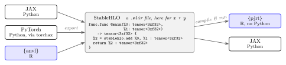

Slides taken out of the R+AI 2026 talk (`index.qmd`), kept for reuse.

```{r}
#| include: false
library(anvl)
set.seed(42)

# The running example of the main deck (index.qmd), which some slides here
# build on.
n <- 10000
p <- 10
X <- matrix(rnorm(n * p), n, p)
y <- matrix(rbinom(n, 1, plogis(X %*% rnorm(p, sd = 0.5))), ncol = 1)
nll <- function(beta, X, y) {
  eta <- X %*% beta
  -nv_mean(y * eta - nv_log1p(nv_exp(eta)))
}
X_nv <- nv_array(X)
y_nv <- nv_array(y)
beta0 <- nv_array(matrix(0, p, 1L))
nll_jit <- jit(nll)

# Benchmark tables are read from CSVs rather than typed into the slides, so a
# re-run cannot silently disagree with the text. A missing file degrades to a
# visible note instead of failing the render.
#
# * paper-hmc-results/: the HMC benchmark of the anvl paper, copied from the
#   anvl branch paper/finish-r-journal (see the README in that folder).
# * gelu-benchmark.csv: written by gelu-benchmark.R.
bench <- function(file) if (file.exists(file)) utils::read.csv(file) else NULL
need <- function(what) cat(sprintf(
  "::: {.callout-warning}\n`%s` missing.\n:::\n", what))
fmt_s <- function(x) ifelse(x < 1, sprintf("%.2f", x), sprintf("%.1f", x))

hmc_files <- file.path("paper-hmc-results", c(
  "cpu.csv", "cpu-tmb.csv", "cpu-torch.csv", "gpu.csv", "gpu-torch.csv", "gpu-stan.csv"
))
hmc_bench <- if (all(file.exists(hmc_files))) {
  runs <- do.call(rbind, lapply(hmc_files, function(f) {
    utils::read.csv(f)[, c("framework", "label", "experiment", "n", "K", "n_draws", "time")]
  }))
  # Each configuration ran three times after a first call that compiles; the
  # paper reports the median.
  stats::aggregate(time ~ framework + label + experiment + n + K + n_draws, runs, median)
}
hmc_time <- function(fw, lbl, exp, n_obs, chains = 1L) {
  with(hmc_bench, time[framework == fw & label == lbl & experiment == exp & n == n_obs & K == chains])
}
```

# Built on industry standards {.center}

::: {.notes}
anvl doesn't reinvent the compiler. It builds on industry standards from the
OpenXLA project.
:::

## Programs move between languages {.smaller}

{.nostretch fig-align="center" width="90%"}

- **StableHLO** is the shared format of the OpenXLA stack: a typed program of
  array operations, independent of the language it was written in.
- **{pjrt}** is {anvl}'s backend: an R interface to OpenXLA's runtime (PJRT),
  which compiles StableHLO programs with XLA and runs them on CPU or GPU.
- **Into R:** programs exported from JAX, or from PyTorch via torchax, can be
  compiled and run in R with {pjrt}, without Python at run time. Tested with
  JAX.
- **Out of R:** {anvl} programs can be exported as StableHLO, too, and run
  elsewhere, e.g. in JAX. Not portable as is: `chol()`, `qr()`, LU, SVD,
  `eigh` and `nv_print()` call {anvl}'s own LAPACK and cuSOLVER handlers.

::: {.notes}
The key format is StableHLO, the shared format of the OpenXLA stack: a typed
program of array operations, independent of the language it was written in. In
the middle of the figure you can see what that looks like: the program anvl
produces for adding two arrays. anvl's backend is the pjrt package, an R
interface to OpenXLA's runtime, which compiles StableHLO programs with XLA and
runs them on a CPU or GPU.

Because the format is shared, programs aren't locked into the language they
were written in. A model written in JAX, or in PyTorch through torchax, can be
exported as StableHLO and run in R with pjrt, without Python at run time; we've
tested this with JAX. And it works the other way, too: anvl programs can be
exported and run elsewhere, for example in JAX, except for a few linear algebra
operations that call our own LAPACK and cuSOLVER handlers.
:::

# Extending {anvl} {.center}

::: {.notes}
No library covers everything, so how do you extend anvl?
:::

## Missing something? Write it yourself {.smaller}

Most missing functions you can easily write yourself, by combining

- `nv_*()` functions, or
- the lower-level, and very flexible, `prim_*()` functions: the 101 primitives
  {anvl} itself is built from.

The result is compiled, fused and differentiable, like a built-in:
[Adding an API Function](https://r-xla.github.io/anvl/articles/extending_api.html).

. . .

If that doesn't cover it:

- **Add your own primitive**, with its own StableHLO lowering and gradient
  rule, in R, as long as the StableHLO operation set covers it:
  [Adding a Primitive](https://r-xla.github.io/anvl/articles/extending_primitive.html),
  [Primitives Reference](https://r-xla.github.io/anvl/articles/primitives.html)
- **Otherwise, implement your own C++ or CUDA function**, registered via
  {pjrt}, and call it from your program:
  [Adding Custom Calls](https://r-xla.github.io/pjrt/articles/ffi.html). That
  is how `chol()`, `qr()` and SVD call LAPACK and cuSOLVER.

**Everything except custom C++ and CUDA functions is written fully in R.**

::: {.notes}
Most missing functions you can write yourself, by combining nv_ functions or
the lower-level and very flexible prim_ functions, the same 101 primitives anvl
itself is built from. What you write is compiled, fused and differentiable,
just like a built-in function. The article on adding an API function shows how.

[click] If that's not enough, you can add your own primitive, with its own
compilation rule and its own gradient rule, still in R, as long as the
StableHLO operation set can express it. And otherwise, you can implement your
own C++ or CUDA function, register it via pjrt, and call it from your program.
That's how our linear algebra calls LAPACK and cuSOLVER. Apart from that last
route, all of these extensions are written entirely in R.
:::

# Backup {.center}

## A small neural network, from scratch {.smaller}

```{r}
#| include: false
set.seed(2)
xs <- matrix(runif(400, -3, 3), ncol = 1)
ys <- sin(xs) + rnorm(400, sd = 0.1)
layer <- function(n_in, n_out) nv_array(matrix(rnorm(n_in * n_out, sd = 0.5), n_in, n_out))
params <- list(W1 = layer(1, 32), b1 = nv_array(matrix(0, 1, 32)),
  W2 = layer(32, 1), b2 = nv_array(matrix(0, 1, 1)))
```

```{r}
mlp <- function(params, x) {
  n <- shape(x)[1L]
  h <- tanh(x %*% params$W1 + nv_broadcast_to(params$b1, c(n, 32L)))
  h %*% params$W2 + nv_broadcast_to(params$b2, c(n, 1L))
}
mse <- function(params, x, y) mean((mlp(params, x) - y)^2)

train <- jit(function(params, x, y, lr, n_steps) {
  grad_mse <- gradient(mse, wrt = "params")   # a nested list of arrays
  nv_scan(params, steps = n_steps, body = function(params, xx) {
    g <- grad_mse(params, x, y)$params
    list(carry = Map(function(p, g) p - lr * g, params, g), out = NULL)
  })$carry
}, static = "n_steps")

fitted <- train(params, nv_array(xs), nv_array(ys), lr = 0.03, n_steps = 10000L)
c(before = as_array(mse(params, nv_array(xs), nv_array(ys))),
  after = as_array(mse(fitted, nv_array(xs), nv_array(ys))))
```

No optimizers or layers: to train ML models in R, {torch} is still the better
choice.

::: {.notes}
Since this is R+AI: the same three tools, arrays, gradients and compilation,
are what neural-network training is built on. Here's a small network written
from scratch, fit to sin(x) plus noise with variance 0.01. The parameters are a
nested list, gradient() handles that, and training is again one compiled
program. Notice the hand-written update step: anvl has no optimizers or
layers, so to train ML models in R, torch is still the better choice. But if
your model is a custom mix of statistics and ML, anvl lets you write exactly
the model you want.
:::

# Additional slides {.center}

## Use cases

- **Bayesian inference:** MCMC and variational inference need thousands of
  gradient evaluations.
  - Some algorithms are designed for GPUs, e.g. HMC with many chains in
    parallel[^chees]
- **Large data:** "standard" statistical models can still become expensive.
- **Neural networks:** large array operations and many gradient steps.

[^chees]: Hoffman, Radul and Sountsov (2021), AISTATS; Sountsov, Carroll and
    Hoffman (2024), arXiv:2411.04260.

::: {.notes}
Where does this matter? Bayesian inference: Hamiltonian Monte Carlo needs
thousands of gradient evaluations of the log-density, and variational inference
is stochastic gradient optimization. Some recent samplers, like ChEES-HMC, are
designed for GPUs: they run many chains at once and get far more gradient
evaluations per second than NUTS. Standard statistical models are instant on
small data, but implementations that are fine for small n do not scale. And
statisticians use neural networks more and more.
:::

## Why not JAX via {reticulate}? {.smaller}

For using a Python library, {reticulate} is great. As the foundation that your
own code and packages build on, the language boundary has costs:

| Cost | What happens ({reticulate} 1.47.0) |
|------|------------------------------------|
| A Python environment in every session | One Python per R session: packages with conflicting Python requirements cannot be loaded together |
| Two type systems | `NA` and `NaN` both become `nan`; an integer `NA` becomes $-2^{31}$; Python's `2**40` comes back to R as `0` |
| Memory R cannot see | Re-assigning an 800 MB NumPy array to the same R variable grew memory by ≈ 760 MB per iteration, until `gc()` |
| Python conventions | 0-based indices, row-major reshaping, errors as Python exceptions |

: Source: the anvl paper, section on Python wrappers (`paper/reticulate/conversions.R`).

::: {.notes}
The obvious question: why not call JAX from R with reticulate? For using a
Python library, reticulate is great. But as the foundation your own code and
packages build on, the language boundary adds up. Every session needs a
matching Python environment, and there's only one Python per R session, so two
packages with conflicting requirements can't be used together. Values cross
between two type systems: NA and NaN both become nan, and large integers can
come back silently wrong. R's garbage collector can't see how much memory a
Python array holds. And you index, reshape and debug in Python's conventions.
:::

## Why not {torch}? {.smaller}

{torch} is native, mature, and the foundation of deep learning in R.

|  | {torch} | {anvl} |
|--|---------|--------|
| Execution | eager: one operation at a time, dispatched from R | the whole function, compiled into one program |
| Overhead | per operation | once per call |
| Your own operation | fast only where {torch} ships a kernel for it | fused by XLA, like a built-in |
| Training ML models | **the better choice**: optimizers, modules, data loaders, {luz} | gradients, but no optimizers or layers yet |
| Hardware | CPU, NVIDIA and Apple GPUs | CPU, NVIDIA GPUs |
| Conventions | 1-based, row-major | 1-based, column-major |

**Training ML models in native R? {torch} is still the better choice.** For the
small and medium models common in statistics, its per-operation overhead
dominates, as the sampler benchmark will show.

::: {.notes}
And torch? torch is native, mature, and the foundation of deep learning in R.
If you want to train machine-learning models in native R, torch is still the
better choice: it has the infrastructure, with optimizers, modules, data
loaders and luz on top, and it also runs on Apple GPUs. anvl gives you
gradients, but none of that infrastructure yet.

But torch executes eagerly: every operation is dispatched from R on its own. In
a big network each operation is expensive enough that this doesn't matter. For
the models we fit in statistics, it often dominates, as you'll see in the
sampler benchmark later.
:::

## Your own operation, as fast as a built-in {.smaller}

The GELU activation, written from elementary operations:

```{r}
#| eval: false
gelu <- function(x) 0.5 * x * (1 + tanh(sqrt(2 / pi) * (x + 0.044715 * x^3)))
```

- **{torch}** runs this as **eight separate operations**, each a full pass
  over memory. `jit(gelu)` hands the whole expression to XLA, which fuses it.
- **{Rcpp}** can run GELU written in C++ just as fast, but a package then
  offers only the activations its author wrote, without gradients. An {anvl} package takes
  `gelu` as an argument and compiles it into one program with its own code.

```{r}
#| echo: false
#| output: asis
g <- bench("gelu-benchmark.csv")
if (is.null(g)) need("gelu-benchmark.csv") else {
  lbl <- c(
    torch_composed = "{torch}, composed: `gelu(x)`",
    torch_builtin = "{torch}, built-in kernel: `nnf_gelu(x, approximate = \"tanh\")`",
    anvl_jit = "{anvl}, composed: `jit(gelu)(x)`"
  )
  print(knitr::kable(data.frame(
    ` ` = unname(lbl[g$implementation]),
    `time per call` = sprintf("%.0f ms", g$ms_per_call),
    check.names = FALSE
  ), align = "lr"))
  cat(sprintf(
    "\n: %g million `f32` values, one CPU core, mean of %d calls (`gelu-benchmark.R`).\n",
    g$n[1L] / 1e6, g$reps[1L]
  ))
}
```

Need your own gradient too? Define a new primitive, in R.

::: {.notes}
Compared with torch, the difference is in your own operations. torch is fast where
somebody wrote a kernel for exactly that operation. Write your own, like this
GELU activation, from elementary operations, and torch runs eight separate
operations, each a full pass over memory. anvl builds everything from about a
hundred low-level StableHLO operations and hands the whole expression to the
XLA compiler, which fuses it. So your own operation is as fast as a built-in
one. And if you need a custom gradient, you can define a new primitive with its
own derivative, in R.

Why not write GELU in C++ with Rcpp? That's fast too, even on a CPU. But a
package written in C++ offers the activations, or kernels, or link functions,
its author wrote; anything else means changing the C++ code, or an R callback
that is slow and has no gradients. An anvl package can take the function as an
argument: jit() compiles the package code and the user's function into one
program and differentiates through both. And the same code runs on a GPU,
where C++ would need a second implementation.

Before recording: re-run gelu-benchmark.R on the recording machine. The first
numbers come from a dev container whose CPU lacks AVX2, which may slow torch's
built-in kernel.
:::

## Consistent where base R is not {.smaller}

:::: {.columns}
::: {.column width="50%"}
**Base R**

```{r}
m <- matrix(1:6, nrow = 2)
dim(m[1, ])
dim(m[1, , drop = FALSE])
```

The shape depends on how many rows you happened to select.
:::
::: {.column width="50%"}
**{anvl}**

```{r}
x <- nv_array(m)
shape(x[1, ])
shape(x[array(1), ])
```

A scalar index drops the axis; an array index keeps it, whatever its length.
:::
::::

**One R value, one shape:** a length-one vector is a scalar; everything else is
an R array, whose `dim` is the shape.

::: {.notes}
Where base R is inconsistent, we chose consistency. In base R, m[1, ] drops
an axis unless you remember drop = FALSE, so the shape of your result depends
on how many rows you happened to select: a classic source of bugs. In anvl, a
scalar index drops the axis and an array index keeps it, whatever its length.
In a compiled program, where shapes are fixed, that predictability matters
even more.
:::

## How `jit()` sees your code {.smaller}

{fig-align="center" width="45%"}

It runs your R function **once**, on placeholder arrays that only know their
shape and data type, and records the array operations.

| What happens | What to do |
|--------------|------------|
| R `if` and `for` run once, while tracing | fine for what is known in advance → `static` arguments |
| Branching or looping on array values | `nv_if()`, `nv_while()`, `nv_scan()` |
| Shapes are fixed per compiled program | new shapes recompile; avoid data-dependent sizes |
| `print()` runs only while tracing | keep functions pure |
| Randomness needs a state | `nv_rnorm(shape, state)` returns a new state |
| Only R generics are intercepted | `sum()` works; `plogis()` → `nv_plogis()` |

::: {.notes}
There is no free lunch, so let me tell you the rules. When you call a jitted
function, anvl runs your R code once with placeholder arrays that only know
their shape and type, and records every array operation. Everything else in
your R code just runs, once, during that trace.

That means R control flow can't depend on array values, because during tracing
there are no values. For that you use nv_if(), nv_while() and nv_scan(). Shapes
have to be known when compiling, so something like unique(), whose output size
depends on the data, doesn't fit; masking with nv_ifelse() usually does. Keep
your functions pure, and pass random number state explicitly: if you've used
JAX, this will feel familiar.
:::

## Precision you control

```{r}
dtype(nll_jit(beta0, X_nv, y_nv))           # the default: fast, GPU-friendly
nll64 <- with_dtypes(nll, c(float = "f64"))
dtype(nll64(beta0, X_nv, y_nv))
```

. . .

R values have no data type of their own: they take the one of the arrays they
meet.

```{r}
B <- matrix(c(0.1, 0.2, 0.3, 0.4), 2, 2)
matmul <- jit(function(x, b) x %*% b)
dtype(matmul(nv_array(diag(2), dtype = "f32"), B))
dtype(matmul(nv_array(diag(2), dtype = "f64"), B))   # B at full precision
```

JAX truncates incoming double data to `f32` by default. **{anvl} never loses
precision unless you ask it to.**

::: {.notes}
One thing statisticians care about is numerical precision. GPUs are built for
single precision, while R computes everything in double. anvl defaults to
32-bit floats because they're fast, and lets you switch per computation:
with_dtypes() gives you a version of a function that runs in double precision,
and with_default_dtypes() or an option changes the default for a whole block or
session.

A design choice that sets anvl apart from JAX: plain R data has no data type of
its own. The same R matrix B is built into the program in single precision when
it meets a single-precision array, and in double when it meets a double. JAX by
default truncates incoming double data to single precision; anvl never loses
precision unless you ask it to.
:::

## Static choices, data-dependent branches

```{r}
link_fn <- jit(function(x, link) {
  if (link == "logit") nv_plogis(x) else nv_pnorm(x)  # decided while tracing
}, static = "link")
link_fn(nv_array(c(-1, 0, 1)), "probit")
```

```{r}
flip <- jit(function(x) nv_if(sum(x) > 0, \() x, \() -x))  # decided on the data
flip(nv_array(c(-1, -2)))
```

Any R code can **build** the program, and each value of `link` gets its own.
When the decision depends on array values, `nv_if()` takes it inside the
program, at run time.

::: {.notes}
Tracing has a powerful upside: you can use any R code to build your program,
with loops, ifs, helper functions and closures. Here, link is a static argument, so
the R if picks logit or probit while tracing, and each choice gets its own
compiled program. When the decision depends on the data, as in flip, you use
nv_if(), and the branch is taken inside the compiled program, at run time.
:::

## Why HMC

Bayesian logistic regression, sampled with Hamiltonian Monte Carlo:

::: {.incremental}
- It needs the **gradient** of the log posterior, at every leapfrog step.
- It is **loops in loops**: leapfrog steps inside a loop of draws, slow in R.
- It wants **many chains**: independent, a good fit for a GPU.
:::

. . .

We write it for $K$ chains at once: the positions are a $K \times p$ matrix.

::: {.notes}
Let's push the running example further. HMC is the sampler behind Stan. It
needs gradients, it's loops inside loops, and you want many chains. That's
anvl's sweet spot. We'll write it for K chains at once, so the parameters are a
K by p matrix.
:::

## The potential and its gradient

```{r}
potential <- function(beta, X, y) {         # beta: K chains x p
  eta <- X %*% t(beta)
  y <- nv_broadcast_to(y, shape(eta))
  loglik <- nv_sum(y * eta - nv_log1p(exp(eta)), axes = 1L)
  logprior <- -nv_sum(beta^2, axes = 2L) / 2
  -(loglik + logprior)                      # one value per chain
}

grad_potential <- gradient(
  function(beta, X, y) sum(potential(beta, X, y)),
  wrt = "beta"
)
```

The chains are independent, so the gradient of the **sum** gives every chain's
gradient in one call.

::: {.notes}
The potential is the negative log posterior, one value per chain. Because the
chains are independent, the gradient of the sum gives us every chain's gradient
in one call.
:::

## Leapfrog: a loop inside the program

```{r}
leapfrog <- function(beta, p, X, y, eps, L) {
  init <- list(beta = beta, p = p, grad = grad_potential(beta, X, y)$beta)
  nv_scan(init, steps = L, body = function(s, x) {
    p <- s$p - eps / 2 * s$grad
    beta <- s$beta + eps * p
    grad <- grad_potential(beta, X, y)$beta
    p <- p - eps / 2 * grad
    list(carry = list(beta = beta, p = p, grad = grad), out = NULL)
  })$carry
}
```

`nv_scan()` runs `L` steps inside the program and threads the state through
them. The gradient is part of the state, so each step evaluates it once.

::: {.notes}
The leapfrog integrator is an nv_scan() over L steps. The gradient at the
current position is part of the carried state, so each step evaluates the
gradient only once.
:::

## One transition

```{r}
hmc_step <- function(beta, state, X, y, eps, L) {
  draw <- nv_rnorm(shape(beta), state)
  p <- draw$values
  prop <- leapfrog(beta, p, X, y, eps, L)
  H0 <- potential(beta, X, y) + nv_sum(p^2, axes = 2L) / 2
  H1 <- potential(prop$beta, X, y) + nv_sum(prop$p^2, axes = 2L) / 2
  u <- nv_runif(shape(beta)[1L], draw$state)
  accept <- log(u$values) < H0 - H1
  accept <- nv_broadcast_to(accept, shape(beta))
  list(beta = nv_ifelse(accept, prop$beta, beta), state = u$state)
}
```

- **Explicit random state:** `nv_rnorm()` hands back the draws and a new state.
- **`nv_ifelse()`, not `if`:** the accept decision depends on the data.

::: {.notes}
The transition draws a momentum, simulates the trajectory, and accepts or
rejects each chain. Two things from the rules slide show up here: the random
state is passed along explicitly, and the accept decision uses nv_ifelse(),
because it depends on the data.
:::

## The whole sampler, one `jit()`

```{r}
hmc <- jit(function(beta, state, X, y, eps, L, n_draws) {
  out <- nv_scan(list(beta = beta, state = state), steps = n_draws,
    body = function(s, x) {
      s <- hmc_step(s$beta, s$state, X, y, eps, L)
      list(carry = s, out = s$beta)
    }
  )
  list(draws = out$out, beta = out$carry$beta, state = out$carry$state)
}, static = c("L", "n_draws"))
```

About 40 lines of R. With 2,000 draws, that is 22,000 gradient evaluations per
chain, in **one compiled program that never returns to R**.

::: {.notes}
Finally, a second nv_scan() collects the draws, and one jit() compiles the
entire sampler, about 40 lines of R, including 2,000 times 11 gradient
evaluations, into a single program that never returns to R.
:::

## It's correct {.smaller}

```{r}
set.seed(1)
n <- 1000
p <- 5
X <- matrix(rnorm(n * p), n, p)
y <- rbinom(n, 1, plogis(X %*% rnorm(p, sd = 0.5)))

draws <- with_default_dtypes(c(float = "f64"), {
  res <- hmc(nv_array(matrix(0, 4, p)), nv_rng_state(42L), nv_array(X),
    nv_array(as.double(y)), eps = 0.5 / sqrt(n), L = 10L, n_draws = 2000L)
  as_array(res$draws)                       # 2000 draws x 4 chains x 5
})
```

```{r}
#| echo: false
#| output: asis
post <- colMeans(apply(draws[1001:2000, , ], 3, c))
mle <- coef(glm(y ~ X - 1, family = binomial))
print(knitr::kable(data.frame(
  ` ` = c("posterior mean, HMC", "maximum likelihood, `glm()`"),
  rbind(sprintf("%.3f", post), sprintf("%.3f", mle)),
  check.names = FALSE
) |> stats::setNames(c(" ", paste0("$\\beta_", 1:5, "$"))), align = "lrrrrr"))
cat("\n: 4 chains, second half of each; `f64`. The small gap is the prior's shrinkage.\n")
```

::: {.notes}
Sanity check: the posterior means match the maximum-likelihood estimates up to
the small shrinkage from the prior.
:::

## It's fast: one chain {.smaller}

```{r}
#| echo: false
#| output: asis
if (is.null(hmc_bench)) need("paper-hmc-results/") else {
  ns <- c(1e3, 1e4, 1e5)
  single <- function(fw, label) vapply(ns, function(n) hmc_time(fw, label, "single", n), 0)
  t_anvl <- single("anvl", "cpu1")
  t_stan <- single("stan", "cpu1")
  t_tmb <- single("tmb", "cpu1")
  t_torch <- single("torch", "cpu1")
  t_gpu <- single("anvl", "gpu")
  print(knitr::kable(data.frame(
    `$n$` = format(ns, big.mark = ",", scientific = FALSE),
    `{anvl}, 1 core` = fmt_s(t_anvl),
    `CmdStan, 1 core` = fmt_s(t_stan),
    `TMB, 1 core` = fmt_s(t_tmb),
    `{torch}, 1 core` = fmt_s(t_torch),
    `{anvl}, GPU` = fmt_s(t_gpu),
    check.names = FALSE
  ), align = "rrrrrr"))
  cat("\n: Seconds for 1,000 draws, $p = 20$, `f64`, median of 3 runs. Static HMC with the same step size and 10 leapfrog steps for all.\n\n")
  ratio <- t_stan / t_anvl
  cat(sprintf("- **One core: %.1f to %.1f× faster than CmdStan**, as XLA optimizes the whole sampler as one program.\n",
    min(ratio), max(ratio)))
  cat(sprintf("- **{torch} needs %.0f× as long** at $n$ = 1,000: its per-operation overhead.\n",
    t_torch[1L] / t_anvl[1L]))
  cat(sprintf("- **GPU at $n$ = 100,000: %.2f s**, %.0f× faster than CmdStan.\n",
    t_gpu[3L], t_stan[3L] / t_gpu[3L]))
}
```

<small>2 × Intel Xeon Gold 6336Y (16 cores) and an NVIDIA A100 80GB, LRZ AI
Systems. Benchmark code and Docker image: `paper/benchmarks/` in the anvl
repository.</small>

::: {.notes}
How fast is it? We benchmarked this exact code against Stan's static HMC with
the same settings, against TMB, and against the same sampler in torch.

On a single CPU core, anvl is between 1.7 and 3 times faster than CmdStan, which
is the gold standard here. We think that's because XLA optimizes the whole
sampler as one program.

The torch row is instructive. torch executes each operation one at a time from
R, and for a statistical model of this size that overhead dominates: 28 seconds
where anvl needs 0.13. That's the cost compilation removes.

On a GPU, with 100,000 observations, the sampler runs in a third of a second,
150 times faster than CmdStan.

Optional, if time allows: without changing the code, the single chain gets 1.7,
2.8 and 4.6 times faster on 2, 4 and 8 cores. Stan scales further, but needs
its model rewritten with reduce_sum().
:::

## Many chains on one GPU

```{r}
#| echo: false
#| output: asis
if (is.null(hmc_bench)) need("paper-hmc-results/") else {
  t_gpu <- hmc_time("anvl", "gpu", "chains", 1e4, 4096L)
  t_stan <- hmc_time("stan", "cpu16", "chains", 1e4, 1024L)
  ov <- bench("paper-hmc-results/overhead.csv")
  ov_tmb <- bench("paper-hmc-results/overhead-tmb.csv")
  compile <- sum(ov$time[ov$what %in% c("hmc: trace", "hmc: lower to StableHLO", "hmc: XLA compile")])
  cat(sprintf("4,096 chains × 1,000 draws in **%.1f s**: **%s draws per second** on one A100 ($n$ = 10,000).\n\n",
    t_gpu, format(round(4096 * 1000 / t_gpu, -4), big.mark = ",")))
  cat(sprintf("- CmdStan on 16 CPU cores: %s draws per second.\n",
    format(round(1024 * 1000 / t_stan, -2), big.mark = ",")))
  cat("- {torch} on the GPU did not finish 1,024 chains, and Stan's OpenCL backend did not finish 64 chains, within an hour.\n")
  cat(sprintf("- One-off cost: tracing, lowering and compiling the sampler take **%.1f s**, against ≈ 11 s to compile the Stan model and %.0f s for the TMB template.\n",
    compile, stats::median(ov_tmb$time)))
}
```

::: {.notes}
And where it really shines is many chains: 4,096 chains in about 11 seconds,
roughly 380,000 draws per second. CmdStan on 16 CPU cores manages about 2,300.
That's the regime that recent many-chain MCMC research works in, and until now
it wasn't reachable from R.

And compiling the whole thing takes under a second.
:::

## One frontend of a shared compiler stack {.smaller}

{fig-align="center" width="75%"}

- Two standard interfaces: **StableHLO** for programs, **PJRT** for hardware.
  Each frontend and each hardware plugin is built once: $n + m$ pieces instead
  of $n \times m$. More frontends: Reactant.jl (Julia), Nx (Elixir).
- {torch} rests on LibTorch, built for a single frontend; `torch.compile()`
  works only from Python.
- **Hardware today: CPU and NVIDIA GPU.** Linux, Windows (CUDA via WSL2), macOS
  (CPU only). PJRT plugins for TPUs and other hardware exist; {anvl} does not
  support them yet.

::: {.notes}
anvl isn't a compiler of its own. It's one of several front-ends for OpenXLA:
JAX, TensorFlow and PyTorch/XLA in Python, Reactant in Julia, Nx in Elixir,
GoMLX in Go, and now anvl in R. OpenXLA was designed as shared infrastructure,
with two standard interfaces: StableHLO for programs and PJRT for hardware.
Each front-end and each hardware backend is built once, and they all fit
together.

That's a different foundation from torch, whose engine was built for one
front-end, PyTorch, and whose compiler only works from Python. For R, it means
we build on a production compiler that keeps getting better without us. To be
clear about today: anvl runs on CPUs and NVIDIA GPUs. Plugins for other
hardware exist, but we don't support them yet.
:::

## Additional info

**Experimental {quickr} backend.** Besides XLA, {anvl} can translate a program
to Fortran via [{quickr}](https://github.com/t-kalinowski/quickr):

```{r}
#| eval: false
with_backend("quickr", {
  f <- jit(function(x) sum(x^2))
  f(nv_array(c(1, 2, 3)))
})
```

- CPU only, for a subset of the primitives, in `f64`, `i32` and `bool`
- A compiled function can be reused for inputs of different shapes, where XLA
  recompiles for each new shape

::: {.notes}
One more thing: besides XLA, anvl has an experimental second backend that
translates programs to Fortran via the quickr package. It only runs on the CPU
and supports a subset of the primitives, in double precision, integers and
booleans. Unlike XLA, a compiled quickr function can be reused for inputs of
different shapes.
:::
