```{r}
#| include: false
library(anvl)
set.seed(42)

# The benchmark chart is read from a CSV rather than typed into the slides, so
# a re-run cannot silently disagree with the text. A missing file degrades to a
# visible note instead of failing the render.
#
# * logreg-benchmark.csv: written by logreg-benchmark.R.
bench <- function(file) if (file.exists(file)) utils::read.csv(file) else NULL
need <- function(what) cat(sprintf(
  "::: {.callout-warning}\n`%s` missing.\n:::\n", what))
```

## The problem

When you are implementing numeric algorithms in R, there can be three main challenges:

:::: {.columns}
::: {.column width="32%" .icon-col}
{.nostretch}

**Speed.** Iterative algorithms mean loops, and loops in R are slow.
:::
::: {.column width="2%"}
:::
::: {.column width="32%" .icon-col}
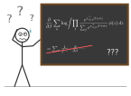{.nostretch}

**Gradients.** Maximum likelihood, standard errors, HMC, variational inference and Laplace approximations all need them.
:::
::: {.column width="2%"}
:::
::: {.column width="32%" .icon-col}
{.nostretch}

**GPU.** Certain algorithms are orders of magnitude faster on a GPU.
:::
::::

::: {.notes}
Let's start with the problem. When you implement a numerical algorithm in R,
you tend to run into three walls. The first is speed. R is an interpreted
language, made for interactive data science, and for that, an interpreter is
the right approach. But a lot of statistics is iterative: optimizers, MCMC
samplers, simulations. That means loops, and loops in R are slow, so when you
switch from interactive analysis to implementing algorithms, you end up
waiting, like our friend on the left: three percent done, four days to go. The
usual way out is rewriting the hot part in C++.

The second is gradients. They are everywhere in statistics: maximum likelihood
needs them, standard errors come from the Hessian, HMC follows them, and
variational inference and Laplace approximations are built on them. For a model
like a mixed logit, writing the gradient down by hand looks like the blackboard
in the middle: tedious and error-prone. It's much nicer when the software
derives them automatically, which is quite common these days.

The third is the GPU. When an algorithm is heavily parallelizable, it can run
orders of magnitude faster on a GPU, and some algorithms are designed
specifically to exploit that. R has some support for GPU computing, but it
could be better: GPUs mostly talk to Python, and looking at Python's GPU
ecosystem, we might get a little jealous.
:::

## {anvl} to the rescue

You write plain R functions over arrays. {anvl} does three things with them:

:::: {.columns}
::: {.column width="32%" .rescue-col}
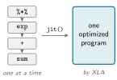{.nostretch}

**Compiles.** Just-in-time (JIT) compiles the whole function into one
optimized program, via XLA, the compiler that also powers JAX and TensorFlow.
:::
::: {.column width="2%"}
:::
::: {.column width="32%" .rescue-col}
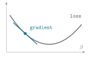{.nostretch}

**Differentiates.** Returns the derivative of a function as another R
function.
:::
::: {.column width="2%"}
:::
::: {.column width="32%" .rescue-col}
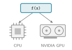{.nostretch}

**Hardware agnostic.** The same code runs on CPU or NVIDIA GPU.
:::
::::

The design is inspired by JAX, Python's library for accelerated array computing
and code transformations.

::: {.notes}
Here's what anvl does. The core idea is simple: you write plain R functions
over n-dimensional arrays, and anvl does three things with them.

First, it compiles them. Normally R runs your code one operation at a time;
jit(), short for just-in-time compilation, turns the whole function into one
optimized program, and once it's compiled, your function doesn't run in R at
all anymore. The compiler is mainly XLA, which also powers JAX, TensorFlow and
other array computing frameworks; other backends exist, but are experimental
for now.

Second, it differentiates them: gradient() takes a function, such as a loss,
and as long as it's made of differentiable parts, returns another R function
that computes its gradient.

Third, it's hardware agnostic, which comes from the XLA compiler we are using under the hood.
XLA stands for Accelerated Linear Algebra, and
it compiles the same program for different hardware. So you write your code
once, and your users choose whether to run it on a CPU or an NVIDIA GPU.

If you know JAX, this will feel familiar, because the design is inspired by it.
JAX's design documents are where we started, but as the project matures, we
deviate more and more: we solve problems we believe exist in JAX, and tailor
the design to the needs of the R community.
:::

## Options in R

|   | Compiles | Autodiff | GPU | Native R |
|---|----------|----------|-----|----------|
| **{Rcpp}** | [✓]{.yes} | [✗]{.no} | [✗]{.no} | [✗]{.no} |
| **{torch}** | [partly\*]{.part} | [✓]{.yes} | [✓]{.yes} | [✓]{.yes} |
| **JAX & co. via {reticulate}** | [✓]{.yes} | [✓]{.yes} | [✓]{.yes} | [✗]{.no} |
| **Stan** | [✓]{.yes} | [✓]{.yes} | [partly\*\*]{.part} | [✗]{.no} |
| **{quickr}** | [✓]{.yes} | [✗]{.no} | [✗]{.no} | [✓]{.yes} |
| **{ast2ast}, {TMB}/{RTMB}, {nimble}** | [✓]{.yes} | [✓]{.yes} | [✗]{.no} | [mostly]{.part} |
| **{anvl}** | [✓]{.yes} | [✓]{.yes} | [✓]{.yes} | [✓]{.yes} |

: {tbl-colwidths="[40,15,15,15,15]"}

::: {style="font-size: 0.55em; color: #737373;"}
\* {torch} can compile code via TorchScript, but TorchScript is no longer
developed and does not cover all the operations we care about.<br>
\*\* Stan runs only some functions on the GPU, via OpenCL, such as Cholesky
decompositions and GLM likelihoods; the rest of the model stays on the CPU.
:::


**{anvl} has the distinguishing feature set: compilation, autodiff, and CPU +
GPU support, natively in R.**

::: {.notes}
You might ask: don't we have this in R already? The table compares the main
options on four things: compiling, automatic differentiation, GPU support, and
whether you can stay in R. It's not exhaustive, there are more packages than
fit on a slide, but it gives an overview.

The most common way to write fast R code is C++ via Rcpp: you get compiled
code, but you write C++, derive gradients yourself, and need a separate
implementation for the GPU. The closest option to anvl is torch: it has
autodiff and the GPU, and it's native R, but it runs operation by operation; it
can compile through TorchScript, but TorchScript is no longer developed and
doesn't cover the operations we need in statistics. JAX through reticulate has
everything, but in Python, with a Python environment, the language boundary in
between, and the usual problems of reticulate-based wrappers. Stan compiles and
differentiates, but you write your model in Stan's own language, and only some
functions, like Cholesky decompositions and GLM likelihoods, run on the GPU.
quickr, a recent addition, compiles a subset of R, but has no autodiff and no
GPU support yet, although I believe that's planned. And ast2ast, TMB, RTMB and
nimble compile and differentiate, but don't run on GPUs.

[click] So anvl has a distinguishing feature set: compilation, autodiff, and
CPU and GPU support, natively in R.
:::

## Already building on {anvl}

```{r}
#| include: false
# Illustrations for the four applications: drawn here, not results.
app_cols <- c("#107895", "#E07A5F", "#81B29A", "#3D405B")
knitr::opts_chunk$set(dev = "png", dpi = 200, fig.width = 2.4, fig.height = 2.4)
```

:::: {.app-grid}
::: {.app-card}
```{r}
#| echo: false
# A raster, coarsened so that its pixels show.
par(mar = c(0, 0, 0, 0))
r <- volcano[seq(1L, 87L, 3L), seq(1L, 61L, 3L)]
image(r, col = hcl.colors(64L, "BrBG"), axes = FALSE, useRaster = TRUE)
```

::: {.app-text}
[Today]{.app-tag}<br>
**Spatial modeling:** [{garry}](https://github.com/belian-earth/garry)^1^, a
raster engine for remote sensing that compiles its numerical kernels with
{anvl} (Hugh Graham)
:::
:::

::: {.app-card}
```{r}
#| echo: false
# A diffusion model turns noise into an image, step by step.
set.seed(7)
px <- 48L
u <- (seq_len(px) - 0.5) / px
img <- array(0, c(px, px, 3L))
sky_top <- c(0.16, 0.24, 0.45)
sky_bottom <- c(0.98, 0.72, 0.45)
for (k in 1:3) img[, , k] <- outer(sky_top[k] + (sky_bottom[k] - sky_top[k]) * u, rep(1, px))
sun <- outer((u - 0.4)^2, (u - 0.66)^2, `+`) < 0.13^2
for (k in 1:3) img[, , k][sun] <- c(1, 0.92, 0.6)[k]
ridge <- 0.62 + 0.12 * sin(u * 7) + 0.06 * sin(u * 17)
hill <- outer(u, ridge, `>`)
for (k in 1:3) img[, , k][hill] <- c(0.24, 0.36, 0.36)[k]
noise <- array(runif(length(img)), dim(img))
par(mar = c(0, 0, 0, 0))
plot.new()
plot.window(c(0, 2.06), c(0, 2.06), xaxs = "i", yaxs = "i")
level <- c(0, 0.45, 0.8, 1)
pos <- list(c(0, 1.06), c(1.06, 1.06), c(0, 0), c(1.06, 0))
for (i in 1:4) {
  tile <- pmin(pmax(level[i] * img + (1 - level[i]) * noise, 0), 1)
  rasterImage(tile, pos[[i]][1], pos[[i]][2], pos[[i]][1] + 1, pos[[i]][2] + 1, interpolate = FALSE)
}
```

::: {.app-text}
[Today]{.app-tag}<br>
**Diffusion models:** Troy Hernandez (cornball.ai) is porting FLUX
image-generation models to {anvl}; a FLUX.2 transformer block already runs
[1.3× faster than {torch}](https://github.com/r-xla/anvl/issues/379)^2^ on an
NVIDIA GPU at matched `f32` precision
:::
:::

::: {.app-card}
```{r}
#| echo: false
# Mode shares of a multinomial logit model as driving gets more expensive.
cost <- seq(0, 15, length.out = 100L)
V <- cbind(car = 0.5 - 0.05 * 25 - 0.3 * cost, bus = 0.2 - 0.05 * 40 - 0.3 * 2,
  walk = -0.05 * 60 + 0 * cost)
P <- exp(V) / rowSums(exp(V))
upper <- t(apply(P, 1L, cumsum))
lower <- cbind(0, upper[, -3L])
par(mar = c(1.8, 0.4, 0.4, 0.4), mgp = c(0.5, 0, 0))
plot(NA, xlim = range(cost), ylim = c(0, 1), axes = FALSE, xaxs = "i", yaxs = "i",
  xlab = "cost of driving", ylab = "", cex.lab = 1.1, col.lab = "grey30")
for (j in 1:3) {
  polygon(c(cost, rev(cost)), c(lower[, j], rev(upper[, j])), col = app_cols[j], border = "white")
}
text(c(3, 11, 13.5), c(0.35, 0.45, 0.93), c("car", "bus", "walk"), col = "white", font = 2, cex = 1.2)
```

::: {.app-text}
[In progress]{.app-tag}<br>
**Choice modeling:** the {apollo} authors are evaluating {anvl} as a backend;
for a mixed logit model, up to 21× faster than pure R, on the CPU alone
:::
:::

::: {.app-card}
```{r}
#| echo: false
# Trace plot: four Metropolis chains from scattered starts, mixing.
set.seed(3)
n_iter <- 300L
starts <- c(-7, -3, 4, 8)
chains <- vapply(starts, function(x0) {
  x <- numeric(n_iter)
  x[1L] <- x0
  for (i in 2:n_iter) {
    prop <- x[i - 1L] + rnorm(1L, sd = 0.6)
    x[i] <- if (log(runif(1L)) < dnorm(prop, log = TRUE) - dnorm(x[i - 1L], log = TRUE)) prop else x[i - 1L]
  }
  x
}, numeric(n_iter))
par(mar = c(1.8, 0.4, 0.4, 0.4), mgp = c(0.5, 0, 0))
matplot(chains, type = "l", lty = 1L, lwd = 1.3, col = app_cols, axes = FALSE,
  xlab = "iteration", ylab = "", cex.lab = 1.1, col.lab = "grey30")
abline(h = 0, col = "grey60", lty = 2L)
```

::: {.app-text}
[In progress]{.app-tag}<br>
**Bayesian inference:** MCMC, and statistical distribution functions for
{anvl} (Louis Aslett)
:::
:::
::::

::: footer
^1^ [github.com/belian-earth/garry](https://github.com/belian-earth/garry)
&nbsp; ^2^ [github.com/r-xla/anvl/issues/379](https://github.com/r-xla/anvl/issues/379)
:::

::: {.notes}
While anvl is still young, I am very happy that people are already building on it, or planning to,
which also gives a feel for the use cases. Two projects use it today. Hugh
Graham's garry is a raster engine for remote sensing that compiles its
numerical kernels with anvl. When Hugh explored anvl, he found some missing
features and contributed them to the package, and he reported good
performance for his use case. And Troy Hernandez from cornball.ai has ported
the FLUX image-generation models, which he previously ran in torch, to anvl: a
FLUX.2 transformer block already runs 1.3 times faster than torch on his GPU,
at the same precision. That was nice to see, because torch is very good at
these deep learning workloads.

Two more are in progress. Recently, the authors of apollo, a package for choice
modeling, wrote to me: they are evaluating anvl as a backend for estimating
mixed logit models, and it was up to 21 times faster than their pure R
implementation, on the CPU alone. There are still some issues to resolve, but
this is exactly the kind of application I had in mind when I started anvl. And
Louis Aslett, an active contributor, is planning a new package for Bayesian
inference with MCMC, built on anvl, and is contributing statistical
distribution functions with a focus on precision. You'll find the links at the
bottom of the slide.
:::

# An R-like API {.center}

::: {.notes}
So what does anvl look like when you use it? One of our main goals was to make
it feel like R. We didn't want a package that feels foreign, which is what you
often get with wrappers around Python libraries, but one that works the way a
typical R user would expect.
:::

## The {anvl} API

|   | Examples | What it is |
|---|----------|------------|
| **Arrays** | `nv_array()`, `nv_fill()`, `nv_seq()` | data on CPU or GPU, with a data type and a shape |
| **Array API** | `+`, `%*%`, `sum()`, `nv_solve()`, `nv_while()` | ~140 functions: R generics plus `nv_*()` functions |
| **Transformations** | `jit()`, `gradient()` | take an R function, return a compiled or differentiated one |

::: {.notes}
The API has three parts. You create arrays with functions like nv_array(): data
on a CPU or a GPU, with a data type and a shape. The nv prefix stands for anvl,
and it avoids conflicts with function names from other packages. You write your
code with the array API: we implement as many of R's operators and generics as
possible, like plus, matrix multiplication or sum(), plus nv_ functions, such
as nv_solve() for linear systems, or nv_while() for loops; about 140 functions
so far. And the transformations, jit() and gradient(), take an R function and
return a new one: a compiled one, one that computes the derivative, or one
that's transformed in some other way.
:::

## Arrays that feel like R

:::: {.columns}
::: {.column width="50%"}
```{r}
x <- nv_array(matrix(1:6, nrow = 2),
              dtype = "f32", device = "cpu")
x
```
:::
::: {.column width="50%"}
```{r}
#| eval: false
x_gpu <- nv_array(matrix(1:6, nrow = 2),
                  dtype = "f32", device = "cuda")
x_gpu
```

```{r}
#| echo: false
# TODO: render on a machine with an NVIDIA GPU and evaluate the chunk above
# instead. Until then, its output is the CPU array's with the device swapped.
cat(sub("[ CPU", "[ CUDA", capture.output(print(x)), fixed = TRUE), sep = "\n")
```
:::
::::

```{r}
sum(x * 2)
```

- About **100 R generics** work on arrays. Where {anvl} needs its own
  functions, names and arguments follow base R: `nv_pmax()`,
  `nv_ifelse(test, yes, no)`, `nv_seq(from, to, by)`.
- {anvl} deviates from R's semantics only for good reasons, such as
  consistency: a scalar index drops an axis, an array index never does,
  whatever its length.

::: {.notes}
Here's an anvl array, created on the CPU from an R matrix. You choose the data
type and the device, and anvl has more data types than R: integers and floats
of different precisions. It prints like an R matrix, and the footer tells you
where it lives and what it is: on the CPU, 32-bit float, two by three. The same
call with device equal to "cuda" puts it on an NVIDIA GPU, and the footer says
CUDA instead. Nothing else changes, and operations on that array run on the
GPU.

Operations run immediately, so you can explore and debug interactively, and
arithmetic and generics like sum() just work. We worked hard to make anvl feel
like R: about a hundred R generics are supported, and where anvl needs its own
functions, their names and arguments follow base R, like nv_ifelse() with test,
yes and no. We only deviate from R's semantics for good reasons, mostly
consistency, which means fixing some inconsistent behavior of base R: whether
indexing drops an axis depends only on whether the index is a scalar, not on
how many elements you happen to select. I'm not sure we got this perfect
everywhere, but that's the goal.
:::

## Column-major, like R

:::: {.columns}
::: {.column width="50%"}
[R and {anvl}: column by column]{.major-cap}

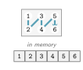{.nostretch .major-fig}

```{r}
nv_flatten(x)
```
:::
::: {.column width="50%" .fragment}
[{torch}: row by row]{.major-cap}

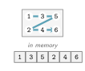{.nostretch .major-fig}

```{r}
xt <- torch::torch_tensor(as_array(x))
torch::torch_flatten(xt)
```
:::
::::

::: {.notes}
One example of feeling like R: an n-dimensional array is stored either in
column-major or in row-major order, and anvl arrays are column-major, just like
R's matrices. The elements are stored column by column, as the picture shows.
This matters, for example, when you flatten an array: our matrix gives one to
six, exactly like c() does in base R.

[click] torch, by contrast, is row-major: the same matrix is stored row by row
and flattens to one, three, five, two, four, six. It's not a huge problem, but
it's one example of how we stay close to R: in anvl, code that relies on R's
memory order keeps working.
:::

# A simple example: logistic regression via gradient descent {.center}

::: {.notes}
To see how this works in practice, let's fit a logistic regression with
gradient descent. It's only for illustration, and there are better ways to fit
a logistic regression, but it shows all of anvl's main features in a simple
setting.
:::

## The loss is plain R

```{r}
#| include: false
set.seed(1)
n <- 10000
p <- 10
X <- matrix(rnorm(n * p), n, p)
beta_true <- rnorm(p, sd = 0.5)
y <- matrix(rbinom(n, 1, plogis(X %*% beta_true)), ncol = 1)
```

:::: {.columns}
::: {.column width="60%"}
```{r}
nll <- function(beta, X, y) {
  eta <- X %*% beta
  -nv_mean(y * eta - nv_log1p(nv_exp(eta)))
}

X_nv  <- nv_array(X)          # 10,000 x 10
y_nv  <- nv_array(y)          # 10,000 x 1
beta0 <- nv_array(matrix(0, 10, 1))
nll(beta0, X_nv, y_nv)
```
:::
::: {.column width="40%"}
```{r}
#| echo: false
#| fig-width: 3.4
#| fig-height: 2.7
# The simulated data: 0/1 outcomes against the true linear predictor, and the
# logistic curve that generated them.
eta_true <- drop(X %*% beta_true)
shown <- seq_len(500L)
par(mar = c(2.6, 2.8, 0.4, 0.4), mgp = c(1.5, 0.4, 0), tcl = -0.25, cex = 0.8)
plot(eta_true[shown], y[shown] + runif(length(shown), -0.05, 0.05), pch = 16L,
  col = adjustcolor("grey40", 0.35), cex = 0.6, xlab = expression(x^T * beta),
  ylab = "y", yaxt = "n", bty = "n", xlim = c(-4, 4))
axis(2L, at = c(0, 1), las = 1L)
curve(plogis(x), from = -4, to = 4, add = TRUE, lwd = 2.6, col = "#107895")
text(1.6, 0.55, "P(y = 1)", col = "#107895", pos = 4L, cex = 0.95)
```
:::
::::

Plain R: generic operators like `%*%` and `*` work on arrays, next to `nv_*()`
functions such as `nv_log1p()`.

::: {.notes}
On the right is our simulated data: binary outcomes, and the logistic curve
that turns the linear predictor into the probability of a one; the code that
simulates it is left out so everything fits on the slide. On the left is the
negative log-likelihood, a plain R function of the coefficients beta, the
design matrix X and the outcomes y. Matrix multiplication and arithmetic work
on anvl arrays just like on matrices, mixed with nv_ functions like nv_mean()
and nv_log1p(). Generics work wherever we've implemented them for anvl arrays;
otherwise, you use the nv_ function. The design matrix has 10,000 rows and 10
columns. We convert the data to anvl arrays and evaluate the loss at beta equal
to zero. This already works, eagerly, one operation at a time, but the function
is not fully compiled yet.
:::

## `jit()`: compile once, run fast

```{r}
nll_jit <- jit(nll)
nll_jit(beta0, X_nv, y_nv)
```

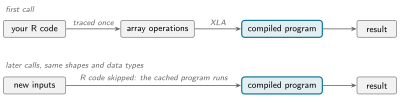{.nostretch fig-align="center" width="92%"}

Later calls with the same shapes and data types **skip your R code entirely**.

::: {.notes}
So how do we make it fast? With the first transformation, jit(), which is
really the heart of anvl. We pass our loss to jit() and get back a compiled
version, which we call just like the original. The diagram shows what happens.
On the first call, instead of executing every operation individually, anvl runs
your R code once and records the array operations, which is called tracing, and
XLA compiles them into one optimized program, which anvl caches. On every later
call with inputs of the same shapes and data types, nothing is recompiled and
your R code is skipped: the cached program runs directly, which is much faster.

Tracing has a few intricacies, for example around control flow. If you want the
details, there's a JIT deep dive article on the package website.
:::

## Gradients for free

:::: {.columns}
::: {.column width="60%"}
```{r}
grad_nll <- jit(gradient(nll, wrt = "beta"))
g <- grad_nll(beta0, X_nv, y_nv)$beta
g
```
:::
::: {.column width="40%"}
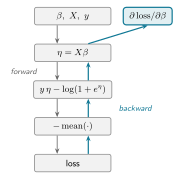{.nostretch fig-align="center" width="78%"}

::: {style="font-size: 0.8em;"}
{anvl} uses **reverse mode**, which is efficient when the input size is much
larger than the output size.
:::
:::
::::

::: {.notes}
The second transformation is gradient(). To minimize the negative
log-likelihood with gradient descent, we need its gradient. gradient() takes
our loss and the argument to differentiate with respect to, here beta, and
returns a new function that computes the gradient, which we compile with jit()
as well. Here's the result: ten partial derivatives, one per coefficient, and I
didn't derive anything by hand.

The diagram shows how it works. anvl records the forward graph of the loss,
from beta and the data to the final number, and then walks it backwards,
applying the chain rule at every step, until it arrives at the derivative with
respect to beta. This is reverse mode, which is efficient when the input is
much larger than the output, as it is for a loss: many parameters, one number.
In the opposite case, forward mode is more efficient; anvl doesn't have it yet,
but we hope to add it.
:::

## The whole fit, one program

:::: {.columns}
::: {.column width="55%"}
```{r}
fit <- jit(function(beta, X, y, lr, n_steps) {
  nv_while(
    init = list(beta = beta, i = 0L),
    cond = \(beta, i) i < n_steps,
    body = \(beta, i) {
      g <- grad_nll(beta, X, y)$beta
      list(beta = beta - lr * g, i = i + 1L)
    }
  )$beta
})

beta_hat <- fit(beta0, X_nv, y_nv,
                lr = 1, n_steps = 500L)
beta_glm <- coef(glm(y ~ X - 1, family = binomial))
max(abs(as_array(beta_hat) - beta_glm))
```
:::
::: {.column width="45%" .fragment}
```{r}
#| echo: false
#| output: asis
#| fig-width: 5.2
#| fig-height: 2.4
# Timed by logreg-benchmark.R: the same fit, against the same 500 steps in a
# base R loop with the gradient derived by hand.
lr_bench <- bench("logreg-benchmark.csv")
if (is.null(lr_bench)) need("logreg-benchmark.csv") else {
  ms <- setNames(lr_bench$ms, lr_bench$implementation)[c("anvl_compile", "anvl", "base_r")]
  lbl <- c("{anvl}, compile time,\nonce per shape", "{anvl}, compiled",
    sprintf("base R loop\n(%s BLAS)", lr_bench$blas[1L]))
  par(mar = c(0.5, 9.5, 0.5, 4.2), xpd = NA)
  bp <- barplot(ms, horiz = TRUE, names.arg = lbl, las = 1L, border = NA, axes = FALSE,
    col = c("#aecfd9", "#107895", "grey65"), xlim = c(0, max(ms) * 1.05), cex.names = 0.85)
  text(ms, bp, sprintf("%.0f ms", ms), pos = 4L, cex = 0.9)
  cat("\n\n::: {style=\"font-size: 0.55em; color: #737373;\"}\nMedian per call; 500 steps, n = 10,000, p = 10, `f64`; on an M1 Pro Mac.\n:::\n")
}
```
:::
::::

`nv_while()` puts the loop **inside** the compiled program: one R call runs all
500 steps. `n_steps` is an ordinary input, so another number of steps reuses
the same program.

::: {.notes}
Now we put it together. Our fit function takes the coefficients, the data, the
learning rate and the number of steps. Instead of an R loop around the
gradient, we put the loop inside the compiled program with nv_while(). It's a
slightly unusual way to write a while loop, but anvl is functional, so this is
how loops look: an initial state, here the coefficients and a counter, a
condition, and a body that takes the current state and returns the updated
one, here by taking one gradient step and incrementing the counter. Because
compiled functions can call other compiled functions, the whole fit, all 500
steps, becomes one program, and a single R call runs it. So we're not calling a
compiled function from an R loop: the loop itself is compiled. The
the result matches glm() up to floating-point error.

[click] How fast is it? The chart compares the compiled fit with the same 500
steps written as a loop in base R, with the gradient derived by hand, in double
precision on the CPU of an M1 Pro Mac. Base R takes about 200 milliseconds,
anvl about 30, so roughly seven times faster, even though this isn't an
expensive function. Part of the gain is that anvl uses all CPU threads by
default, while base R uses R's default BLAS here, which is single-threaded, so
an optimized BLAS would narrow the gap somewhat. And compiling isn't free: the
light bar is the time to trace and compile the program, about 50 milliseconds,
which you pay once for every new combination of input shapes.
We'll come back
to that in the limitations.
Note that on actually expensive workloads, and especially when comparing against GPUs,
the differences will be much more pro
:::

## Precision first

:::: {.app-grid}
::: {.app-card}
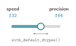{.nostretch}

::: {.app-text}
**Configurable default float and integer data types:** switch easily between
speed (`f32`) and precision (`f64`)
:::
:::

::: {.app-card}
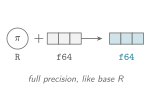{.nostretch}

::: {.app-text}
**Carefully designed type promotion rules:** R values never lose precision:
they take the data type of the array they meet, e.g. `pi` with an `f64` array
:::
:::

::: {.app-card}
```{r}
#| echo: false
#| fig-width: 2.5
#| fig-height: 1.6
# log P(Z > z) of a standard normal in f32: the naive log(1 - pnorm(z)) hits
# -Inf once pnorm(z) rounds to 1; nv_pnorm() works on the log scale.
z <- seq(0, 10, length.out = 201L)
tail_anvl <- as_array(nv_pnorm(nv_array(z, dtype = "f32"), lower_tail = FALSE, log_p = TRUE))
tail_naive <- as_array(log(1 - nv_pnorm(nv_array(z, dtype = "f32"))))
tail_naive[!is.finite(tail_naive)] <- NA
z_inf <- z[min(which(is.na(tail_naive)))]
par(mar = c(2.1, 2.6, 0.3, 0.3), mgp = c(1.2, 0.3, 0), tcl = -0.2, cex = 0.7)
plot(z, tail_anvl, type = "l", lwd = 2.4, col = "#107895", xlab = "z", ylab = "log P(Z > z)",
  bty = "n", las = 1L)
lines(z, tail_naive, lwd = 2, lty = 2L, col = "#b23b3b")
arrows(z_inf + 0.15, -14, z_inf + 0.15, -45, length = 0.06, col = "#b23b3b", lwd = 1.5)
text(z_inf + 0.15, -8, "-Inf", col = "#b23b3b", cex = 0.9, pos = 4L)
legend("bottomleft", c("nv_pnorm()", "log(1 - pnorm)"), col = c("#107895", "#b23b3b"),
  lty = c(1L, 2L), lwd = 2, bty = "n", cex = 0.85)
```

::: {.app-text}
**High-precision distribution functions,** carefully benchmarked and accurate
far into the tails\*
:::
:::

::: {.app-card}
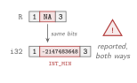{.nostretch}

::: {.app-text}
**Careful `NA` handling:** R stores `NA_integer_` as `INT_MIN`; {anvl} reports
it when data enters, and when such a value comes back to R
:::
:::
::::

::: footer
\* Still less precise than base R, the gold standard our implementations are
benchmarked against.
:::

::: {.notes}
Beyond the core transformations, another design goal behind anvl is precision
first, which matters a lot in statistics. Deep learning frameworks sometimes
make decisions that prioritize speed; we try to make high precision as easy as
possible. The default float and integer data types are configurable, so you
can easily switch between speed, with 32-bit floats, and precision, with 64-bit
floats.

The type promotion rules are carefully designed, so R values never lose
precision. An R number like pi isn't rounded to 32 bits up front: it takes the
data type of the array it meets, so combined with an f64 array, it keeps its
full precision and gives the same result as base R. That's different from JAX,
which is infamous for automatically converting double-precision data down to
32-bit floats by default.

The distribution functions, which Louis Aslett is contributing, are
exhaustively benchmarked and accurate far into the tails. In the plot, the naive log of one minus the normal CDF hits minus
infinity in single precision at around five and a half standard deviations,
while anvl's pnorm stays accurate far beyond. Base R remains the gold standard,
though: our implementations are benchmarked against it and are still less
precise, as the footnote says.

And missing values need care when data moves between R and anvl, which not
every package handles carefully. R has no separate integer NA: NA_integer_ is
simply the smallest 32-bit integer. So when integer data with NAs enters anvl,
the NA travels as that number, and anvl warns you. And when a computation on
the device happens to produce that number, R would read it as NA, so anvl warns
on the way back, too. If you prefer, you can turn that warning into an error,
so you never silently get wrong results.
:::

## Summary of noteworthy features {.smaller}

::: {.card-grid}
::: {.card}
**No CUDA toolkit:** `install_anvl()` installs the CUDA libraries as an R
package; an NVIDIA driver is all you need
:::
::: {.card}
**Serializable arrays:** `saveRDS()` works, unlike for most objects that wrap
external pointers; `nv_save()` writes safetensors
:::
::: {.card}
**Memory R can see:** R's garbage collector accounts for CPU results; on a GPU,
running out of memory triggers `gc()` and a retry
:::
::: {.card}
**All CPU cores**, with nothing to configure
:::
::: {.card}
**Asynchronous execution:** R keeps going while the device computes
:::
::: {.card}
**Nested lists of arrays** as inputs and outputs, also for `gradient()`
:::
::: {.card}
**An alternative backend:** experimental {quickr}, which transpiles to Fortran
:::
::: {.card}
**Mostly written in R:** easy to extend and contribute to, without a low-level
language
:::
::: {.card}
**Careful error messages:** they say what went wrong and how to fix it
:::
:::

::: {.notes}
There are many more practical features, so here's an overview. Not every one
will matter to everyone, but if you've worked with similar packages, you'll
notice that some of them aren't a given.

For an NVIDIA GPU, you don't need to install a CUDA toolkit: we try to make the
CUDA setup as easy as possible, so install_anvl() installs the CUDA libraries
as an R package, and a compatible driver is all you need. Arrays can be saved
with saveRDS(). Objects that wrap external pointers are notoriously bad at
serialization and usually need special saving functions, which can be a pain;
here, there are no surprises, and nv_save() writes the safetensors format.
Memory is another common problem with external pointers, because R doesn't
know how much memory they occupy. In anvl, memory is managed so that R can see
it: on the CPU, results live in memory that R's garbage collector accounts for.
On a GPU, this can't be solved completely, but because anvl compiles whole
programs, it's less of a problem, and running out of memory triggers a garbage
collection and a retry. This is where a package designed for R differs from
using JAX through reticulate.

On the CPU, anvl uses all cores without any configuration. Execution is
asynchronous, so R keeps going while the device computes. Inputs and outputs
can be nested lists of arrays, also for gradients. The design is backend
agnostic: there's an experimental second backend that, instead of going
through XLA, transpiles to Fortran via Tomasz Kalinowski's quickr package. The
package is mostly written in R, so it's easy to read, extend and contribute to,
without a low-level language. And we put a lot of care into error messages:
they say what went wrong and how to fix it, instead of ending in a long Python
traceback.
:::

## Why you should adopt {anvl} for your modeling package {.smaller}

**A high degree of customization:** instead of picking from options you
hard-coded, your users write parts of the model as R functions. Here: the
utility of each alternative in a discrete choice model.

```{r}
#| include: false
set.seed(4)
n_obs <- 1000L
raw <- list(
  time_car = runif(n_obs, 10, 40), cost_car = runif(n_obs, 2, 8),
  time_bus = runif(n_obs, 20, 60), cost_bus = runif(n_obs, 1, 3),
  time_walk = runif(n_obs, 30, 90)
)
V_true <- cbind(
  0.5 - 0.05 * raw$time_car - 0.3 * raw$cost_car,
  0.2 - 0.05 * raw$time_bus - 0.3 * raw$cost_bus,
  -0.05 * raw$time_walk
)
choice <- apply(exp(V_true) / rowSums(exp(V_true)), 1L, function(pr) sample(3L, 1L, prob = pr))
data <- c(lapply(raw, nv_array), list(choice = nv_array(choice)))
beta <- lapply(list(asc_car = 0, asc_bus = 0, time = 0, cost = 0), nv_scalar)

# Log-likelihood of the observed choices, given one utility per alternative:
# the chosen utility minus the log-sum-exp over all of them.
choice_loglik <- function(V, choice) {
  m <- Reduce(nv_pmax, V)
  log_denom <- m + log(Reduce(`+`, lapply(V, \(v) exp(v - m))))
  V_chosen <- Reduce(`+`, Map(\(v, j) nv_ifelse(choice == j, v, 0), V, seq_along(V)))
  sum(V_chosen - log_denom)
}
```

:::: {.columns}
::: {.column width="44%"}
**In your package**

```{r}
# Multinomial logit: log-likelihood
mnl_loglik <- jit(function(beta, data, utilities) {
  V <- lapply(utilities, \(u) u(beta, data))
  choice_loglik(V, data$choice)
}, static = "utilities")
# ... and the helper choice_loglik()
```
:::
::: {.column width="56%"}
**Your users**

```{r}
#| output: false
utilities <- list(
  car  = \(b, d) b$asc_car + b$time * d$time_car + b$cost * d$cost_car,
  bus  = \(b, d) b$asc_bus + b$time * d$time_bus + b$cost * d$cost_bus,
  walk = \(b, d) b$time * d$time_walk
)
mnl_loglik(beta, data, utilities)
```
:::
::::

- One compiled program from your package code and the user's utilities: as
  fast as if you had written them yourself, and differentiable end to end, for
  maximum likelihood estimation
- No C++ in your package, nothing to compile for your users, and the same code
  runs on a GPU

::: {.notes}
If you develop a modeling package, here's why anvl is worth a look: with a JIT
compiler behind the scenes, you can give your users a high degree of
customization without a performance penalty. Many packages offer a fixed menu
of options: you pick one by name, with a string, and you get exactly what the
author implemented, usually in C++. With anvl, your users write parts of the
model themselves, as plain R functions.

Here's an example from discrete choice modeling, inspired by the apollo
package, whose users already work exactly like this. Your package implements the multinomial logit
log-likelihood once, and the utilities are simply an argument. Your users write
one utility per alternative, here car, bus and walking, each a line of R with
their own parameters and data, and pass them to your function.

jit() compiles your package code and the user's utilities together into one
program, so a custom specification runs as fast as if you had written it into
the package yourself. And it's differentiable end to end, so you get the
gradients for maximum likelihood estimation for free. With Rcpp, everything is
compiled ahead of time, so you have to hard-code the options, and a
user-defined specification would mean changing your C++ code or calling back
into R, which is slow. The same goes for, say, a Gaussian process package: with
C++, you hard-code a few kernels and maybe offer a slower R fallback; with
anvl, users write their own kernel, and it runs as fast as a built-in one. And
there's no C++ in your package, nothing for your users to compile, and the same
code runs on a GPU.
:::

## Built on industry standards, extensible in R {.smaller}

:::: {.columns}
::: {.column width="50%"}
**Built on OpenXLA**

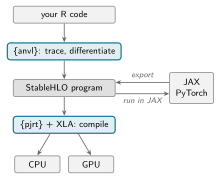{.nostretch fig-align="center" width="82%"}

::: {style="font-size: 0.8em;"}
StableHLO is a portable format: models exported from JAX, or from PyTorch via
torchax, run in R without Python, and most {anvl} programs run in JAX.
:::
:::
::: {.column width="50%"}
**Extensible in R**

- Missing a function? Write it from `nv_*()` functions, in R: compiled, fused
  and differentiable, like a built-in
  ([Adding an API Function](https://r-xla.github.io/anvl/articles/extending_api.html)^1^)
- Need more? Call your own C++ or CUDA code
  ([Adding Custom Calls](https://r-xla.github.io/pjrt/articles/ffi.html)^2^)
:::
::::

::: footer
^1^ [r-xla.github.io/anvl/articles/extending_api.html](https://r-xla.github.io/anvl/articles/extending_api.html)
&nbsp; ^2^ [r-xla.github.io/pjrt/articles/ffi.html](https://r-xla.github.io/pjrt/articles/ffi.html)
:::

::: {.notes}
anvl doesn't reinvent the compiler; it's built on industry standards. As the
diagram shows, it traces and differentiates your R code and turns it into
StableHLO, the portable program format of the OpenXLA project. You can think of
StableHLO as a programming language for array programs: it's not meant to be
written by hand, but compilers use it internally. The pjrt package, anvl's
backend, then compiles it with XLA, the compiler behind JAX, and runs it on a
CPU or GPU. Because JAX and PyTorch also interoperate with the same format, programs move
between languages in both directions: a model trained in JAX, or in PyTorch
through torchax, can be exported and run in R without Python, and most anvl
programs can run in JAX.

And when something is missing, you can add it in R. Because of the JIT
compilation, functions you write yourself are just as good as built-in ones:
you combine nv_ functions, and the result is compiled, fused and
differentiable. If you can't build it from existing functions, you can call
your own C++ or CUDA code (which we still have to make simpler).
The articles linked at the bottom walk through both.
:::

# Wrapping up {.center}

::: {.notes}
Let me wrap up. Whenever something seems too good to be true, there's probably
a catch, and I want to be honest about it.
:::

## Is {anvl} for you?

:::: {.columns}
::: {.column width="50%"}
**Good fit**

- Iterative algorithms: optimizers, samplers, simulations
- Anything that needs gradients
- Large arrays, linear algebra, many chains
- Code you want to run on an NVIDIA GPU
- Packages that need gradients and compiled code underneath
:::
::: {.column width="50%"}
**Better elsewhere**

- Small one-off computations: base R
- Data wrangling, strings, filtering: base R and friends
- GPUs other than NVIDIA: not supported yet
- Sparse matrices: not supported
:::
::::

::: {.notes}
So, is anvl for you? It's a good fit for iterative algorithms like optimizers,
samplers and large-scale simulations; for anything that needs gradients; for
large arrays, linear algebra or many chains, so highly parallel work; for code
you want to run on an NVIDIA GPU; and for packages that need gradients and
compiled code under the hood.

When is it not the right tool? For small one-off computations, base R is
simpler, since compiling takes a moment. For data wrangling and strings, it's
the wrong tool. GPUs other than NVIDIA aren't supported yet, so there's no
Apple Metal support, for example, and, unfortunately, there are no sparse
matrices either. There are also some limitations that come from the compiler,
which we hope to lift in the future.
:::

## Limitations {.smaller}

:::: {.columns}
::: {.column width="52%"}
**Static shapes**

Each new combination of input shapes compiles a new program, and no output's
shape can depend on the data. Padding inputs to a few fixed sizes helps:
[Static Shape Restriction](https://r-xla.github.io/anvl/articles/static_shapes.html)^1^,
[padding inputs](https://r-xla.github.io/anvl/articles/efficiency.html#padding-inputs-to-avoid-recompilation)^2^.

|   | **Expensive** | **Cheap** |
|---|---------------|-----------|
| **Many input shapes** | ✓ Possibly good fit, with padding | – Not needed |
| **Few input shapes** | ✓ Good fit | – Not needed |

: {tbl-colwidths="[30,35,35]"}
:::
::: {.column width="48%"}
**`jit()` takes some getting used to**

Your R code runs once, while tracing, so branching and looping on array values
need `nv_if()` and `nv_while()`, and getting this right takes some care:
[JIT Deep Dive](https://r-xla.github.io/anvl/articles/jit.html)^3^.

Some more peculiarities to get used to:
[Gotchas](https://r-xla.github.io/anvl/articles/gotchas.html)^4^.
:::
::::

::: footer
^1^ [r-xla.github.io/anvl/articles/static_shapes.html](https://r-xla.github.io/anvl/articles/static_shapes.html)
&nbsp; ^2^ [r-xla.github.io/anvl/articles/efficiency.html](https://r-xla.github.io/anvl/articles/efficiency.html#padding-inputs-to-avoid-recompilation)<br>
^3^ [r-xla.github.io/anvl/articles/jit.html](https://r-xla.github.io/anvl/articles/jit.html)
&nbsp; ^4^ [r-xla.github.io/anvl/articles/gotchas.html](https://r-xla.github.io/anvl/articles/gotchas.html)
:::

::: {.notes}
The biggest of these limitations is static shapes: each new combination of
input shapes compiles a new program, and the shape of an output can't depend
on the data, so something like selecting the positive values of x doesn't fit
in a compiled program. In exchange, the compiler knows exactly how large every
intermediate value is, which allows very aggressive optimizations. The table
sums up what this means in practice. If your computation is expensive and there are only a few
different input shapes, anvl is a great fit. With many shapes, you can pad your
inputs to a few fixed sizes; the articles on static shapes and padding show
how. If the computation is cheap, you don't need anvl either way: base R is
fast enough.

Second, jit() takes some getting used to: your R code runs only once, while
tracing, so branching and looping on array values need nv_if() and nv_while().
The JIT deep dive explains the details, and the gotchas article collects more
peculiarities and how to avoid the common traps; it's too much to cover here.
:::

## Get started

{anvl} is not on CRAN yet, so install it from r&#8209;universe:

```r
install.packages(
  "anvl",
  repos = c("https://r-xla.r-universe.dev", getOption("repos"))
)
anvl::install_anvl()
```

For an NVIDIA GPU, on Linux or on Windows via WSL2, **a compatible driver is
all you need**: no CUDA toolkit to install. On macOS, {anvl} runs on the CPU.
Prebuilt Docker images: `ghcr.io/r-xla/anvl-cpu`{.nowrap} and
`ghcr.io/r-xla/anvl-cuda`{.nowrap}.

The package website, [r-xla.github.io/anvl](https://r-xla.github.io/anvl/), has a
[Get Started article](https://r-xla.github.io/anvl/articles/anvl.html)^1^ and
worked examples: a Gaussian process, a Metropolis-Hastings sampler.

::: footer
^1^ [r-xla.github.io/anvl/articles/anvl.html](https://r-xla.github.io/anvl/articles/anvl.html)
:::

::: {.notes}
Getting started is easy. anvl isn't on CRAN yet, though we've started the
process, so you install it from r-universe and then run install_anvl() once.
It runs on macOS, Linux and Windows. For an NVIDIA GPU, on Linux or on Windows
via WSL2, the Windows Subsystem for Linux, a compatible driver is all you need. On a Mac, anvl runs on
the CPU. There are also prebuilt Docker images for CPU and CUDA. And the
package website has a Get Started article, linked at the bottom, and worked
examples, such as a Gaussian process and a Metropolis-Hastings sampler.
:::

## Where this is going {.smaller}

::: {.roadmap}
::: {.roadmap-col}
**Current work**

- **Distribution functions:** more densities, distribution functions and
  quantiles, accurate in the tails
- **Auto-vectorization:** write a function for a single item, map it across a
  batch
- **CRAN release:** in progress; for now, {anvl} is on r&#8209;universe
:::
::: {.roadmap-col}
**Potential next steps**

- **Forward-mode AD:** combined with reverse mode, efficient Hessians, e.g. for
  Laplace approximations
- Easier custom C++ and CUDA kernels
:::
::: {.roadmap-col}
**Possibly, via the IREE compiler**

- No static-shape restriction
- More hardware: Apple GPUs (Metal), maybe WebAssembly
:::
:::

**There's lots to do: contributions welcome!** And feedback is always very
helpful to steer {anvl} towards what benefits the R community.

::: {.notes}
Where is this going? This is partly ongoing work, partly things I hope we get
to, and partly things we're exploring. Right now we're working on three things:
more distribution functions, accurate in the tails, which Louis Aslett is
ticking off one by one; automatic vectorization, what other frameworks call
vmap, so you write a function for a single item and map it across a batch; and
a CRAN release. We're also working on making random number generation more
R-like.

As next steps, we'd like to add forward-mode differentiation, which, combined
with reverse mode, gives efficient Hessians, for example for Laplace
approximations; gradients through loops; and easier custom C++ and CUDA
kernels. And possibly, via the IREE compiler, which also consumes StableHLO, or
via the quickr backend, we could lift the static-shape restriction and support
more hardware, like Apple GPUs and maybe WebAssembly; AMD GPUs are possible in
principle, too.

There's a lot to do: despite all the advances in coding agents, a compiler is
still a lot of work if you want to understand what's going on and get it
right. So contributions are very welcome. And feedback is just as valuable:
it's what steers anvl towards what benefits the R community, and towards a
foundation for fast modeling packages.
:::

## Thank you

**Try it on your own algorithm, and tell us where it breaks.**

- Package: [github.com/r-xla/anvl](https://github.com/r-xla/anvl)
- Docs: [r-xla.github.io/anvl](https://r-xla.github.io/anvl/)

::: {.notes}
Thank you for listening! Please try anvl on your own algorithm, and tell us
where it breaks: issues and ideas on GitHub are very welcome. The package lives
in the r-xla organization on GitHub, which is a bit of a misnomer by now, since
we want to offer compilers other than XLA as well. You'll find the package and
the documentation at these links.
:::

## Acknowledgments

This work is supported by **MaRDI**, the Mathematical Research Data
Initiative, an NFDI project funded by the Deutsche Forschungsgemeinschaft
(DFG), project number 460135501.

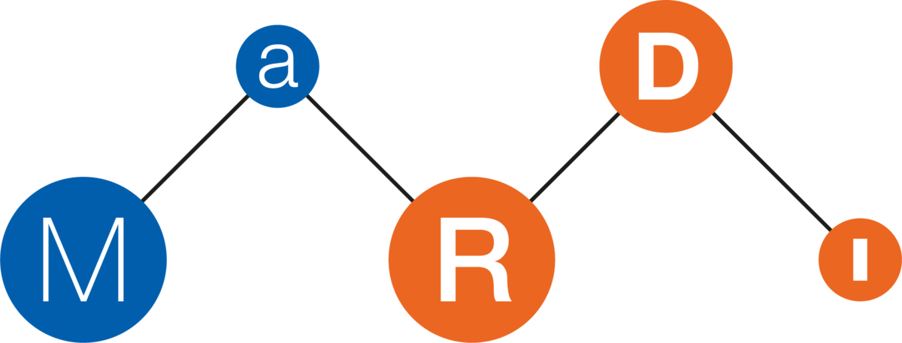{.nostretch fig-align="center" width="35%"}

::: {.notes}
Finally, thanks to MaRDI, the Mathematical Research Data Initiative, a German
initiative for research data and research software in mathematics, which is
funded by the German Research Foundation and supports this work.
:::
